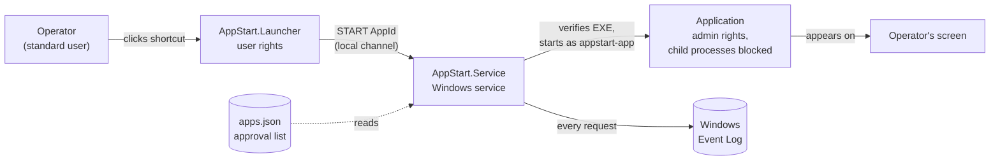

# AppStart

**Start applications with admin rights – without the user being an admin.**

> **Current version: [v0.4.1](https://github.com/trosinde/app-launcher/releases/latest)** – `AppStart-Setup.exe` and the manual `AppStart-Manual-<Version>.pdf` are attached to the release. Details: [Implementation status](#implementation-status).

AppStart is a Windows service with a launcher. It starts selected desktop applications with administrator rights for standard users: without a password, without a UAC prompt and without the user becoming an administrator. The applications and their installers stay unchanged.

Intended for IT administrators and service technicians who look after PCs with older desktop applications that only run with admin rights.

[](https://github.com/trosinde/app-launcher/actions/workflows/ci.yml)


[](LICENSE)

<p align="center">
  
  <br>
  <sub>This is how it should look: a standard user starts the test application. It runs as <code>appstart-app</code> with admin rights; opening a command prompt from it fails. (UI design)</sub>
</p>

---

## The problem

Some desktop applications only run with administrator rights. Typical examples are older line-of-business applications that write to `HKLM` or `C:\Program Files`. That is why the operators of such PCs often work as administrators all the time. The consequences:

- Operators can change the application's exchange and configuration files.
- Operators can read passwords that the application stores in plain text in the registry.
- Every other program the operator starts also runs with full rights.

Audits regularly flag this, and it contradicts the principle of least privilege.

## The solution

The operator works as a standard user. Only the approved applications run with admin rights, under a dedicated account that nobody can log on with. Their data is locked for the operator.

| | Operator is admin (today) | With AppStart |
|---|---|---|
| Operator's account | Administrator | Standard user |
| Approved application | runs as the operator, with admin rights | runs as `appstart-app`, with admin rights |
| Application's data folder and registry key | readable and writable for the operator | locked for the operator |
| Other programs | run with admin rights | run without admin rights |
| Prompt at start | UAC confirmation, if UAC is on | none |

## How it works



1. The operator clicks the application's shortcut. It looks the same as before but points to the launcher.
2. The launcher sends only the application's identifier to the service, no path and no parameters.
3. The service checks whether the application is approved and whether its EXE is unchanged (signature or checksum).
4. The service starts the application as the account `appstart-app` on the operator's screen. By default it cannot start other programs, such as a command prompt.
5. Every request is written to the Windows Event Log with user, application and result.

More: [How it works](docs/funktionsweise.md) and [Security model](docs/sicherheitsmodell.md).

## Components

| Component | Purpose | Runs as |
|---|---|---|
| `AppStart.Service` | Windows service: accepts start requests, verifies them, starts the application | LocalSystem (Windows system account) |
| `AppStart.Launcher` | Small windowless EXE behind every shortcut, shows a message if there is a problem | Operator |
| `AppStart.Setup` | Setup with user interface and command line: approve applications, set up accounts and rights, verify the setup | Administrator |
| `AppStart.Core` | Shared library: configuration, verification of the EXE, protocol between launcher and service | – |
| `AppStart.TestApp` | Test application that behaves like an affected application | – |
| Installation package | Per-machine MSI, installs to `C:\Program Files\AppStart` | Administrator |

## Where AppStart fits – and where it does not

**Fits** if

- a desktop application strictly requires admin rights and cannot be changed,
- operators work at fixed workstations with their own or a shared account,
- you have to prove that operators have no admin rights and cannot read protected data.

**Does not fit** if

- the application has to start other programs (can be allowed per application, but weakens the protection),
- the application accesses network drives or databases with the Windows logon (the account `appstart-app` has no network credentials),
- administrators must not be able to read the application's passwords either.

Important: an approved application runs with admin rights, and so do its dialogs such as "Open file". What that means is described in the [Security model](docs/sicherheitsmodell.md#residual-risks-and-limits).

## Implementation status

| Area | Status |
|---|---|
| Service: acceptance, verification, start in the operator's session, blocking of child processes, Event Log | ✅ implemented, end-to-end test on Windows 11 green (23/23, launcher without Native AOT) |
| Launcher with messages | ✅ implemented |
| Test application | ✅ implemented |
| MSI package, service registration during installation | ✅ implemented |
| Setup (user interface and command line), accounts, rights, shortcuts | ✅ implemented, end-to-end test green (19/19) |
| `verify` command, verification view and verification report, automatic verification after changes | ✅ implemented |
| Installation program `AppStart-Setup.exe` (MSI embedded), signed releases | ✅ implemented |
| User manual (PDF in the package, Start menu "AppStart – Manual") | ✅ implemented; 7 of 13 screenshots |
| Acceptance test as a real operator (30/30), installation tests incl. update (29/29), operations tests | ✅ on Windows 11 |
| Tests on Windows 10, Remote Desktop, lock screen, restart, real second session | 🔲 manual, see [MANUAL-TESTS.md](tests/e2e/MANUAL-TESTS.md) |
| Verification of the real target applications (child processes, data, registry, network) | 🔲 open (spike 1.4) |

The complete plan is in [`tasks.md`](openspec/changes/add-appstart-service/tasks.md).

## Installation

1. Run `AppStart-Setup.exe` from the [latest release](https://github.com/trosinde/app-launcher/releases/latest) as administrator. It installs the MSI and opens the setup.
2. Select applications, optionally specify a data folder and registry key for each application.
3. Create the operator account or assign existing users to the group `AppStart Users`.
4. The setup creates shortcuts, locks the data and verifies everything itself at the end.

<p align="center">
  
  <br>
  <sub>Setup, step 1 of 3 (UI design). All steps: <a href="docs/funktionsweise.md#setup">How it works → Setup</a></sub>
</p>

For software distribution there is the MSI and a command line:

```text
AppStart.Setup.exe add --exe "C:\Program Files\Vendor\AppA\AppA.exe" --data-dir "C:\ProgramData\Vendor\AppA" --reg-key "HKLM\SOFTWARE\Vendor\AppA"
AppStart.Setup.exe add-user --member "DOMAIN\operator1"
AppStart.Setup.exe verify --report "C:\Temp\appstart-verification.html"
```

Step by step, including silent installation: [manual, chapter Installation](docs/manual/03-installation.md).

## Development

Windows 11 x64 and .NET 10 SDK. Building, testing, releasing and project structure: [Development](docs/entwicklung.md).

> ⚠️ Setup and service create accounts and change rights. **Install only on a separate test VM, never on your own work computer.**

## Documentation

Overview of all documents: [docs/](docs/README.md)

User manual for installers and service technicians (also as PDF `AppStart-Manual-<Version>.pdf` in the [release](https://github.com/trosinde/app-launcher/releases/latest)):

1. [Overview](docs/manual/01-overview.md)
2. [Requirements](docs/manual/02-requirements.md)
3. [Installation](docs/manual/03-installation.md)
4. [Managing applications](docs/manual/04-managing-applications.md)
5. [Accounts and group](docs/manual/05-accounts-and-group.md)
6. [Verification after a service visit](docs/manual/06-verification-after-a-service-visit.md)
7. [Messages and troubleshooting](docs/manual/07-messages-and-troubleshooting.md)
8. [Update and uninstallation](docs/manual/08-update-and-uninstall.md)
9. [Reference](docs/manual/09-reference.md)

## Contributing and security

Contributions via pull request are welcome, see [CONTRIBUTING.md](CONTRIBUTING.md). Please report vulnerabilities confidentially, see [SECURITY.md](SECURITY.md).

## License

[MIT](LICENSE)
