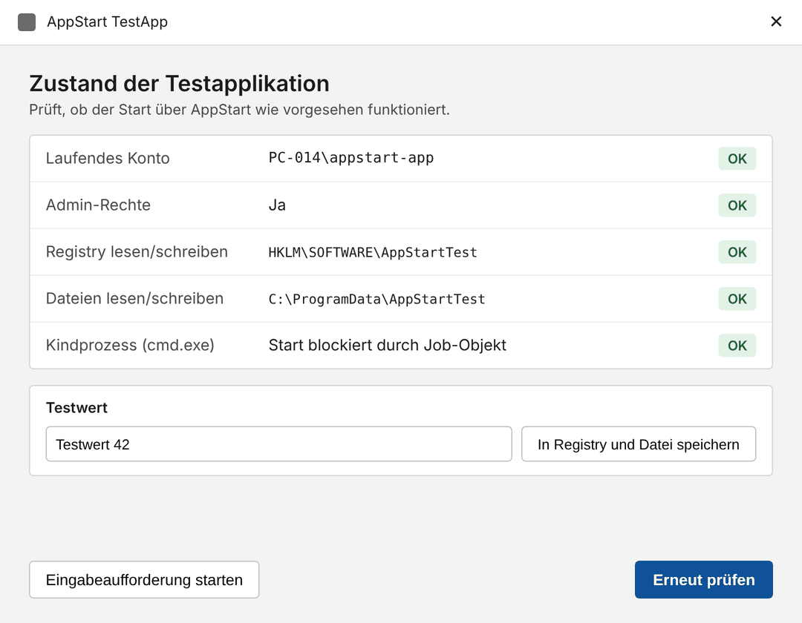
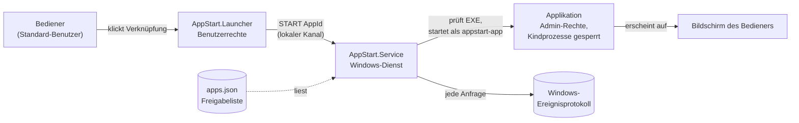
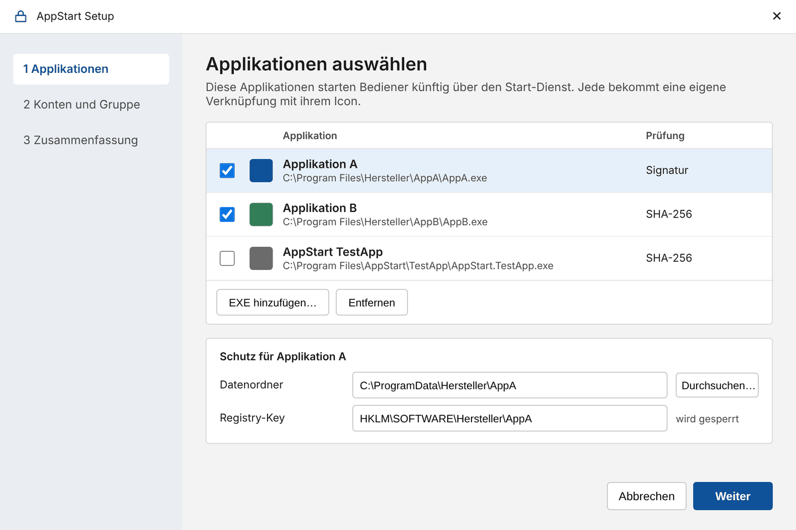

# AppStart

**Applikationen mit Admin-Rechten starten – ohne dass der Benutzer Admin ist.**

> **Stand: in Entwicklung (0.1.0-dev).** Dienst, Launcher und Testapplikation laufen und sind auf Windows 11 getestet. Das Einrichtungsprogramm (Setup) fehlt noch, für den produktiven Einsatz ist AppStart nicht bereit. Details: [Stand der Umsetzung](#stand-der-umsetzung).

AppStart ist ein Windows-Dienst mit Launcher. Er startet ausgewählte Desktop-Applikationen mit Administratorrechten für Standard-Benutzer: ohne Passwort, ohne UAC-Abfrage und ohne dass der Benutzer selbst Administrator wird. Die Applikationen und ihre Installer bleiben unverändert.

Gedacht für IT-Verantwortliche und Servicetechnikerinnen und -techniker, die PCs mit älteren Desktop-Applikationen betreuen, die nur mit Admin-Rechten laufen.

[](https://github.com/trosinde/app-launcher/actions/workflows/ci.yml)


[](LICENSE)

<p align="center">
  
  <br>
  <sub>So soll es aussehen: Ein Standard-Benutzer startet die Testapplikation. Sie läuft als <code>appstart-app</code> mit Admin-Rechten, eine Eingabeaufforderung daraus zu öffnen, scheitert. (UI-Entwurf)</sub>
</p>

---

## Das Problem

Manche Desktop-Applikationen laufen nur mit Administratorrechten. Typisch sind ältere Fachanwendungen, die in `HKLM` oder `C:\Program Files` schreiben. Deshalb arbeiten die Bediener solcher PCs oft dauerhaft als Administrator. Die Folgen:

- Bediener können Austausch- und Konfigurationsdateien der Applikation ändern.
- Bediener können Passwörter lesen, die die Applikation im Klartext in der Registry ablegt.
- Jedes andere Programm, das der Bediener startet, läuft ebenfalls mit vollen Rechten.

Das fällt in Audits regelmässig auf und widerspricht dem Prinzip der minimalen Rechte.

## Die Lösung

Der Bediener arbeitet als Standard-Benutzer. Nur die freigegebenen Applikationen laufen mit Admin-Rechten, und zwar unter einem eigenen Konto, mit dem sich niemand anmelden kann. Ihre Daten sind für den Bediener gesperrt.

| | Bediener ist Admin (heute) | Mit AppStart |
|---|---|---|
| Konto des Bedieners | Administrator | Standard-Benutzer |
| Freigegebene Applikation | läuft als Bediener, mit Admin-Rechten | läuft als `appstart-app`, mit Admin-Rechten |
| Datenordner und Registry-Key der Applikation | für den Bediener les- und schreibbar | für den Bediener gesperrt |
| Andere Programme | laufen mit Admin-Rechten | laufen ohne Admin-Rechte |
| Abfrage beim Start | UAC-Bestätigung, sofern UAC aktiv | keine |

## So funktioniert es



1. Der Bediener klickt die Verknüpfung der Applikation. Sie sieht aus wie bisher, zeigt aber auf den Launcher.
2. Der Launcher sendet nur die Kennung der Applikation an den Dienst, keinen Pfad und keine Parameter.
3. Der Dienst prüft, ob die Applikation freigegeben ist und ob ihre EXE unverändert ist (Signatur oder Prüfsumme).
4. Der Dienst startet die Applikation als Konto `appstart-app` auf dem Bildschirm des Bedieners. Standardmässig kann sie keine weiteren Programme starten, etwa eine Eingabeaufforderung.
5. Jede Anfrage landet mit Benutzer, Applikation und Ergebnis im Windows-Ereignisprotokoll.

Mehr dazu: [Funktionsweise](docs/funktionsweise.md) und [Sicherheitsmodell](docs/sicherheitsmodell.md).

## Bestandteile

| Komponente | Aufgabe | Läuft als |
|---|---|---|
| `AppStart.Service` | Windows-Dienst: nimmt Startanfragen an, prüft sie, startet die Applikation | LocalSystem (Systemkonto von Windows) |
| `AppStart.Launcher` | Kleine EXE ohne Fenster hinter jeder Verknüpfung, zeigt bei Problemen eine Meldung | Bediener |
| `AppStart.Setup` | Einrichtung mit Oberfläche und Kommandozeile: Applikationen freigeben, Konten und Rechte setzen, Einrichtung prüfen | Administrator |
| `AppStart.Core` | Gemeinsame Bibliothek: Konfiguration, Prüfung der EXE, Protokoll zwischen Launcher und Dienst | – |
| `AppStart.TestApp` | Testapplikation, die sich wie eine betroffene Applikation verhält | – |
| Installationspaket | MSI für den ganzen Rechner, installiert nach `C:\Program Files\AppStart` | Administrator |

## Wo AppStart passt – und wo nicht

**Passt**, wenn

- eine Desktop-Applikation zwingend Admin-Rechte braucht und sich nicht anpassen lässt,
- Bediener an festen Arbeitsplätzen mit eigenem oder gemeinsamem Konto arbeiten,
- Sie nachweisen müssen, dass Bediener keine Admin-Rechte haben und geschützte Daten nicht lesen können.

**Passt nicht**, wenn

- die Applikation weitere Programme starten muss (lässt sich je Applikation freischalten, schwächt aber den Schutz),
- die Applikation mit der Windows-Anmeldung auf Netzlaufwerke oder Datenbanken zugreift (das Konto `appstart-app` hat keine Netzwerk-Anmeldedaten),
- auch Administratoren die Passwörter der Applikation nicht lesen dürfen.

Wichtig: Eine freigegebene Applikation läuft mit Admin-Rechten, auch ihre Dialoge wie «Datei öffnen». Was das bedeutet, steht im [Sicherheitsmodell](docs/sicherheitsmodell.md#restrisiken-und-grenzen).

## Stand der Umsetzung

| Bereich | Stand |
|---|---|
| Dienst: Annahme, Prüfung, Start in der Bediener-Session, Sperre von Kindprozessen, Ereignisprotokoll | ✅ umgesetzt, End-to-End-Test auf Windows 11 grün (23/23, Launcher ohne Native AOT) |
| Launcher mit Meldungen | ✅ umgesetzt |
| Testapplikation | ✅ umgesetzt |
| MSI-Paket, Dienst-Registrierung bei Installation | ✅ umgesetzt |
| Setup (Oberfläche und Kommandozeile), Konten, Rechte, Verknüpfungen | ✅ umgesetzt, End-to-End-Test grün (19/19) |
| Prüfbefehl `verify`, Prüfansicht und Prüfbericht, automatische Prüfung nach Änderungen | ✅ umgesetzt |
| Installationsprogramm `AppStart-Setup.exe` (MSI eingebettet), signierte Releases | ✅ umgesetzt |
| Benutzerhandbuch (PDF im Paket, Startmenü «AppStart – Handbuch») | ✅ umgesetzt; 7 von 13 Bildschirmfotos |
| Abnahmetest als echter Bediener (30/30), Installationstests inkl. Update (29/29), Betriebstests | ✅ auf Windows 11 |
| Tests unter Windows 10, Remote Desktop, Sperrbildschirm, Neustart, echte zweite Sitzung | 🔲 manuell, siehe [MANUAL-TESTS.md](tests/e2e/MANUAL-TESTS.md) |
| Prüfung der realen Ziel-Applikationen (Kindprozesse, Daten, Registry, Netzwerk) | 🔲 offen (Spike 1.4) |

Der vollständige Plan steht in [`tasks.md`](openspec/changes/add-appstart-service/tasks.md).

## Installation (Vorschau)

> Noch nicht nutzbar, solange das Setup fehlt. So wird es aussehen:

1. `AppStart-Setup.exe` als Administrator ausführen. Es installiert das MSI und öffnet die Einrichtung.
2. Applikationen auswählen, je Applikation optional Datenordner und Registry-Key angeben.
3. Bedienerkonto anlegen oder bestehende Benutzer der Gruppe `AppStart Users` zuordnen.
4. Die Einrichtung legt Verknüpfungen an, sperrt die Daten und prüft am Ende alles selbst.

<p align="center">
  
  <br>
  <sub>Setup, Schritt 1 von 3 (UI-Entwurf). Alle Schritte: <a href="docs/funktionsweise.md#einrichtung">Funktionsweise → Einrichtung</a></sub>
</p>

Für die Softwareverteilung gibt es das MSI und eine Kommandozeile:

```text
AppStart.Setup.exe add --exe "C:\Program Files\Hersteller\AppA\AppA.exe" --data-dir "C:\ProgramData\Hersteller\AppA" --reg-key "HKLM\SOFTWARE\Hersteller\AppA"
AppStart.Setup.exe add-user --member "DOMAIN\bediener1"
AppStart.Setup.exe verify --report "C:\Temp\appstart-pruefung.html"
```

## Entwicklung

Windows 11 x64 und .NET 10 SDK. Bauen, Testen, Release und Projektstruktur: [Entwicklung](docs/entwicklung.md).

> ⚠️ Setup und Dienst legen Konten an und ändern Rechte. **Nur auf einer separaten Test-VM installieren, nie auf dem eigenen Arbeitsrechner.**

## Dokumentation

Übersicht aller Dokumente: [docs/](docs/README.md)

## Mitmachen und Sicherheit

Beiträge per Pull Request sind willkommen, siehe [CONTRIBUTING.md](CONTRIBUTING.md). Schwachstellen bitte vertraulich melden, siehe [SECURITY.md](SECURITY.md).

## Lizenz

[MIT](LICENSE)
