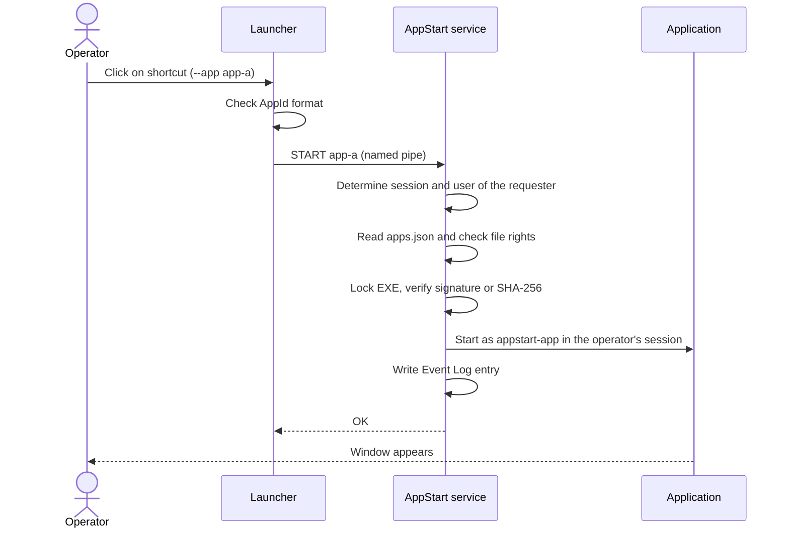
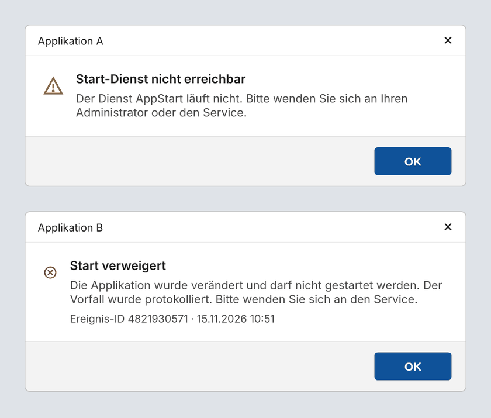
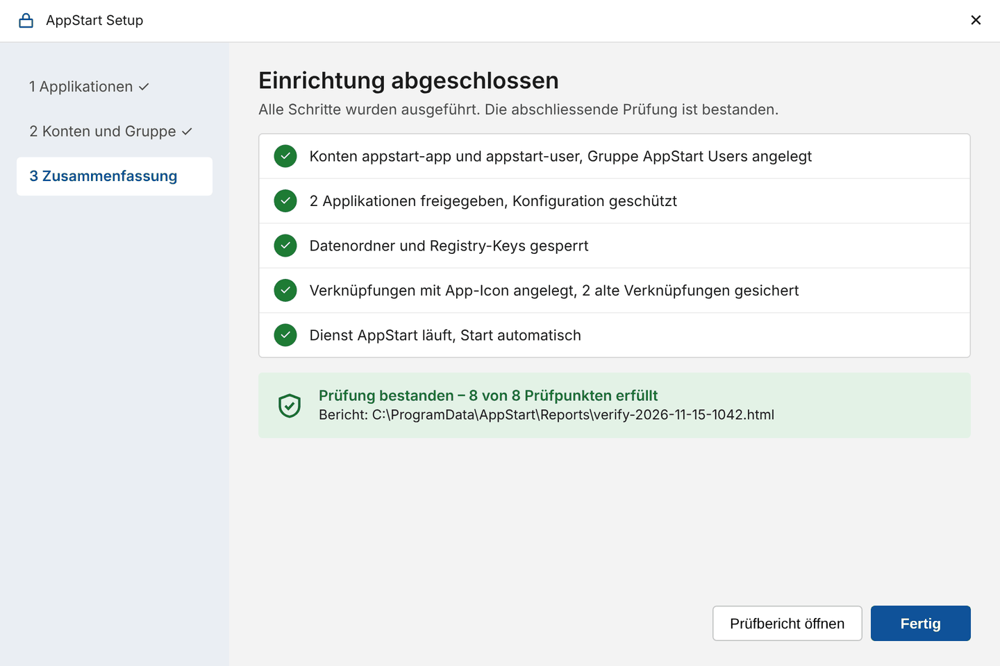
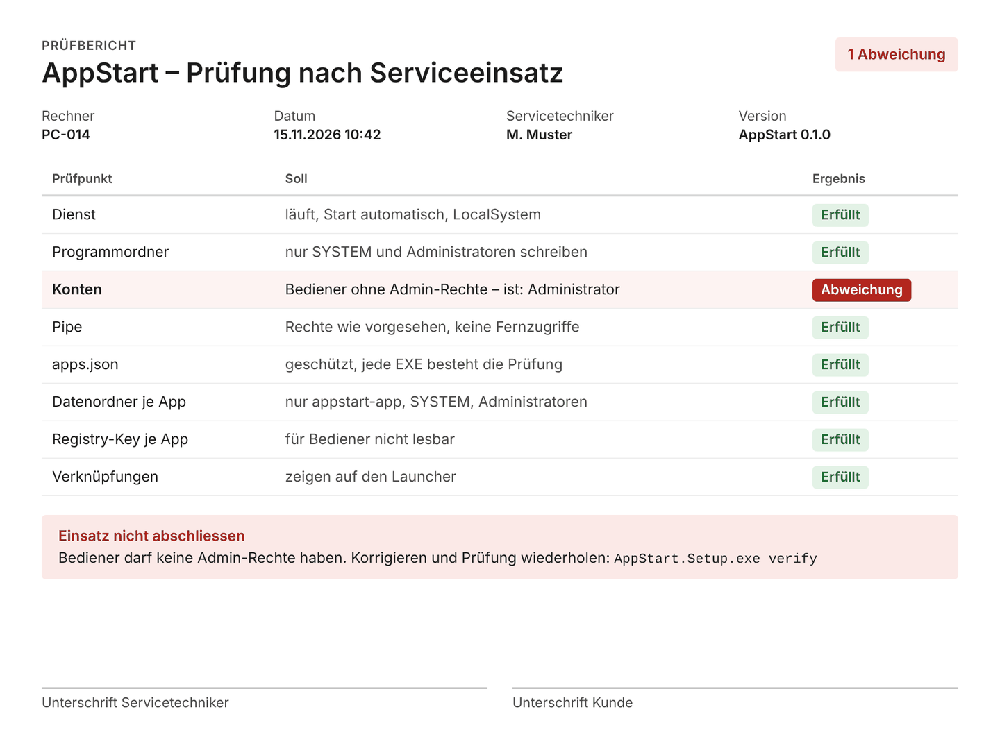

# How it works

This page explains what happens when an application starts, which accounts and files AppStart uses and which messages can appear.

## Terms

| Term | Meaning |
|---|---|
| **Operator** | Person working at the PC. Has no admin rights. |
| **Approved application** | Application that is listed in `apps.json` and may start through AppStart |
| **AppId** | Short identifier of an approved application, e.g. `app-a`. Lowercase letters, digits and hyphens only, at most 32 characters. |
| **App account** `appstart-app` | Local account with admin rights under which the applications run. Nobody can log on with it. |
| **Operator account** `appstart-user` | Optional local standard account for operators |
| **Group** `AppStart Users` | Only its members may start applications through AppStart |
| **Launcher** | Small EXE behind every shortcut; sends the start request to the service |
| **Named pipe** | Local channel between launcher and service. Not reachable from other computers. |
| **Job object** | Windows mechanism that groups all processes of an application: in mode "Blocked" with a limit of one process, in mode "Allowed helper programs only" monitored by the service |
| **Helper program** | Program that an application starts itself (export, updater, PDF viewer). In mode "Allowed helper programs only" it runs only if it is on the application's list. |
| **Learning mode** | For a limited time (5–120 minutes) the service records which programs an application starts instead of ending them; the suggestions can be adopted |
| **S4U logon** | The service logs on `appstart-app` without knowing a password |
| **Thumbprint** | Unique fingerprint of a certificate |

## Start sequence



In detail:

1. **Shortcut.** Every approved application has its own shortcut in the public Start menu and on the desktop. It points to `AppStart.Launcher.exe --app <AppId>` and carries the application's icon.
2. **Launcher.** Checks only the format of the AppId and sends `START <AppId>` to the named pipe `\\.\pipe\AppStart`. It passes no paths, arguments or environment variables.
3. **Acceptance.** The service determines the Windows session and user of the requester. One request per session is processed at a time. After every request, including a rejected one, a lockout time of 2 seconds applies to the session.
4. **Verification.** The service reads `apps.json` anew on every request. If non-administrators can write to the file, it refuses every start. It then opens the EXE so that it cannot be changed, renamed or deleted until the start, and verifies the signature or SHA-256.
5. **Start.** The service logs on `appstart-app` without a password (S4U logon), loads its profile and starts the application in the operator's session. What the application itself may start is controlled by `childProcesses`:
   - `blocked` (default): job object with a limit of one process; every further start fails.
   - `allowlist`: job object without a limit, with `KILL_ON_JOB_CLOSE` and without breakaway, bound to a completion port. For every new process in the job (grandchild processes too) the service opens the file locked and checks it against `allowedChildren`. No entry, wrong signature or checksum, any error during the check: the process is ended immediately (event 1206), otherwise event 1101. `conhost.exe` from `System32` is always allowed. When the application ends, the service keeps monitoring its allowed helper programs until none is running any more.
   - `all`: no job object.
   If learning mode is active for the application (`learn.json`), it runs in the monitored job, but the service ends nothing and instead records every program in `C:\ProgramData\AppStart\Learn\<AppId>.json` (event 1102). When it expires, the configured mode applies again, even in the running instance.
6. **Log.** Every request, successful or rejected, is written to the Event Log with time, user, session, AppId and result.

## Configuration `apps.json`

Path: `C:\ProgramData\AppStart\apps.json`. Only SYSTEM and Administrators may read and write the file. The setup maintains it; it does not have to be edited by hand.

```json
{
  "version": 2,
  "apps": [
    {
      "id": "app-a",
      "name": "Application A",
      "exe": "C:\\Program Files\\Vendor\\AppA\\AppA.exe",
      "workingDir": "C:\\Program Files\\Vendor\\AppA",
      "check": "signature",
      "signerThumbprint": "<thumbprint of the signing certificate>",
      "sha256": null,
      "childProcesses": "allowlist",
      "allowedChildren": [
        { "exe": "C:\\Program Files\\Vendor\\AppA\\Export.exe", "check": "signature", "signerThumbprint": "<thumbprint>" },
        { "exe": "C:\\Program Files\\Vendor\\AppA\\Updater.exe", "check": "sha256", "sha256": "<checksum>" }
      ],
      "dataDir": "C:\\ProgramData\\Vendor\\AppA",
      "registryKey": "HKLM\\SOFTWARE\\Vendor\\AppA"
    }
  ]
}
```

| Field | Meaning |
|---|---|
| `id` | AppId, also used in the shortcut |
| `name` | Display name, e.g. in the title of messages |
| `exe`, `workingDir` | Program file and working folder |
| `check` | `signature`: the signature must be valid and come from the expected certificate. Survives updates of the application. `sha256`: the checksum must match exactly. For unsigned EXEs; capture it again after every update. |
| `signerThumbprint` / `sha256` | Expected certificate or expected checksum |
| `childProcesses` | `blocked` (default, also if the field is missing), `allowlist` or `all`, see start sequence step 5 |
| `allowedChildren` | Only with `allowlist`, at least one entry: `exe` (absolute path, unique), `check` and check value as for the application, `allowShell: true` for confirmed shells and script hosts |

The service still reads version 1 (with `allowChildProcesses: false` or `true`) as `blocked` or `all`. The setup writes only version 2 and converts a version 1 file on the first save.
| `dataDir`, `registryKey` | Optional. The setup locks these folders and keys for operators. |

## Accounts and rights

| Account / group | Created | Rights |
|---|---|---|
| `appstart-app` | always | Member of Administrators. Interactive and Remote Desktop logon denied. Random password that nobody knows and that is stored nowhere. |
| `AppStart Users` | always | May open the service's pipe, nothing else |
| `appstart-user` | on request | Standard user, member of `AppStart Users`. Alternatively add existing local or domain users to the group. |

What the setup locks:

| Object | Access only for |
|---|---|
| `C:\Program Files\AppStart` (write) | SYSTEM, Administrators |
| `C:\ProgramData\AppStart\apps.json` | SYSTEM, Administrators |
| Data folder per application | `appstart-app`, SYSTEM, Administrators |
| Registry key per application | `appstart-app`, SYSTEM, Administrators |

## Pipe protocol

| Direction | Format | Example |
|---|---|---|
| Request | `START <AppId>`, ASCII, max. 64 bytes | `START app-a` |
| Response success | `OK` | `OK` |
| Response rejection | `DENIED <reason> <incident number>` | `DENIED integrity 4821930571` |

Reasons: `unknown-app`, `integrity`, `config`, `busy`, `error`. The launcher learns only the reason. Details are only in the Event Log. A request must arrive within 2 seconds, otherwise the connection is closed. The service does not answer invalid requests; they only appear as event 1204.

The **incident number** is a random 10-digit number per rejection. It appears in the text of the Event Log entry ("Incident: …") and so links the message shown to the operator with the log entry.

## Launcher messages

On success the launcher shows nothing. Otherwise one of these messages appears. The window title is the name of the shortcut, i.e. the name of the application.

For a rejection (except "Start already in progress") a 10-digit number is shown at the bottom, currently labeled "Event ID". It is the **incident number**, not the ID of the event type. To find the entry: Event Viewer → Windows Logs → Application, source AppStart, search for the number with "Find…".

<p align="center">
  
  <br>
  <sub>Top: the service is not running. Bottom: EXE modified, with incident number for searching the Event Log. (UI design)</sub>
</p>

| Message | Cause | Action |
|---|---|---|
| **Launch service unreachable** | Service `AppStart` is not running | Start the service, check the Event Log |
| **No permission** | User is not in the group `AppStart Users` | Add the user to the group, log on again |
| **Invalid shortcut** | Shortcut without an AppId or with a wrong one | Create the shortcut again through the setup |
| **Start denied** – application modified | Signature or checksum does not match | Clarify where the EXE came from; after a legitimate update `rehash` |
| **Start denied** – not approved | AppId is not in `apps.json` | Approve the application in the setup |
| **Start denied** – setup not in order | `apps.json` is missing, invalid or writable for non-admins | Run `verify`, repair the setup |
| **Start denied** – other error | Start failed technically | Check the Event Log entry for the incident number |
| **Start already in progress** | Second click during the start | Wait a moment, try again |
| **Unexpected response** | Response from the service not readable | Check the Event Log, compare the versions of launcher and service |

## Event Log

Log **Application**, source **AppStart**.

| ID | Event |
|---|---|
| 1000 | Service started |
| 1001 | Service stopped |
| 1100 | Application started |
| 1101 | Helper program allowed (mode "Allowed helper programs only") |
| 1102 | Learning mode: program recorded |
| 1200 | Rejected: AppId unknown |
| 1201 | Rejected: signature or checksum wrong |
| 1202 | Rejected: configuration faulty or unsafe |
| 1203 | Rejected: start already in progress in this session |
| 1204 | Invalid request (format, length, timeout) |
| 1205 | Start failed technically |
| 1206 | Disallowed program ended immediately, with reason |
| 1207 | Learning mode ignored: `learn.json` unprotected or invalid |
| 1208 | Monitoring disrupted |
| 1300 | Pipe already exists – service does not start |
| 1301 | Pipe could not be created |
| 1302 | Pipe error |
| 1400 | Learning mode started |
| 1401 | Learning mode ended or expired |

Event 1300 is a security event: another process created the pipe before the service. The service then deliberately does not start.

## Setup

> Work in progress. The images show the binding UI designs, not the finished software.

The setup guides you through the setup in three steps. The same works silently from the command line (see [README](../README.md#installation-vorschau)).

**1 · Select applications.** Add an EXE, specify the data folder and registry key for each application. The setup detects whether the EXE is signed and chooses the check type: signature or SHA-256.

<p align="center"></p>

**2 · Accounts and group.** The app account and the group are always created. Create the operator account `appstart-user` or add existing users to the group.

<p align="center"></p>

**3 · Summary.** Shows what was set up and the result of the automatic verification with the path to the report.

<p align="center"></p>

## Verify setup (`verify`)

> Work in progress.

`AppStart.Setup.exe verify` verifies the entire setup against the expected state and saves a report as HTML and JSON under `C:\ProgramData\AppStart\Reports`. Exit code 0 only if everything is correct. Intended for checking after the installation and after every service visit – for example when a technician has temporarily changed rights.

<p align="center">
  
  <br>
  <sub>Verification report with one deviation: the operator account is an administrator again. (UI design)</sub>
</p>

| Check | Expected |
|---|---|
| Service | installed, running, automatic start, account LocalSystem |
| Program folder | only SYSTEM and Administrators can write |
| Accounts | `appstart-app` present, no interactive logon, right "Log on as a batch job"; operators without admin rights |
| Administrators with password | every active account in the Administrators group has a password |
| Pipe | rights as intended, no remote access |
| `apps.json` | only SYSTEM and Administrators; every EXE passes verification |
| Data folder per app | only `appstart-app`, SYSTEM, Administrators |
| Helper programs per app | present, verification passed, folder not writable for operators; no learning mode active; "All allowed" as a notice |
| Registry key per app | not readable for operators |
| Shortcuts | point to the launcher, no direct shortcut to the EXE |

## Update and uninstallation

- **Updating AppStart:** install the new MSI over the old one. The service is stopped, replaced and restarted. Configuration, accounts and shortcuts are kept. There are no automatic updates.
- **Updating an application:** with `check: signature` there is nothing to do as long as the vendor signs with the same certificate. With `check: sha256` run `AppStart.Setup.exe rehash --app <AppId>` afterwards; this also captures the checksums of the helper programs again.
- **Uninstallation:** first `AppStart.Setup.exe uninstall` (restores the original shortcuts and rights, removes accounts), then uninstall the MSI.
