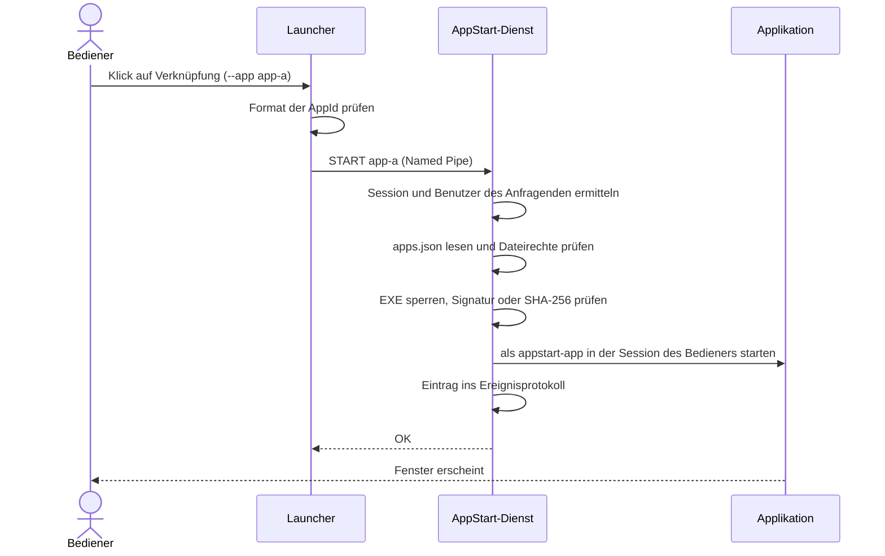
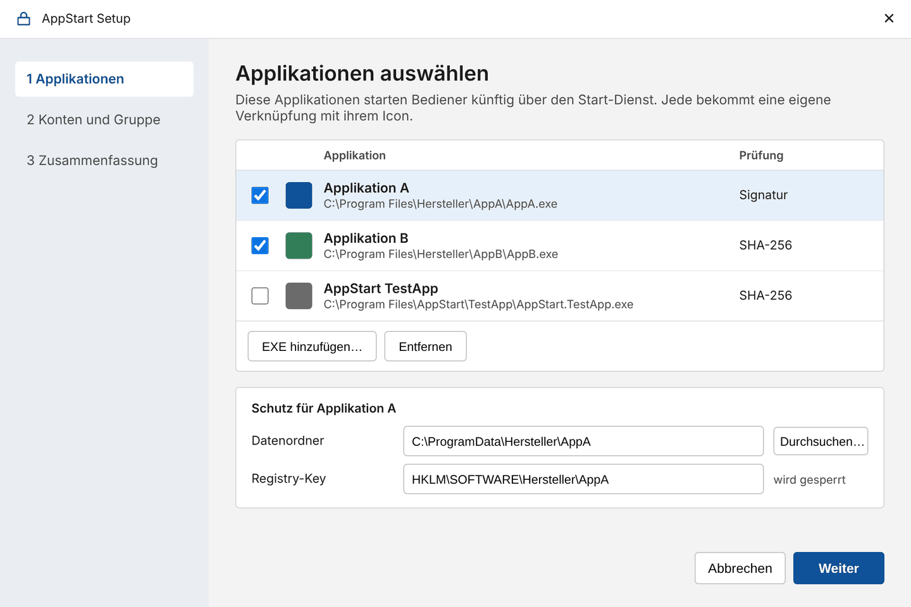
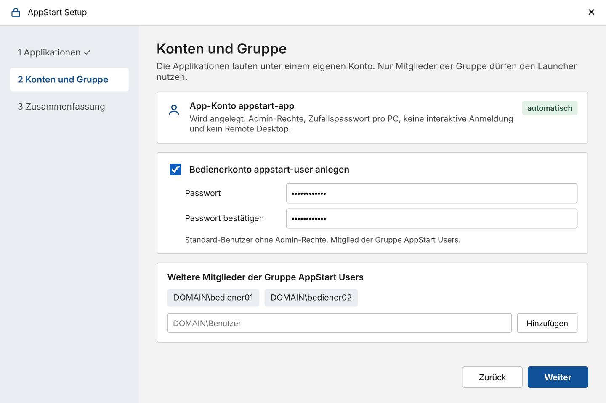

# Funktionsweise

Diese Seite erklärt, was beim Start einer Applikation passiert, welche Konten und Dateien AppStart nutzt und welche Meldungen auftreten können.

## Begriffe

| Begriff | Bedeutung |
|---|---|
| **Bediener** | Person, die am PC arbeitet. Hat keine Admin-Rechte. |
| **Freigegebene Applikation** | Applikation, die in `apps.json` eingetragen ist und über AppStart starten darf |
| **AppId** | Kurze Kennung einer freigegebenen Applikation, z. B. `app-a`. Nur Kleinbuchstaben, Ziffern und Bindestrich, maximal 32 Zeichen. |
| **App-Konto** `appstart-app` | Lokales Konto mit Admin-Rechten, unter dem die Applikationen laufen. Niemand kann sich damit anmelden. |
| **Bedienerkonto** `appstart-user` | Optionales lokales Standardkonto für Bediener |
| **Gruppe** `AppStart Users` | Nur ihre Mitglieder dürfen Applikationen über AppStart starten |
| **Launcher** | Kleine EXE hinter jeder Verknüpfung, schickt die Startanfrage an den Dienst |
| **Named Pipe** | Lokaler Kanal zwischen Launcher und Dienst. Von anderen Rechnern aus nicht erreichbar. |
| **Job-Objekt** | Windows-Mechanismus, der alle Prozesse einer Applikation zusammenfasst: im Modus «gesperrt» mit Limit von einem Prozess, im Modus «nur erlaubte Hilfsprogramme» vom Dienst überwacht |
| **Hilfsprogramm** | Programm, das eine Applikation selbst startet (Export, Updater, PDF-Anzeige). Läuft im Modus «nur erlaubte Hilfsprogramme» nur, wenn es auf ihrer Liste steht. |
| **Lernmodus** | Zeitlich begrenzt (5–120 Minuten) zeichnet der Dienst auf, welche Programme eine Applikation startet, statt sie zu beenden; die Vorschläge lassen sich übernehmen |
| **S4U-Anmeldung** | Der Dienst meldet `appstart-app` an, ohne ein Passwort zu kennen |
| **Thumbprint** | Eindeutiger Fingerabdruck eines Zertifikats |

## Ablauf beim Start



Im Detail:

1. **Verknüpfung.** Jede freigegebene Applikation hat eine eigene Verknüpfung im öffentlichen Startmenü und auf dem Desktop. Sie zeigt auf `AppStart.Launcher.exe --app <AppId>` und trägt das Icon der Applikation.
2. **Launcher.** Prüft nur das Format der AppId und sendet `START <AppId>` an die Named Pipe `\\.\pipe\AppStart`. Er übergibt keine Pfade, Argumente oder Umgebungsvariablen.
3. **Annahme.** Der Dienst ermittelt Windows-Session und Benutzer des Anfragenden. Pro Session wird eine Anfrage gleichzeitig bearbeitet. Nach jeder Anfrage, auch einer abgelehnten, gilt für die Session eine Sperrzeit von 2 Sekunden.
4. **Prüfung.** Der Dienst liest `apps.json` bei jeder Anfrage neu. Ist die Datei für Nicht-Administratoren beschreibbar, verweigert er jeden Start. Danach öffnet er die EXE so, dass sie bis zum Start nicht verändert, umbenannt oder gelöscht werden kann, und prüft Signatur oder SHA-256.
5. **Start.** Der Dienst meldet `appstart-app` ohne Passwort an (S4U-Anmeldung), lädt dessen Profil und startet die Applikation in der Session des Bedieners. Was sie selbst starten darf, regelt `childProcesses`:
   - `blocked` (Standard): Job-Objekt mit Limit von einem Prozess; jeder weitere Start scheitert.
   - `allowlist`: Job-Objekt ohne Limit, mit `KILL_ON_JOB_CLOSE` und ohne Breakaway, an einen Completion Port gebunden. Für jeden neuen Prozess im Job (auch Enkelprozesse) öffnet der Dienst die Datei gesperrt und prüft sie gegen `allowedChildren`. Kein Eintrag, falsche Signatur oder Prüfsumme, jeder Fehler bei der Prüfung: Der Prozess wird sofort beendet (Ereignis 1206), sonst Ereignis 1101. `conhost.exe` aus `System32` ist immer erlaubt. Endet die Applikation, überwacht der Dienst ihre erlaubten Hilfsprogramme weiter, bis keines mehr läuft.
   - `all`: kein Job-Objekt.
   Ist für die Applikation der Lernmodus aktiv (`learn.json`), läuft sie im überwachten Job, der Dienst beendet aber nichts, sondern zeichnet jedes Programm in `C:\ProgramData\AppStart\Learn\<AppId>.json` auf (Ereignis 1102). Nach Ablauf gilt wieder der eingestellte Modus, auch in der laufenden Instanz.
6. **Protokoll.** Jede Anfrage, ob erfolgreich oder abgelehnt, wird mit Zeit, Benutzer, Session, AppId und Ergebnis ins Ereignisprotokoll geschrieben.

## Konfiguration `apps.json`

Pfad: `C:\ProgramData\AppStart\apps.json`. Nur SYSTEM und Administratoren dürfen die Datei lesen und schreiben. Das Setup pflegt sie, von Hand muss sie nicht bearbeitet werden.

```json
{
  "version": 2,
  "apps": [
    {
      "id": "app-a",
      "name": "Applikation A",
      "exe": "C:\\Program Files\\Hersteller\\AppA\\AppA.exe",
      "workingDir": "C:\\Program Files\\Hersteller\\AppA",
      "check": "signature",
      "signerThumbprint": "<Thumbprint des Signaturzertifikats>",
      "sha256": null,
      "childProcesses": "allowlist",
      "allowedChildren": [
        { "exe": "C:\\Program Files\\Hersteller\\AppA\\Export.exe", "check": "signature", "signerThumbprint": "<Thumbprint>" },
        { "exe": "C:\\Program Files\\Hersteller\\AppA\\Updater.exe", "check": "sha256", "sha256": "<Prüfsumme>" }
      ],
      "dataDir": "C:\\ProgramData\\Hersteller\\AppA",
      "registryKey": "HKLM\\SOFTWARE\\Hersteller\\AppA"
    }
  ]
}
```

| Feld | Bedeutung |
|---|---|
| `id` | AppId, steht auch in der Verknüpfung |
| `name` | Anzeigename, z. B. im Titel von Meldungen |
| `exe`, `workingDir` | Programmdatei und Arbeitsordner |
| `check` | `signature`: Signatur muss gültig sein und vom erwarteten Zertifikat stammen. Übersteht Updates der Applikation. `sha256`: Prüfsumme muss exakt stimmen. Für unsignierte EXE, nach jedem Update neu erfassen. |
| `signerThumbprint` / `sha256` | Erwartetes Zertifikat bzw. erwartete Prüfsumme |
| `childProcesses` | `blocked` (Standard, auch wenn das Feld fehlt), `allowlist` oder `all`, siehe Ablauf Schritt 5 |
| `allowedChildren` | Nur bei `allowlist`, mindestens ein Eintrag: `exe` (absoluter Pfad, eindeutig), `check` und Prüfwert wie bei der Applikation, `allowShell: true` für bestätigte Shells und Skript-Hosts |

Version 1 (mit `allowChildProcesses: false` bzw. `true`) liest der Dienst weiter als `blocked` bzw. `all`. Das Setup schreibt nur Version 2 und stellt eine Version-1-Datei beim ersten Speichern um.
| `dataDir`, `registryKey` | Optional. Diese Ordner und Keys sperrt das Setup für Bediener. |

## Konten und Rechte

| Konto / Gruppe | Wird angelegt | Rechte |
|---|---|---|
| `appstart-app` | immer | Mitglied der Administratoren. Interaktive Anmeldung und Remote Desktop verweigert. Zufallspasswort, das niemand kennt und das nirgends gespeichert wird. |
| `AppStart Users` | immer | Darf die Pipe des Dienstes öffnen, sonst nichts |
| `appstart-user` | auf Wunsch | Standard-Benutzer, Mitglied von `AppStart Users`. Alternativ bestehende lokale oder Domänen-Benutzer in die Gruppe aufnehmen. |

Was das Setup sperrt:

| Objekt | Zugriff nur für |
|---|---|
| `C:\Program Files\AppStart` (schreiben) | SYSTEM, Administratoren |
| `C:\ProgramData\AppStart\apps.json` | SYSTEM, Administratoren |
| Datenordner je Applikation | `appstart-app`, SYSTEM, Administratoren |
| Registry-Key je Applikation | `appstart-app`, SYSTEM, Administratoren |

## Pipe-Protokoll

| Richtung | Format | Beispiel |
|---|---|---|
| Anfrage | `START <AppId>`, ASCII, max. 64 Byte | `START app-a` |
| Antwort Erfolg | `OK` | `OK` |
| Antwort Ablehnung | `DENIED <grund> <vorgangsnummer>` | `DENIED integrity 4821930571` |

Gründe: `unknown-app`, `integrity`, `config`, `busy`, `error`. Der Launcher erfährt nur den Grund. Details stehen ausschliesslich im Ereignisprotokoll. Eine Anfrage muss innerhalb von 2 Sekunden eintreffen, sonst wird die Verbindung geschlossen. Ungültige Anfragen beantwortet der Dienst nicht, sie erscheinen nur als Ereignis 1204.

Die **Vorgangsnummer** ist eine zufällige 10-stellige Zahl je Ablehnung. Sie steht im Text des Eintrags im Ereignisprotokoll («Vorgang: …») und verbindet so die Meldung beim Bediener mit dem Protokolleintrag.

## Meldungen des Launchers

Bei Erfolg zeigt der Launcher nichts. Sonst erscheint eine dieser Meldungen. Der Fenstertitel ist der Name der Verknüpfung, also der Name der Applikation.

Bei einer Ablehnung (ausser «Start läuft bereits») steht unten eine 10-stellige Nummer, derzeit beschriftet als «Ereignis-ID». Es ist die **Vorgangsnummer**, nicht die ID des Ereignistyps. So finden Sie den Eintrag: Ereignisanzeige → Windows-Protokolle → Anwendung, Quelle AppStart, mit «Suchen…» nach der Nummer suchen.

<p align="center">
  
  <br>
  <sub>Oben: Dienst läuft nicht. Unten: EXE verändert, mit Vorgangsnummer für die Suche im Ereignisprotokoll. (UI-Entwurf)</sub>
</p>

| Meldung | Ursache | Massnahme |
|---|---|---|
| **Start-Dienst nicht erreichbar** | Dienst `AppStart` läuft nicht | Dienst starten, Ereignisprotokoll prüfen |
| **Keine Berechtigung** | Benutzer ist nicht in der Gruppe `AppStart Users` | Benutzer in die Gruppe aufnehmen, neu anmelden |
| **Ungültige Verknüpfung** | Verknüpfung ohne oder mit falscher AppId | Verknüpfung über das Setup neu anlegen |
| **Start verweigert** – Applikation verändert | Signatur oder Prüfsumme stimmt nicht | Herkunft der EXE klären; nach legitimem Update `rehash` |
| **Start verweigert** – nicht freigegeben | AppId steht nicht in `apps.json` | Applikation im Setup freigeben |
| **Start verweigert** – Einrichtung nicht in Ordnung | `apps.json` fehlt, ist ungültig oder für Nicht-Admins beschreibbar | `verify` ausführen, Einrichtung reparieren |
| **Start verweigert** – sonstiger Fehler | Start ist technisch gescheitert | Eintrag zur Vorgangsnummer im Ereignisprotokoll prüfen |
| **Start läuft bereits** | Zweiter Klick während des Starts | kurz warten, erneut versuchen |
| **Unerwartete Antwort** | Antwort des Dienstes nicht lesbar | Ereignisprotokoll prüfen, Versionen von Launcher und Dienst vergleichen |

## Ereignisprotokoll

Protokoll **Anwendung**, Quelle **AppStart**.

| ID | Ereignis |
|---|---|
| 1000 | Dienst gestartet |
| 1001 | Dienst beendet |
| 1100 | Applikation gestartet |
| 1101 | Hilfsprogramm erlaubt (Modus «nur erlaubte Hilfsprogramme») |
| 1102 | Lernmodus: Programm aufgezeichnet |
| 1200 | Abgelehnt: AppId unbekannt |
| 1201 | Abgelehnt: Signatur oder Prüfsumme falsch |
| 1202 | Abgelehnt: Konfiguration fehlerhaft oder unsicher |
| 1203 | Abgelehnt: Start in dieser Session läuft bereits |
| 1204 | Ungültige Anfrage (Format, Länge, Zeitüberschreitung) |
| 1205 | Start technisch gescheitert |
| 1206 | Nicht erlaubtes Programm sofort beendet, mit Grund |
| 1207 | Lernmodus ignoriert: `learn.json` ungeschützt oder ungültig |
| 1208 | Überwachung gestört |
| 1300 | Pipe existiert bereits – Dienst startet nicht |
| 1301 | Pipe konnte nicht angelegt werden |
| 1302 | Fehler an der Pipe |
| 1400 | Lernmodus gestartet |
| 1401 | Lernmodus beendet oder abgelaufen |

Ereignis 1300 ist ein Sicherheitsereignis: Ein anderer Prozess hat die Pipe vor dem Dienst angelegt. Der Dienst startet dann bewusst nicht.

## Einrichtung

> In Arbeit. Die Bilder zeigen die verbindlichen UI-Entwürfe, nicht die fertige Software.

Das Setup führt in drei Schritten durch die Einrichtung. Dasselbe geht still über die Kommandozeile (siehe [README](../README.md#installation-vorschau)).

**1 · Applikationen auswählen.** EXE hinzufügen, je Applikation Datenordner und Registry-Key angeben. Das Setup erkennt, ob die EXE signiert ist, und wählt die Prüfart: Signatur oder SHA-256.

<p align="center"></p>

**2 · Konten und Gruppe.** App-Konto und Gruppe werden immer angelegt. Bedienerkonto `appstart-user` neu anlegen oder bestehende Benutzer in die Gruppe aufnehmen.

<p align="center"></p>

**3 · Zusammenfassung.** Zeigt, was eingerichtet wurde, und das Ergebnis der automatischen Prüfung mit Pfad zum Bericht.

<p align="center"></p>

## Einrichtung prüfen (`verify`)

> In Arbeit.

`AppStart.Setup.exe verify` prüft die gesamte Einrichtung gegen den Sollzustand und legt einen Bericht als HTML und JSON unter `C:\ProgramData\AppStart\Reports` ab. Exit-Code 0 nur, wenn alles stimmt. Gedacht für die Kontrolle nach der Installation und nach jedem Serviceeinsatz – etwa wenn ein Techniker vorübergehend Rechte geändert hat.

<p align="center">
  
  <br>
  <sub>Prüfbericht mit einer Abweichung: Das Bedienerkonto ist wieder Administrator. (UI-Entwurf)</sub>
</p>

| Prüfpunkt | Soll |
|---|---|
| Dienst | installiert, läuft, Start automatisch, Konto LocalSystem |
| Programmordner | nur SYSTEM und Administratoren schreiben |
| Konten | `appstart-app` vorhanden, keine interaktive Anmeldung, Recht «Als Batchauftrag anmelden»; Bediener ohne Admin-Rechte |
| Pipe | Rechte wie vorgesehen, kein Fernzugriff |
| `apps.json` | nur SYSTEM und Administratoren; jede EXE besteht die Prüfung |
| Datenordner je App | nur `appstart-app`, SYSTEM, Administratoren |
| Hilfsprogramme je App | vorhanden, Prüfung bestanden, Ordner für Bediener nicht beschreibbar; kein Lernmodus aktiv; «Alle erlaubt» als Hinweis |
| Registry-Key je App | für Bediener nicht lesbar |
| Verknüpfungen | zeigen auf den Launcher, keine direkte Verknüpfung auf die EXE |

## Update und Deinstallation

- **Update von AppStart:** neues MSI über das alte installieren. Der Dienst wird gestoppt, ersetzt und neu gestartet. Konfiguration, Konten und Verknüpfungen bleiben erhalten. Automatische Updates gibt es nicht.
- **Update einer Applikation:** Bei `check: signature` ist nichts zu tun, solange der Hersteller mit demselben Zertifikat signiert. Bei `check: sha256` danach `AppStart.Setup.exe rehash --app <AppId>`; das erfasst auch die Prüfsummen der Hilfsprogramme neu.
- **Deinstallation:** zuerst `AppStart.Setup.exe uninstall` (stellt ursprüngliche Verknüpfungen und Rechte wieder her, entfernt Konten), dann das MSI deinstallieren.
