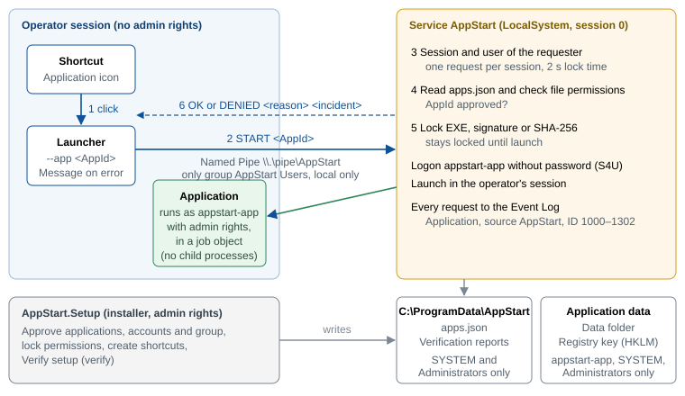

# Overview

## Purpose

Some desktop applications (fat clients) require admin rights at startup and store passwords or exchange files in places that every user can read. AppStart solves both without changing the applications:

- Operators start approved applications through a familiar shortcut, **without having admin rights themselves**, without a password and without a UAC prompt.
- The application runs under a dedicated account (`appstart-app`) with admin rights. Its data folder and registry key are locked for operators.
- Only applications that the installer has approved, and only unmodified program files (signature or SHA-256), are started.
- Every start attempt is recorded in the Windows Event Log.
- A verification command (`verify`) proves after the installation and after every service visit that the setup matches the expected state.

What AppStart does not do:

- Applications that need to start other programs are only suitable to a limited extent (see `allowChildProcesses` in the [Reference](09-reference.md)).
- The account `appstart-app` has no network credentials. Applications that access network drives or databases with the Windows sign-in do not work through it.
- Administrators can still read the data folder and registry key.

> **Important:** An approved application runs with admin rights, including its dialogs such as "Open file". This is why AppStart prevents it from starting other programs and only approves applications that the installer has deliberately selected.

## How it works at a glance

1. The operator clicks the shortcut of the application. It points to the launcher `AppStart.Launcher.exe --app <AppId>` and carries the icon of the application.
2. The launcher only checks the format of the AppId and sends `START <AppId>` to the named pipe `\\.\pipe\AppStart`. It passes no paths, arguments or environment variables.
3. The service `AppStart` determines the session and user of the requester. It handles one request per session at a time; after that, a lockout period of 2 seconds applies.
4. The service reads `C:\ProgramData\AppStart\apps.json` again for every request. If non-administrators can write to the file or the file is invalid, it denies every start.
5. The service opens the EXE so that it cannot be changed, renamed or deleted until it has started, and checks the signature or SHA-256.
6. The service signs in `appstart-app` without a password (S4U logon) and starts the application in the operator's session, enclosed in a job object. The launcher receives `OK` and exits without a window. If the start is denied, it shows a message (see [Messages and troubleshooting](07-messages-and-troubleshooting.md)).

## Components

| Component | File | Task | Runs with |
|---|---|---|---|
| Installer | `AppStart-Setup.exe` | Installs the MSI and then opens the setup | admin rights (UAC) |
| Installation package | `AppStart-<Version>.msi` | Installs everything to `C:\Program Files\AppStart`, registers the service. For software distribution. | admin rights or SYSTEM |
| Service | `AppStart.Service.exe` | Accepts start requests, checks them and starts the application | LocalSystem |
| Launcher | `AppStart.Launcher.exe` | Sits behind every shortcut, sends the start request, shows messages | the operator's rights |
| Setup | `AppStart.Setup.exe` | Setup (wizard and command line), verification `verify` | admin rights (UAC) |
| Test application | `TestApp\AppStart.TestApp.exe` | Behaves like an affected fat client, for acceptance and troubleshooting | through AppStart |

Program files are located in `C:\Program Files\AppStart\current\`. All paths are listed in the [Reference](09-reference.md).

## Terms

| Term | Meaning |
|---|---|
| **Operator** | Person who works at the PC. Has no admin rights. |
| **Installer** | Sets up AppStart. Needs admin rights. |
| **Service technician** | Maintains the PC and the applications, then verifies the setup with `verify`. |
| **Approved application** | Application that is listed in `apps.json` and may start through AppStart |
| **AppId** | Short identifier of an approved application, e.g. `app-a`. Only lowercase letters `a-z`, digits and hyphen, 1 to 32 characters. The setup derives it from the file name of the EXE. |
| **App account** `appstart-app` | Local account with admin rights under which the applications run. Nobody can sign in with it, nobody knows its password. |
| **Operator account** `appstart-user` | Optional local standard account without admin rights for the operators |
| **Group** `AppStart Users` | Local group. Only its members may start applications through AppStart. |
| **Launcher** | Small EXE behind every shortcut. Sends the start request to the service. |
| **Service** | Windows service `AppStart`, checks and starts the applications |
| **Named pipe** | Local channel `\\.\pipe\AppStart` between launcher and service, not reachable from other computers |
| **Job object** | Windows mechanism that prevents the application from starting other programs (e.g. a command prompt through "Open file") |
| **S4U logon** | The service signs in `appstart-app` without knowing a password |
| **Signature / thumbprint** | Digital signature of the EXE. The thumbprint is the fingerprint of the signing certificate; AppStart only accepts the certificate recorded at approval. |
| **SHA-256** | Checksum of the EXE for unsigned applications. Changes with every update of the application. |
| **Incident ID** | Random number of up to 10 digits for each denied start. Shown in the launcher's message (as "Event ID …") and in the Event Log. |
| **Verification report** | Result of `verify` with ten checks, as HTML and JSON under `C:\ProgramData\AppStart\Reports` |
