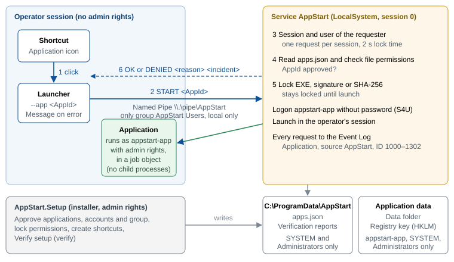

# Überblick

## Zweck

Manche Desktop-Applikationen (Fat Clients) verlangen beim Start zwingend Admin-Rechte und speichern Passwörter oder Austauschdateien an Orten, die jeder Benutzer lesen kann. AppStart löst beides, ohne die Applikationen zu ändern:

- Bediener starten freigegebene Applikationen über eine gewohnte Verknüpfung, **ohne selbst Admin-Rechte zu haben**, ohne Passwort und ohne UAC-Abfrage.
- Die Applikation läuft unter einem eigenen Konto (`appstart-app`) mit Admin-Rechten. Ihr Datenordner und ihr Registry-Key sind für Bediener gesperrt.
- Nur Applikationen, die der Installateur freigegeben hat, und nur unveränderte Programmdateien (Signatur oder SHA-256) werden gestartet.
- Jeder Startversuch steht im Windows-Ereignisprotokoll.
- Ein Prüfbefehl (`verify`) belegt nach Installation und jedem Serviceeinsatz, dass die Einrichtung dem Soll entspricht.

Was AppStart nicht leistet:

- Applikationen, die weitere Programme starten müssen, sind nur eingeschränkt geeignet (siehe `allowChildProcesses` in der [Referenz](09-referenz.md)).
- Das Konto `appstart-app` hat keine Netzwerk-Anmeldedaten. Applikationen, die mit der Windows-Anmeldung auf Netzlaufwerke oder Datenbanken zugreifen, funktionieren darüber nicht.
- Administratoren können Datenordner und Registry-Key weiterhin lesen.

> **Wichtig:** Eine freigegebene Applikation läuft mit Admin-Rechten, auch ihre Dialoge wie «Datei öffnen». Deshalb verhindert AppStart, dass sie weitere Programme startet, und gibt nur Applikationen frei, die der Installateur bewusst ausgewählt hat.

## Funktionsweise in einem Bild

1. Der Bediener klickt die Verknüpfung der Applikation. Sie zeigt auf den Launcher `AppStart.Launcher.exe --app <AppId>` und trägt das Icon der Applikation.
2. Der Launcher prüft nur das Format der AppId und sendet `START <AppId>` an die Named Pipe `\\.\pipe\AppStart`. Er übergibt keine Pfade, Argumente oder Umgebungsvariablen.
3. Der Dienst `AppStart` ermittelt Sitzung und Benutzer des Anfragenden. Je Sitzung bearbeitet er eine Anfrage gleichzeitig; danach gilt eine Sperrzeit von 2 Sekunden.
4. Der Dienst liest `C:\ProgramData\AppStart\apps.json` bei jeder Anfrage neu. Ist die Datei für Nicht-Administratoren beschreibbar oder ungültig, verweigert er jeden Start.
5. Der Dienst öffnet die EXE so, dass sie bis zum Start nicht verändert, umbenannt oder gelöscht werden kann, und prüft Signatur oder SHA-256.
6. Der Dienst meldet `appstart-app` ohne Passwort an (S4U-Anmeldung) und startet die Applikation in der Sitzung des Bedieners, eingeschlossen in ein Job-Objekt. Der Launcher erhält `OK` und beendet sich ohne Fenster. Bei einer Ablehnung zeigt er eine Meldung (siehe [Meldungen und Fehlerbehebung](07-meldungen-und-fehlerbehebung.md)).

## Bestandteile

| Bestandteil | Datei | Aufgabe | Läuft mit |
|---|---|---|---|
| Installationsprogramm | `AppStart-Setup.exe` | Installiert das MSI und öffnet danach die Einrichtung | Admin-Rechten (UAC) |
| Installationspaket | `AppStart-<Version>.msi` | Installiert alles nach `C:\Program Files\AppStart`, registriert den Dienst. Für die Softwareverteilung. | Admin-Rechten oder SYSTEM |
| Dienst | `AppStart.Service.exe` | Nimmt Startanfragen an, prüft sie und startet die Applikation | LocalSystem |
| Launcher | `AppStart.Launcher.exe` | Steht hinter jeder Verknüpfung, sendet die Startanfrage, zeigt Meldungen | Rechten des Bedieners |
| Setup | `AppStart.Setup.exe` | Einrichtung (Assistent und Kommandozeile), Prüfung `verify` | Admin-Rechten (UAC) |
| Testapplikation | `TestApp\AppStart.TestApp.exe` | Verhält sich wie ein betroffener Fat Client, für Abnahme und Fehlersuche | über AppStart |

Programmdateien liegen in `C:\Program Files\AppStart\current\`. Alle Pfade stehen in der [Referenz](09-referenz.md).

## Begriffe

| Begriff | Bedeutung |
|---|---|
| **Bediener** | Person, die am PC arbeitet. Hat keine Admin-Rechte. |
| **Installateur** | Richtet AppStart ein. Braucht Admin-Rechte. |
| **Servicetechniker** | Wartet den PC und die Applikationen, prüft danach die Einrichtung mit `verify`. |
| **Freigegebene Applikation** | Applikation, die in `apps.json` eingetragen ist und über AppStart starten darf |
| **AppId** | Kurze Kennung einer freigegebenen Applikation, z.B. `app-a`. Nur Kleinbuchstaben `a-z`, Ziffern und Bindestrich, 1 bis 32 Zeichen. Das Setup bildet sie aus dem Dateinamen der EXE. |
| **App-Konto** `appstart-app` | Lokales Konto mit Admin-Rechten, unter dem die Applikationen laufen. Niemand kann sich damit anmelden, sein Passwort kennt niemand. |
| **Bedienerkonto** `appstart-user` | Optionales lokales Standardkonto ohne Admin-Rechte für die Bediener |
| **Gruppe** `AppStart Users` | Lokale Gruppe. Nur ihre Mitglieder dürfen Applikationen über AppStart starten. |
| **Launcher** | Kleine EXE hinter jeder Verknüpfung. Sendet die Startanfrage an den Dienst. |
| **Dienst** | Windows-Dienst `AppStart`, prüft und startet die Applikationen |
| **Named Pipe** | Lokaler Kanal `\\.\pipe\AppStart` zwischen Launcher und Dienst, von anderen Rechnern aus nicht erreichbar |
| **Job-Objekt** | Windows-Mechanismus, der verhindert, dass die Applikation weitere Programme startet (z.B. eine Eingabeaufforderung über «Datei öffnen») |
| **S4U-Anmeldung** | Der Dienst meldet `appstart-app` an, ohne ein Passwort zu kennen |
| **Signatur / Thumbprint** | Digitale Signatur der EXE. Der Thumbprint ist der Fingerabdruck des Signaturzertifikats; AppStart akzeptiert nur das bei der Freigabe erfasste Zertifikat. |
| **SHA-256** | Prüfsumme der EXE für unsignierte Applikationen. Ändert sich bei jedem Update der Applikation. |
| **Vorgangsnummer** | Zufällige, bis 10-stellige Nummer je abgelehntem Start. Steht in der Meldung des Launchers und im Ereignisprotokoll. |
| **Prüfbericht** | Ergebnis von `verify` mit acht Prüfpunkten, als HTML und JSON unter `C:\ProgramData\AppStart\Reports` |
