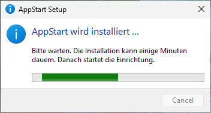
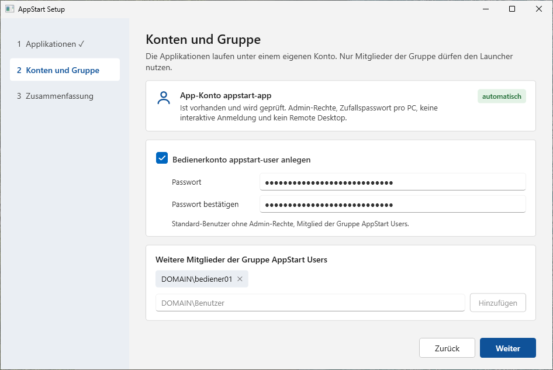
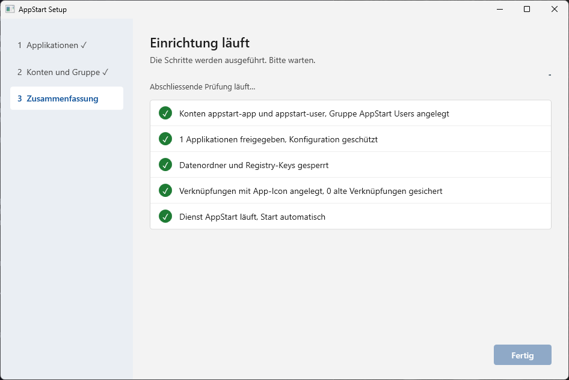
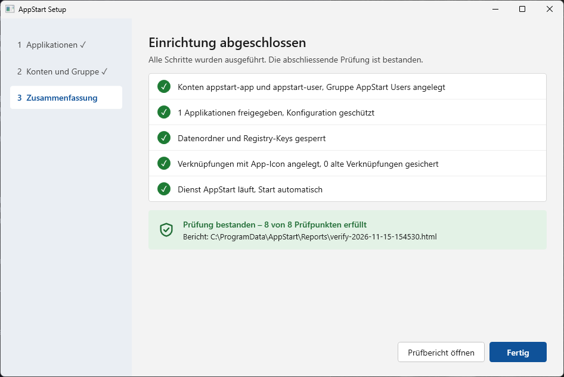
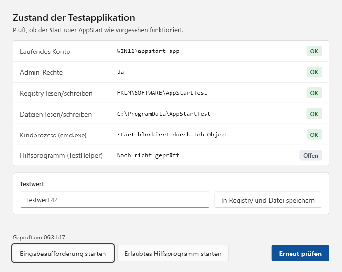

# Installation

Es gibt zwei Wege:

| Weg | Für | Ablauf |
|---|---|---|
| **Interaktiv** mit `AppStart-Setup.exe` | Installateur am PC | Installationsprogramm starten, UAC bestätigen, Einrichtung in drei Schritten |
| **Still** mit `AppStart-<Version>.msi` | Softwareverteilung, Skripte | `msiexec` ohne Oberfläche, danach Einrichtung über die Kommandozeile |

Beide Wege installieren dasselbe MSI nach `C:\Program Files\AppStart`, registrieren und starten den Dienst `AppStart` und legen im Startmenü den Ordner «AppStart» an:

| Eintrag | Öffnet |
|---|---|
| «AppStart – Einrichtung» | Den Assistenten (`AppStart.Setup.exe` ohne Argumente) |
| «AppStart – Einrichtung prüfen» | Die Prüfansicht (`AppStart.Setup.exe verify --ui`), siehe [Prüfung nach Serviceeinsatz](06-verification-after-a-service-visit.md) |
| «AppStart – Handbuch» | Dieses Handbuch als PDF |


Nach jeder Installation und jedem Update prüft das MSI die Einrichtung automatisch (`verify`) und legt den Bericht unter `C:\ProgramData\AppStart\Reports` ab. Solange die Einrichtung nicht abgeschlossen ist, meldet dieser erste Bericht Abweichungen, und der Dienst läuft zwar, wartet aber auf die Gruppe `AppStart Users` (Ereignis 1301, siehe [Meldungen](07-messages-and-troubleshooting.md)). Das ist normal.

## Interaktive Installation mit AppStart-Setup.exe

1. `AppStart-Setup.exe` auf den PC kopieren, z.B. nach `Downloads`, und per Doppelklick starten.
2. Die UAC-Abfrage mit Admin-Zugangsdaten bestätigen. Es ist die einzige UAC-Abfrage der Installation.
3. Das Installationsprogramm zeigt «AppStart wird installiert …» mit dem Hinweis «Bitte warten. Die Installation kann einige Minuten dauern. Danach startet die Einrichtung.» Es entpackt das eingebettete MSI in den geschützten Ordner `C:\ProgramData\AppStart\Installer\<Guid>` (nie nach `%TEMP%` oder in den Download-Ordner), installiert es ohne weitere Dialoge und löscht die entpackte Kopie danach wieder.
4. Danach prüft es, ob `C:\Program Files\AppStart\current\AppStart.Setup.exe` mit demselben Zertifikat signiert ist wie das Installationsprogramm, und öffnet daraus den Assistenten (Schritt 1). Er erbt die Admin-Rechte, eine zweite UAC-Abfrage gibt es nicht.



Protokolle legt das Installationsprogramm unter `C:\ProgramData\AppStart\Logs` ab:

| Datei | Inhalt |
|---|---|
| `install-<JJJJMMTT-hhmmss>.log` | Ausführliches Protokoll von Windows Installer (`msiexec /l*v`) |
| `bootstrapper-<JJJJMMTT-hhmmss>.log` | Schritte des Installationsprogramms: Version, Modus, Ordnerprüfung, Exit-Code von `msiexec`, Signaturprüfung. Bei unsignierten Entwicklungs-Builds steht hier eine Zeile «WARNUNG», weil die Signaturprüfung übersprungen wurde. |

Fehler- und Hinweismeldungen zeigen eine Überschrift, die Ursache, eine Zeile «Massnahme: …» und, wenn vorhanden, unten «Protokoll: C:\ProgramData\AppStart\Logs\install-20261115-104212.log». Alle Meldungen mit Ursache und Massnahme stehen im Kapitel [Meldungen und Fehlerbehebung](07-messages-and-troubleshooting.md#installationsprogramm). Bei einem Fehler startet der Assistent nicht.

**Bereits installiert:** Ist dieselbe oder eine neuere Version von AppStart installiert, überspringt das Installationsprogramm die Installation, meldet «AppStart ist bereits installiert» und öffnet direkt den Assistenten. So lässt sich `AppStart-Setup.exe` auch nur zum Öffnen der Einrichtung verwenden.

**Neustart:** Meldet Windows Installer, dass ein Neustart nötig ist (Code 3010), erscheint «Neustart erforderlich». Zuerst die Einrichtung durchführen, danach den PC neu starten.

**Parameter von AppStart-Setup.exe** (Details in der [Referenz](09-reference.md#appstart-setup-exe)):

| Aufruf | Wirkung |
|---|---|
| `AppStart-Setup.exe` | Installiert AppStart und startet danach die Einrichtung |
| `AppStart-Setup.exe /quiet` | Installiert nur, ohne Oberfläche und ohne Einrichtung. Exit-Code = Exit-Code von `msiexec` (0 oder 3010 = erfolgreich). Ist AppStart schon in derselben oder neueren Version installiert: Exit-Code 0. |
| `AppStart-Setup.exe /quiet /config C:\Deploy\appstart.json` | Installiert und richtet danach in einem Schritt ohne Oberfläche nach der Antwortdatei ein: Applikationen, Schutz, weitere Programme und Bediener (Format: [Referenz → `apply`](09-reference.md#apply)). Für die Softwareverteilung als SYSTEM. Exit-Code 0 oder 3010 = eingerichtet, 10 = Einrichtung mit Fehler oder Abweichung, 11 = Antwortdatei ungültig; Ausgabe in `C:\ProgramData\AppStart\Logs\apply-….log`. Das lokale Konto `appstart-user` legt die Antwortdatei nicht an (kein Passwort in Dateien). |
| `AppStart-Setup.exe /?` | Zeigt die Hilfe |

Ohne Installationsprogramm (nur MSI vorhanden): `AppStart-<Version>.msi` per Doppelklick oder `msiexec /i` installieren und danach im Startmenü «AppStart – Einrichtung» öffnen.

## Einrichtung in drei Schritten

Der Assistent «AppStart Setup» führt in drei Schritten durch die Einrichtung. Links zeigt er die Schritte «Applikationen», «Konten und Gruppe» und «Zusammenfassung»; erledigte Schritte sind mit einem Häkchen markiert. Er lässt sich jederzeit erneut über «AppStart – Einrichtung» öffnen und zeigt dann die bestehende Konfiguration: freigegebene Applikationen, vorhandene Konten und Mitglieder der Gruppe.

Knöpfe: «Abbrechen» (Schritte 1 und 2), «Zurück» (Schritt 2), «Weiter», nach der Einrichtung «Prüfbericht öffnen» und «Fertig».

### Schritt 1: Applikationen auswählen


Überschrift «Applikationen auswählen», darunter: «Diese Applikationen starten Bediener künftig über den Start-Dienst. Jede bekommt eine eigene Verknüpfung mit ihrem Icon.»

1. «EXE hinzufügen…» klicken. Im Dialog «Programmdatei auswählen» (Filter `Programme (*.exe)|*.exe`) eine oder mehrere EXE wählen.
2. Das Setup liest jede EXE und zeigt sie in der Liste mit den Spalten «Applikation» (Name und Pfad) und «Prüfung». Die Prüfung ist «Signatur», wenn die EXE gültig signiert ist, sonst «SHA-256».
3. Nur angehakte Applikationen werden freigegeben. Mit «Entfernen» verschwindet die markierte Applikation aus der Liste; nach «Weiter» und Abschluss der Einrichtung wird ihre Freigabe entzogen.
4. Für die markierte Applikation im Bereich «Schutz für Applikation A» (Name der markierten Applikation) eintragen. Unter der Überschrift steht: «Datenordner und Registry-Key werden beim Übernehmen gesperrt: Danach haben nur appstart-app, SYSTEM und Administratoren Zugriff, Bediener nicht. Fehlt das Ziel, legt das Setup es an. Bei der Deinstallation kommen die ursprünglichen Rechte zurück. Leer lassen, wenn die Applikation dort nichts speichert; dann wird nichts gesperrt. Beispiele: `C:\ProgramData\<Hersteller>\<App>` und `HKLM\SOFTWARE\<Hersteller>\<App>`.»
   - «Datenordner»: Ordner, in den die Applikation schreibt (Messwerte, Austauschdateien, Logs), mit «Durchsuchen…» wählbar (Dialog «Datenordner auswählen»). Die Applikation läuft als `appstart-app` und darf dort schreiben; Bediener sehen den Ordner danach nicht mehr. Leer lassen, wenn es keinen gibt.
   - «Registry-Key»: Key unter `HKLM`, in dem die Applikation Einstellungen oder Passwörter speichert, z.B. `HKLM\SOFTWARE\Hersteller\AppA`. Hinweis rechts: «wird gesperrt». Bediener können ihn danach in regedit nicht öffnen.
   - **Nicht den Programmordner als Datenordner wählen.** Ist der Datenordner der Ordner der EXE, liegt er darin oder enthält er ihn, erscheint ein gelber Kasten: «Achtung: Dieser Datenordner ist der Programmordner der Applikation, liegt darin oder enthält ihn. appstart-app bekäme Schreibrechte auf EXE und DLLs. Eine ausgetauschte EXE erkennt die Prüfung, ausgetauschte DLLs nicht. Empfohlen ist ein Ordner unter C:\ProgramData, z.B. `C:\ProgramData\<Hersteller>\<App>`.» «Weiter» bleibt gesperrt, bis der Ordner geändert oder «Risiko verstanden, diesen Ordner trotzdem verwenden» angehakt ist. Die Zusammenfassung in Schritt 3 und die Kommandozeile melden es zusätzlich als «Warnung: Datenordner … von … liegt im Programmordner der Applikation oder enthält ihn. appstart-app kann dann EXE und DLLs ändern; ausgetauschte DLLs erkennt die Hash- und Signaturprüfung nicht. Empfohlen: ein Ordner unter C:\ProgramData, z.B. `C:\ProgramData\<Hersteller>\<App>`».
5. «Weiter».

Unten links öffnet «Einrichtung prüfen» jederzeit die Prüfansicht mit dem aktuellen Stand, ohne etwas zu ändern (siehe [Prüfung nach Serviceeinsatz](06-verification-after-a-service-visit.md)).

Leere Liste: «Noch keine Applikation. Mit «EXE hinzufügen…» eine Programmdatei wählen.»

Hinweise und Fehler in Schritt 1:

| Meldung | Ursache | Massnahme |
|---|---|---|
| «Mindestens eine Applikation auswählen.» | Keine Applikation angehakt. «Weiter» ist gesperrt. | Mindestens eine Applikation anhaken |
| «Datenordner von Applikation A liegt im Programmordner: ändern oder das Risiko bestätigen.» | Bei einer angehakten Applikation ist die Warnung zum Datenordner offen. «Weiter» ist gesperrt. | Applikation markieren, Datenordner ändern oder das Risiko bestätigen |
| «Der Datenordner muss ein vollständiger Pfad sein, z.B. C:\ProgramData\Hersteller\App.» | Relativer Pfad oder Netzwerkpfad | Vollständigen Pfad mit Laufwerksbuchstabe angeben |
| «Der Registry-Key muss mit HKLM\ beginnen.» | Key unter `HKCU` oder ohne Wurzel | Key unter `HKLM\` angeben. Schlüssel des Benutzers (`HKCU`) kann AppStart nicht schützen. |
| «AppA.exe kann nicht hinzugefügt werden: …» | Die EXE lässt sich nicht lesen oder ist gerade gesperrt; nach dem Doppelpunkt steht der Grund | Pfad und Rechte prüfen, laufende Applikation beenden, erneut hinzufügen |
| «Die bestehende Konfiguration konnte nicht gelesen werden: …» | `apps.json` ist ungültig oder nicht lesbar | Siehe Prüfpunkt [apps.json](06-verification-after-a-service-visit.md); notfalls `apps.json` aus einer Sicherung zurückholen |

### Schritt 2: Konten und Gruppe



Überschrift «Konten und Gruppe», darunter: «Die Applikationen laufen unter einem eigenen Konto. Nur Mitglieder der Gruppe dürfen den Launcher nutzen.»

- **«App-Konto appstart-app»** (Kennzeichen «automatisch»): wird immer eingerichtet. Text bei der Erstinstallation: «Wird angelegt. Admin-Rechte, Zufallspasswort pro PC, keine interaktive Anmeldung und kein Remote Desktop.» Bei bestehender Einrichtung: «Ist vorhanden und wird geprüft. Admin-Rechte, Zufallspasswort pro PC, keine interaktive Anmeldung und kein Remote Desktop.»
- **«Bedienerkonto appstart-user anlegen»**: anhaken, wenn die Bediener ein gemeinsames lokales Konto nutzen sollen. Dann «Passwort» und «Passwort bestätigen» ausfüllen. Hinweis: «Standard-Benutzer ohne Admin-Rechte, Mitglied der Gruppe AppStart Users.» Existiert das Konto schon, steht dort «Bedienerkonto appstart-user ist bereits vorhanden» mit dem Kennzeichen «vorhanden»; sein Passwort ändert das Setup nicht.
- **«Weitere Mitglieder der Gruppe AppStart Users»**: bestehende Benutzer eintragen (Feld «Benutzer hinzufügen», Platzhalter `DOMAIN\Benutzer`) und «Hinzufügen» klicken. Mit dem Knopf «Mitglied entfernen» neben einem Eintrag wird er wieder entfernt.

Meldungen in Schritt 2:

| Meldung | Ursache | Massnahme |
|---|---|---|
| «Bitte ein Passwort eingeben.» | Bedienerkonto angehakt, Passwort leer | Passwort eingeben oder Haken entfernen |
| «Die Passwörter stimmen nicht überein.» | «Passwort» und «Passwort bestätigen» unterscheiden sich | Beide Felder neu eingeben |
| «Konto als DOMAIN\Benutzer, .\Benutzer oder Benutzer angeben.» | Ungültige Schreibweise des Kontos | Konto in einer der drei Schreibweisen eingeben |
| «Dieses Konto ist bereits in der Liste.» | Konto doppelt eingetragen | – |

Ob ein eingetragenes Konto existiert, prüft das Setup erst in Schritt 3. Ein unbekanntes Konto oder eine Gruppe (statt eines Benutzers) führt dort zu «Konten und Gruppe konnten nicht eingerichtet werden».

### Schritt 3: Zusammenfassung und Prüfung

Mit «Weiter» in Schritt 2 beginnt die Einrichtung. Überschrift «Einrichtung läuft», Text «Die Schritte werden ausgeführt. Bitte warten.» Darunter erscheint der Fortschritt: «Einrichtung wird gestartet…», dann nacheinander

1. «Konten und Gruppe werden eingerichtet …»
2. «Konfiguration wird geschrieben …»
3. «Datenordner und Registry-Keys werden gesperrt …»
4. «Verknüpfungen werden angelegt …»
5. «Dienst wird geprüft …»
6. «Abschliessende Prüfung läuft…» (`verify`)



Während die Einrichtung läuft, lässt sich das Fenster nicht schliessen. Danach steht je Schritt eine Zeile mit ✓ (erfolgreich) oder ✗ (fehlgeschlagen, mit Grund). Bei Erfolg:

- ✓ «Konten appstart-app und appstart-user, Gruppe AppStart Users angelegt» (bzw. «Konto appstart-app und Gruppe AppStart Users angelegt» ohne Bedienerkonto)
- ✓ «2 Applikationen freigegeben, Konfiguration geschützt»
- ✓ «Datenordner und Registry-Keys gesperrt»
- ✓ «Verknüpfungen mit App-Icon angelegt, 2 alte Verknüpfungen gesichert» (Anzahl der ersetzten Verknüpfungen, die direkt auf die EXE zeigten)
- ✓ «Dienst AppStart läuft, Start automatisch»



Zum Schluss das Ergebnis der Prüfung und der Pfad des Berichts:

| Überschrift und Text | Bedeutung |
|---|---|
| «Einrichtung abgeschlossen» – «Alle Schritte wurden ausgeführt. Die abschliessende Prüfung ist bestanden.» mit «Prüfung bestanden – 10 von 10 Prüfpunkten erfüllt» | Fertig. Mit «Fertig» schliessen (Exit-Code 0). |
| «Einrichtung abgeschlossen» – «Alle Schritte wurden ausgeführt. Die abschliessende Prüfung hat Abweichungen gefunden.» mit «Prüfung nicht bestanden – 1 Abweichung, 9 von 10 Prüfpunkten erfüllt» oder «Prüfung nicht bestanden – 2 Abweichungen, 8 von 10 Prüfpunkten erfüllt» | Bericht öffnen, Abweichungen nach [Prüfung nach Serviceeinsatz](06-verification-after-a-service-visit.md) beheben, Einrichtung erneut ausführen |
| «Einrichtung unvollständig» – «Nicht alle Schritte waren erfolgreich. Die Prüfung zeigt, was fehlt.» | Mindestens eine Zeile mit ✗. Grund in der Zeile, Massnahme im Kapitel [Meldungen und Fehlerbehebung](07-messages-and-troubleshooting.md) |

Weitere Zeilen, die erscheinen können:

| Meldung | Bedeutung |
|---|---|
| «Bericht: C:\ProgramData\AppStart\Reports\verify-2026-11-15-104212.html» | Pfad des abgelegten Prüfberichts |
| «Einrichtung abgebrochen: …» | Unerwarteter Fehler; nach dem Doppelpunkt steht der Grund. Einrichtung erneut ausführen. |
| «Prüfung konnte nicht ausgeführt werden: …» | `verify` ist gescheitert. Über das Startmenü «AppStart – Einrichtung prüfen» wiederholen. |
| «Bericht konnte nicht gespeichert werden: …» | `C:\ProgramData\AppStart\Reports` ist nicht beschreibbar oder voll |
| «Der Bericht kann nicht geöffnet werden: …» | Kein Programm für `.html`-Dateien. Bericht mit einem Browser öffnen. |

«Prüfbericht öffnen» zeigt den Bericht im Standard-Browser. «Fertig» schliesst den Assistenten.

**Abbrechen:** «Abbrechen» in Schritt 1 oder 2 ändert nichts am System (Exit-Code 2). AppStart bleibt installiert, der Assistent lässt sich über «AppStart – Einrichtung» erneut starten, und `verify` meldet die fehlende Einrichtung als Abweichung.

Exit-Codes des Assistenten: 0 = eingerichtet und Prüfung bestanden, 1 = Fehler oder Abweichungen, 2 = vor der Einrichtung abgebrochen.

## Stille Installation

Für Softwareverteilung und Skripte. Alles läuft ohne Oberfläche, als SYSTEM oder in einer Eingabeaufforderung «Als Administrator ausführen».

**1. MSI installieren**

```text
msiexec /i AppStart-<Version>.msi /qn /l*v C:\Windows\Temp\AppStart-msi.log
```

Danach ist AppStart unter `C:\Program Files\AppStart` installiert, der Dienst läuft (wartet auf die Einrichtung), und es erscheint keine Oberfläche. Exit-Codes von `msiexec`: 0 = erfolgreich, 3010 = erfolgreich, Neustart nötig, 1618 = eine andere Installation läuft (später wiederholen), sonst Log-Datei prüfen.

**2. Applikationen freigeben, Konten einrichten, prüfen**

```text
set SETUP="C:\Program Files\AppStart\current\AppStart.Setup.exe"
%SETUP% add --exe "C:\Program Files\Hersteller\AppA\AppA.exe" --data-dir "C:\ProgramData\Hersteller\AppA" --reg-key "HKLM\SOFTWARE\Hersteller\AppA" --name "Applikation A"
%SETUP% add --exe "C:\Program Files\Hersteller\AppB\AppB.exe"
%SETUP% add-user --member "DOMAIN\bediener01"
%SETUP% verify --report "C:\Windows\Temp\appstart-pruefung.html"
```

Jeder ändernde Befehl (`add`, `add-user`, `remove`, `rehash`) schreibt je Schritt eine Zeile mit ✓ oder ✗, danach «Automatische Prüfung nach der Änderung:» mit dem Ergebnis von `verify`, und endet mit Exit-Code 0 (alles erfolgreich und keine Abweichung), 1 (Fehler oder Abweichung) oder 2 (falsche Angaben bei `add-user`). Massgebend für den Abschluss ist das Ergebnis des abschliessenden `verify`. Alle Befehle und Optionen: [Referenz](09-reference.md).

**Bedienerkonto `appstart-user` ohne Eingabe:** Das Passwort wird als eine Zeile über die Standardeingabe übergeben und erscheint so in keiner Befehlszeile:

```text
%SETUP% add-user --name appstart-user --password-stdin < passwort.txt
```

Die Datei danach sofort löschen. Ohne `--password-stdin` fragt der Befehl «Passwort für appstart-user: » und «Passwort wiederholen: » in der Konsole.

**Aus PowerShell** wartet der Aufruf mit `Start-Process` auf das Ende und liefert den Exit-Code:

```powershell
$setup = 'C:\Program Files\AppStart\current\AppStart.Setup.exe'
$p = Start-Process $setup -ArgumentList 'verify' -Wait -PassThru -NoNewWindow
if ($p.ExitCode -ne 0) { throw "AppStart: Prüfung nicht bestanden (Exit-Code $($p.ExitCode))" }
```

## Nach der Installation

1. Prüfbericht ansehen: Ergebnis «Keine Abweichung» (siehe [Prüfung nach Serviceeinsatz](06-verification-after-a-service-visit.md)).
2. Als Bediener (Mitglied von `AppStart Users`) anmelden und die Applikation über ihre Verknüpfung im Startmenü oder auf dem Desktop starten. Sie erscheint ohne UAC-Abfrage.
3. Für die Abnahme die Testapplikation freigeben und prüfen (nächster Abschnitt).

## Abnahme mit der Testapplikation

Die Testapplikation `C:\Program Files\AppStart\current\TestApp\AppStart.TestApp.exe` wird mit AppStart installiert, aber nicht automatisch freigegeben. Sie verhält sich wie ein betroffener Fat Client: Sie verlangt Admin-Rechte, schreibt ein Test-Passwort im Klartext nach `HKLM\SOFTWARE\AppStartTest` und Austauschdateien nach `C:\ProgramData\AppStartTest`.

```text
%SETUP% add --exe "C:\Program Files\AppStart\current\TestApp\AppStart.TestApp.exe" --data-dir "C:\ProgramData\AppStartTest" --reg-key "HKLM\SOFTWARE\AppStartTest" --name "AppStart TestApp"
```



Fenster «AppStart TestApp», Überschrift «Zustand der Testapplikation», darunter «Prüft, ob der Start über AppStart wie vorgesehen funktioniert.» Je Zeile ein Wert und ein Kennzeichen:

| Zeile | Soll beim Start über AppStart | Abweichung |
|---|---|---|
| «Laufendes Konto» | `<PC>\appstart-app`, «OK» | «Nicht via AppStart»: die TestApp läuft unter einem anderen Konto, wurde also nicht über AppStart gestartet |
| «Admin-Rechte» | «Ja», «OK» | «Nein», «Fehler» |
| «Registry lesen/schreiben» | `HKLM\SOFTWARE\AppStartTest`, «OK» | «Fehler» mit Grund: Key gesperrt ohne `appstart-app` oder Rechte falsch |
| «Dateien lesen/schreiben» | `C:\ProgramData\AppStartTest`, «OK» | «Fehler» mit Grund |
| «Kindprozess (cmd.exe)» | nach Klick auf «Eingabeaufforderung starten»: «Start blockiert durch Job-Objekt» (Modus «gesperrt») oder «Von AppStart sofort beendet (nicht erlaubt)» (Modus «nur erlaubte Hilfsprogramme»), jeweils «OK» | «Gestartet – Ausbruch möglich» mit Kennzeichen «Ausbruch»: Modus «alle erlaubt» oder die Eingabeaufforderung steht auf der Liste. «Start fehlgeschlagen: …» mit Kennzeichen «Prüfen»: anderer Fehler, Grund lesen. |
| «Hilfsprogramm (TestHelper)» | nach Klick auf «Erlaubtes Hilfsprogramm starten», je nach Modus der TestApp (siehe [Weitere Programme](04-managing-applications.md)): «Gestartet und beendet: AppStart TestHelper läuft als …» mit «Erlaubt», wenn `AppStart.TestHelper.exe` erlaubt ist; «Start blockiert durch Job-Objekt (Modus gesperrt)» oder «Von AppStart sofort beendet (nicht auf der Liste)» mit «Gesperrt» | «Start fehlgeschlagen: …» mit «Prüfen» |

Das Hilfsprogramm `AppStart.TestHelper.exe` liegt neben der TestApp. Zum Ausprobieren der Positivliste: `%SETUP% allow-child --app appstart-testapp --exe "C:\Program Files\AppStart\current\TestApp\AppStart.TestHelper.exe"`. Danach startet das Hilfsprogramm, die Eingabeaufforderung dagegen beendet AppStart sofort.

Vor der ersten Prüfung steht beim Kindprozess «Noch nicht geprüft» mit dem Kennzeichen «Offen». «Erneut prüfen» wiederholt die Anzeigen und zeigt «Geprüft um 10:42:17». Im Feld «Testwert» (Vorgabe «Testwert 42») lässt sich ein Wert eingeben; «In Registry und Datei speichern» schreibt ihn und zeigt «Gespeichert um 10:42:30» oder «Speichern fehlgeschlagen: …».

Abnahmeschritte:

1. Als Bediener über die Verknüpfung «AppStart TestApp» starten: alle Anzeigen «OK».
2. Als Bediener `HKLM\SOFTWARE\AppStartTest` in regedit öffnen: Zugriff verweigert.
3. Als Bediener `C:\ProgramData\AppStartTest` im Explorer öffnen: Zugriff verweigert.
4. Als Bediener `AppStart.TestApp.exe` direkt starten: Meldung «AppStart TestApp» – «Die Testapplikation benötigt Administratorrechte und wird beendet. Bitte über die Verknüpfung von AppStart starten.»
5. In der TestApp «Eingabeaufforderung starten»: «Start blockiert durch Job-Objekt».
6. Als Administrator ein Byte der TestApp-EXE ändern (auf einer Kopie der Test-VM): Start über die Verknüpfung wird mit «Start verweigert» abgelehnt, Ereignis 1201.
7. `AppStart.Setup.exe verify` liefert Exit-Code 0; nach absichtlicher Fehlkonfiguration (z.B. Bediener in die Administratoren aufnehmen) ungleich 0.

Nach der Abnahme die Freigabe der TestApp mit `AppStart.Setup.exe remove --app appstart-testapp` entziehen, wenn sie nicht gebraucht wird. Die AppId zeigt `AppStart.Setup.exe list`.
