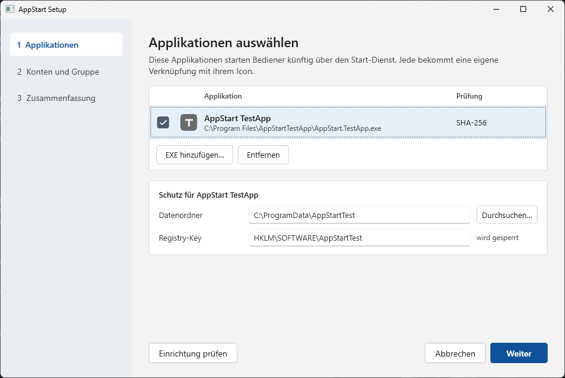

# Installation

There are two ways:

| Way | For | Procedure |
|---|---|---|
| **Interactive** with `AppStart-Setup.exe` | Installer at the PC | Start the installer, confirm UAC, setup in three steps |
| **Silent** with `AppStart-<Version>.msi` | Software distribution, scripts | `msiexec` without user interface, then setup through the command line |

Both ways install the same MSI to `C:\Program Files\AppStart`, register and start the service `AppStart` and create the folder "AppStart" in the Start menu:

| Entry | Opens |
|---|---|
| "AppStart – Setup" | The wizard (`AppStart.Setup.exe` without arguments) |
| "AppStart – Verify setup" | The verification view (`AppStart.Setup.exe verify --ui`), see [Verification after a service visit](06-verification-after-a-service-visit.md) |
| "AppStart – Manual" | This manual as a PDF |


After every installation and every update, the MSI verifies the setup automatically (`verify`) and stores the report under `C:\ProgramData\AppStart\Reports`. As long as the setup is not complete, this first report shows deviations, and the service runs but waits for the group `AppStart Users` (event 1301, see [Messages](07-messages-and-troubleshooting.md)). This is normal.

## Interactive installation with AppStart-Setup.exe

1. Copy `AppStart-Setup.exe` to the PC, e.g. to `Downloads`, and double-click it.
2. Confirm the UAC prompt with admin credentials. This is the only UAC prompt of the installation.
3. The installer shows "Installing AppStart …" with the note "Please wait. The installation can take a few minutes. Afterwards the setup starts." It extracts the embedded MSI to the protected folder `C:\ProgramData\AppStart\Installer\<Guid>` (never to `%TEMP%` or the download folder), installs it without further dialogs and then deletes the extracted copy.
4. It then checks whether `C:\Program Files\AppStart\current\AppStart.Setup.exe` is signed with the same certificate as the installer, and opens the wizard from it (step 1). The wizard inherits the admin rights; there is no second UAC prompt.


The installer stores logs under `C:\ProgramData\AppStart\Logs`:

| File | Content |
|---|---|
| `install-<YYYYMMDD-hhmmss>.log` | Verbose log of Windows Installer (`msiexec /l*v`) |
| `bootstrapper-<YYYYMMDD-hhmmss>.log` | Steps of the installer: version, mode, folder check, exit code of `msiexec`, signature check. For unsigned development builds, this log contains a "WARNING" line because the signature check was skipped. |

Error and information messages show a heading, the cause, a line "Action: …" and, if available, at the bottom "Log: C:\ProgramData\AppStart\Logs\install-20261115-104212.log". All messages with cause and action are listed in the chapter [Messages and troubleshooting](07-messages-and-troubleshooting.md#installationsprogramm). If an error occurs, the wizard does not start.

**Already installed:** If the same or a newer version of AppStart is installed, the installer skips the installation, reports "AppStart is already installed" and opens the wizard directly. This way you can also use `AppStart-Setup.exe` just to open the setup.

**Restart:** If Windows Installer reports that a restart is required (code 3010), "Restart required" appears. Complete the setup first, then restart the PC.

**Parameters of AppStart-Setup.exe** (details in the [Reference](09-reference.md#appstart-setup-exe)):

| Call | Effect |
|---|---|
| `AppStart-Setup.exe` | Installs AppStart and then starts the setup |
| `AppStart-Setup.exe /quiet` | Installs only, without user interface and without setup. Exit code = exit code of `msiexec` (0 or 3010 = success). If AppStart is already installed in the same or a newer version: exit code 0. |
| `AppStart-Setup.exe /quiet /config C:\Deploy\appstart.json` | Installs and then sets up in one step without user interface from the answer file: applications, protection, other programs and operators (format: [Reference → `apply`](09-reference.md#apply)). For software distribution as SYSTEM. Exit code 0 or 3010 = set up, 10 = setup with error or deviation, 11 = answer file invalid; output in `C:\ProgramData\AppStart\Logs\apply-….log`. The answer file does not create the local account `appstart-user` (no password in files). |
| `AppStart-Setup.exe /?` | Shows the help |

Without the installer (only the MSI available): install `AppStart-<Version>.msi` by double-clicking it or with `msiexec /i`, then open "AppStart – Setup" from the Start menu.

## Setup in three steps

The wizard "AppStart Setup" guides you through the setup in three steps. On the left it shows the steps "Applications", "Accounts and group" and "Summary"; completed steps are marked with a check mark. You can open it again at any time through "AppStart – Setup"; it then shows the existing configuration: approved applications, existing accounts and members of the group.

Buttons: "Cancel" (steps 1 and 2), "Back" (step 2), "Next", and after the setup "Open verification report" and "Finish".

### Step 1: Select applications



Heading "Select application", below it: "Operators will start these applications through the AppStart service. Each one gets its own shortcut with its icon."

1. Click "Add EXE…". In the dialog "Select program file" (filter `Programs (*.exe)|*.exe`), select one or more EXEs.
2. The setup reads each EXE and shows it in the list with the columns "Application" (name and path) and "Verification". The verification is "Signature" if the EXE is validly signed, otherwise "SHA-256".
3. Only checked applications are approved. "Remove" removes the selected application from the list; after "Next" and completion of the setup, its approval is revoked.
4. For the selected application, fill in the area "Protection for Application A" (name of the selected application). Below the heading it says: "The data folder and registry key are locked when the setup is applied: afterwards only appstart-app, SYSTEM and Administrators have access, operators do not. If the target is missing, the setup creates it. On uninstall the original permissions are restored. Leave empty if the application stores nothing there; then nothing is locked. Examples: `C:\ProgramData\<Vendor>\<App>` and `HKLM\SOFTWARE\<Vendor>\<App>`."
   - "Data folder": folder the application writes to (measured values, exchange files, logs), selectable with "Browse…" (dialog "Select data folder"). The application runs as `appstart-app` and may write there; operators can no longer see the folder afterwards. Leave empty if there is none.
   - "Registry key": key under `HKLM` in which the application stores settings or passwords, e.g. `HKLM\SOFTWARE\Vendor\AppA`. Note on the right: "will be locked". Operators can no longer open it in regedit afterwards.
   - **Do not choose the program folder as the data folder.** If the data folder is the folder of the EXE, lies inside it or contains it, a yellow box appears: "Caution: This data folder is the program folder of the application, lies inside it or contains it. appstart-app would get write access to the EXE and DLLs. The verification detects a replaced EXE, but not replaced DLLs. A folder under C:\ProgramData is recommended, e.g. `C:\ProgramData\<Vendor>\<App>`." "Next" stays disabled until you change the folder or check "I understand the risk, use this folder anyway". The summary in step 3 and the command line also report it as "Warning: Data folder … of … lies in the program folder of the application or contains it. appstart-app can then change the EXE and DLLs; the hash and signature check does not detect replaced DLLs. Recommended: a folder under C:\ProgramData, e.g. `C:\ProgramData\<Vendor>\<App>`".
5. "Next".

At the bottom left, "Verify setup" opens the verification view with the current state at any time, without changing anything (see [Verification after a service visit](06-verification-after-a-service-visit.md)).

Empty list: "No application yet. Choose a program file with "Add EXE…"."

Notes and errors in step 1:

| Message | Cause | Action |
|---|---|---|
| "Select at least one application." | No application checked. "Next" is disabled. | Check at least one application |
| "The data folder of Application A lies in the program folder: change it or confirm the risk." | The data folder warning is open for a checked application. "Next" is disabled. | Select the application, change the data folder or confirm the risk |
| "The data folder must be a full path, e.g. C:\ProgramData\Vendor\App." | Relative path or network path | Enter a full path with drive letter |
| "The registry key must start with HKLM\\." | Key under `HKCU` or without a root | Enter a key under `HKLM\`. AppStart cannot protect keys of the user (`HKCU`). |
| "AppA.exe cannot be added: …" | The EXE cannot be read or is currently locked; the reason follows the colon | Check the path and permissions, close the running application, add it again |
| "The existing configuration could not be read: …" | `apps.json` is invalid or not readable | See check [apps.json](06-verification-after-a-service-visit.md#appsjson); if necessary, restore `apps.json` from a backup |

### Step 2: Accounts and group


Heading "Accounts and group", below it: "The applications run under a dedicated account. Only members of the group may use the launcher."

- **"App account appstart-app"** (badge "automatic"): always set up. Text on first installation: "Will be created. Admin rights, random password per PC, no interactive sign-in and no Remote Desktop." With an existing setup: "Exists and will be verified. Admin rights, random password per PC, no interactive sign-in and no Remote Desktop."
- **"Create operator account appstart-user"**: check this if the operators should use a shared local account. Then fill in "Password" and "Confirm password". Note: "Standard user without admin rights, member of the group AppStart Users." If the account already exists, it shows "Operator account appstart-user already exists" with the badge "exists"; the setup does not change its password.
- **"Other members of the group AppStart Users"**: enter existing users (field "Add user", placeholder `DOMAIN\user`) and click "Add". The button "Remove member" next to an entry removes it again.

Messages in step 2:

| Message | Cause | Action |
|---|---|---|
| "Please enter a password." | Operator account checked, password empty | Enter a password or clear the check box |
| "The passwords do not match." | "Password" and "Confirm password" differ | Enter both fields again |
| "Enter the account as DOMAIN\user, .\user or user." | Invalid notation of the account | Enter the account in one of the three notations |
| "This account is already in the list." | Account entered twice | – |

The setup only checks in step 3 whether an entered account exists. An unknown account or a group (instead of a user) leads to "Accounts and group could not be set up" there.

### Step 3: Summary and verification

"Next" in step 2 starts the setup. Heading "Setup running", text "The steps are being carried out. Please wait." Below it the progress appears: "Starting setup…", then one after the other

1. "Setting up accounts and group …"
2. "Writing configuration …"
3. "Locking data folders and registry keys …"
4. "Creating shortcuts …"
5. "Verifying service …"
6. "Final verification running…" (`verify`)


While the setup is running, you cannot close the window. Afterwards there is one line per step with ✓ (successful) or ✗ (failed, with reason). On success:

- ✓ "Accounts appstart-app and appstart-user, group AppStart Users created" (or "Account appstart-app and group AppStart Users created" without an operator account)
- ✓ "2 applications approved, configuration protected"
- ✓ "Data folders and registry keys locked"
- ✓ "Shortcuts with app icon created, 2 old shortcuts backed up" (number of replaced shortcuts that pointed directly to the EXE)
- ✓ "Service AppStart is running, starts automatically"


Finally, the result of the verification and the path of the report:

| Heading and text | Meaning |
|---|---|
| "Setup complete" – "All steps were carried out. The final verification passed." with "Verification passed – 10 of 10 checks passed" | Done. Close with "Finish" (exit code 0). |
| "Setup complete" – "All steps were carried out. The final verification found deviations." with "Verification failed – 1 deviation, 9 of 10 checks passed" or "Verification failed – 2 deviations, 8 of 10 checks passed" | Open the report, correct the deviations as described in [Verification after a service visit](06-verification-after-a-service-visit.md), run the setup again |
| "Setup incomplete" – "Not all steps succeeded. The verification shows what is missing." | At least one line with ✗. Reason in the line, action in the chapter [Messages and troubleshooting](07-messages-and-troubleshooting.md) |

Other lines that can appear:

| Message | Meaning |
|---|---|
| "Report: C:\ProgramData\AppStart\Reports\verify-2026-11-15-104212.html" | Path of the stored verification report |
| "Setup aborted: …" | Unexpected error; the reason follows the colon. Run the setup again. |
| "Verification could not be run: …" | `verify` failed. Repeat it through the Start menu entry "AppStart – Verify setup". |
| "Report could not be saved: …" | `C:\ProgramData\AppStart\Reports` is not writable or full |
| "The report cannot be opened: …" | No program for `.html` files. Open the report with a browser. |

"Open verification report" shows the report in the default browser. "Finish" closes the wizard.

**Cancel:** "Cancel" in step 1 or 2 changes nothing on the system (exit code 2). AppStart remains installed, you can start the wizard again through "AppStart – Setup", and `verify` reports the missing setup as a deviation.

Exit codes of the wizard: 0 = set up and verification passed, 1 = error or deviations, 2 = canceled before the setup.

## Silent installation

For software distribution and scripts. Everything runs without a user interface, as SYSTEM or in a command prompt opened with "Run as administrator".

**1. Install the MSI**

```text
msiexec /i AppStart-<Version>.msi /qn /l*v C:\Windows\Temp\AppStart-msi.log
```

AppStart is then installed under `C:\Program Files\AppStart`, the service is running (waiting for the setup), and no user interface appears. Exit codes of `msiexec`: 0 = success, 3010 = success, restart required, 1618 = another installation is in progress (try again later), otherwise check the log file.

**2. Approve applications, set up accounts, verify**

```text
set SETUP="C:\Program Files\AppStart\current\AppStart.Setup.exe"
%SETUP% add --exe "C:\Program Files\Vendor\AppA\AppA.exe" --data-dir "C:\ProgramData\Vendor\AppA" --reg-key "HKLM\SOFTWARE\Vendor\AppA" --name "Application A"
%SETUP% add --exe "C:\Program Files\Vendor\AppB\AppB.exe"
%SETUP% add-user --member "DOMAIN\operator01"
%SETUP% verify --report "C:\Windows\Temp\appstart-verification.html"
```

Every changing command (`add`, `add-user`, `remove`, `rehash`) writes one line per step with ✓ or ✗, then "Automatic verification after the change:" with the result of `verify`, and ends with exit code 0 (everything successful and no deviation), 1 (error or deviation) or 2 (invalid input for `add-user`). The result of the final `verify` is what counts for completion. All commands and options: [Reference](09-reference.md).

**Operator account `appstart-user` without input:** The password is passed as one line through standard input and therefore does not appear on any command line:

```text
%SETUP% add-user --name appstart-user --password-stdin < password.txt
```

Delete the file immediately afterwards. Without `--password-stdin`, the command prompts "Password for appstart-user: " and "Repeat password: " in the console.

**From PowerShell**, a call with `Start-Process` waits for the end and returns the exit code:

```powershell
$setup = 'C:\Program Files\AppStart\current\AppStart.Setup.exe'
$p = Start-Process $setup -ArgumentList 'verify' -Wait -PassThru -NoNewWindow
if ($p.ExitCode -ne 0) { throw "AppStart: verification failed (exit code $($p.ExitCode))" }
```

## After the installation

1. Look at the verification report: result "No deviation" (see [Verification after a service visit](06-verification-after-a-service-visit.md)).
2. Sign in as an operator (member of `AppStart Users`) and start the application through its shortcut in the Start menu or on the desktop. It appears without a UAC prompt.
3. For the acceptance test, approve and check the test application (next section).

## Acceptance test with the test application

The test application `C:\Program Files\AppStart\current\TestApp\AppStart.TestApp.exe` is installed with AppStart but not approved automatically. It behaves like an affected fat client: it requires admin rights, writes a test password in plain text to `HKLM\SOFTWARE\AppStartTest` and exchange files to `C:\ProgramData\AppStartTest`.

```text
%SETUP% add --exe "C:\Program Files\AppStart\current\TestApp\AppStart.TestApp.exe" --data-dir "C:\ProgramData\AppStartTest" --reg-key "HKLM\SOFTWARE\AppStartTest" --name "AppStart TestApp"
```


Window "AppStart TestApp", heading "State of the test application", below it "Checks whether starting through AppStart works as intended." Each row shows a value and a badge:

| Row | Expected when started through AppStart | Deviation |
|---|---|---|
| "Running account" | `<PC>\appstart-app`, "OK" | "Not via AppStart": the TestApp runs under a different account, so it was not started through AppStart |
| "Admin rights" | "Yes", "OK" | "No", "Error" |
| "Read/write registry" | `HKLM\SOFTWARE\AppStartTest`, "OK" | "Error" with reason: key locked without `appstart-app` or wrong permissions |
| "Read/write files" | `C:\ProgramData\AppStartTest`, "OK" | "Error" with reason |
| "Child process (cmd.exe)" | after clicking "Start command prompt": "Start blocked by job object" (mode "blocked") or "Ended immediately by AppStart (not allowed)" (mode "allowed helper programs only"), each with "OK" | "Started – breakout possible" with the badge "Breakout": mode "all allowed" or the command prompt is on the list. "Start failed: …" with the badge "Check": other error, read the reason. |
| "Helper program (TestHelper)" | after clicking "Start allowed helper program", depending on the mode of the TestApp (see [Other programs](04-managing-applications.md)): "Started and ended: AppStart TestHelper running as …" with "Allowed" if `AppStart.TestHelper.exe` is allowed; "Start blocked by job object (mode blocked)" or "Ended immediately by AppStart (not on the list)" with "Blocked" | "Start failed: …" with "Check" |

The helper program `AppStart.TestHelper.exe` is located next to the TestApp. To try out the allowlist: `%SETUP% allow-child --app appstart-testapp --exe "C:\Program Files\AppStart\current\TestApp\AppStart.TestHelper.exe"`. After that, the helper program starts, whereas AppStart ends the command prompt immediately.

Before the first check, the child process row shows "Not checked yet" with the badge "Open". "Check again" repeats the checks and shows "Checked at 10:42:17". In the field "Test value" (default "Test value 42") you can enter a value; "Save to registry and file" writes it and shows "Saved at 10:42:30" or "Saving failed: …".

Acceptance steps:

1. As an operator, start through the shortcut "AppStart TestApp": all indicators "OK".
2. As an operator, open `HKLM\SOFTWARE\AppStartTest` in regedit: access denied.
3. As an operator, open `C:\ProgramData\AppStartTest` in Explorer: access denied.
4. As an operator, start `AppStart.TestApp.exe` directly: message "AppStart TestApp" – "The test application needs administrator rights and will exit." "Please start it through the AppStart shortcut."
5. In the TestApp, "Start command prompt": "Start blocked by job object".
6. As an administrator, change one byte of the TestApp EXE (on a copy on the test VM): the start through the shortcut is rejected with "Launch denied", event 1201.
7. `AppStart.Setup.exe verify` returns exit code 0; after a deliberate misconfiguration (e.g. adding an operator to the Administrators group) a non-zero code.

After the acceptance test, revoke the approval of the TestApp with `AppStart.Setup.exe remove --app appstart-testapp` if it is not needed. `AppStart.Setup.exe list` shows the AppId.
