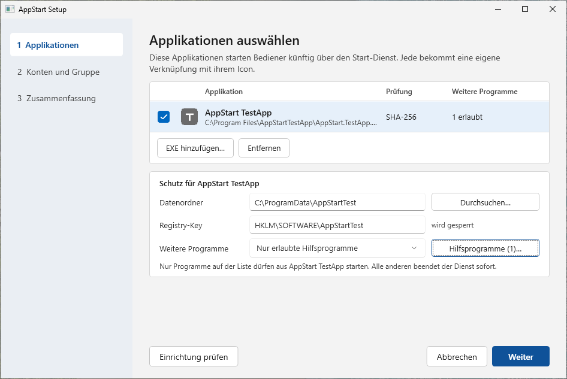
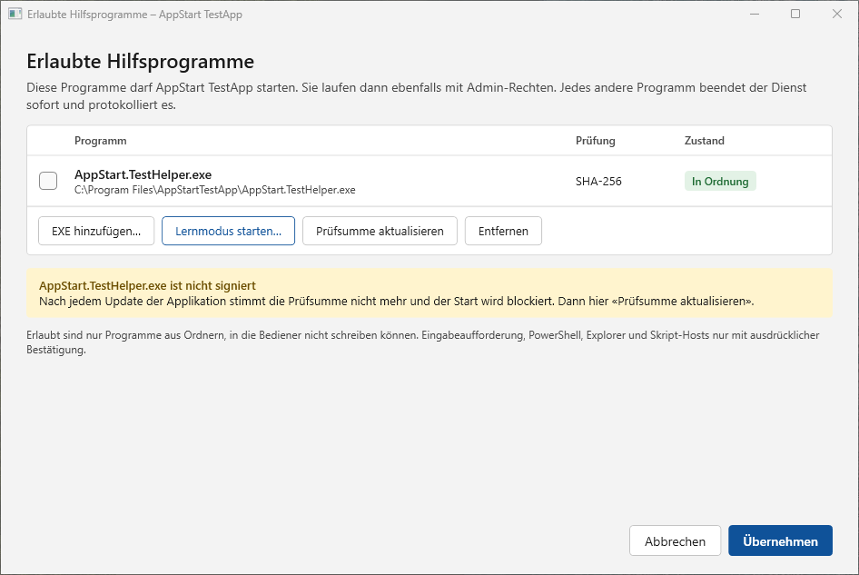
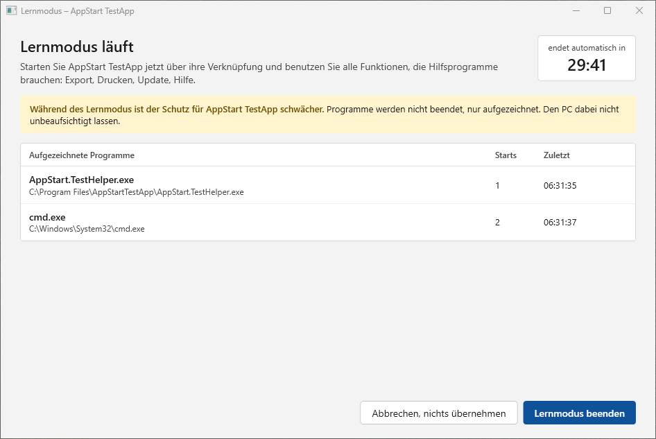
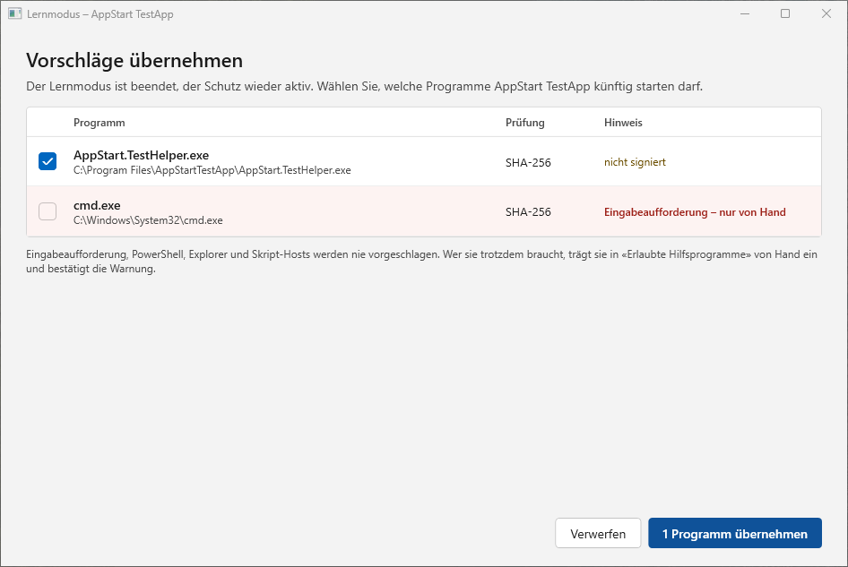

# Managing applications

All changes are made through the wizard ("AppStart – Setup") or the command line `AppStart.Setup.exe` with admin rights. You do not need to edit `apps.json` by hand. After every change, `verify` runs automatically; the report is stored under `C:\ProgramData\AppStart\Reports`.

In the examples, `%SETUP%` stands for `"C:\Program Files\AppStart\current\AppStart.Setup.exe"`.

## Showing approved applications

```text
%SETUP% list
```

Output per application: AppId and name, below it the EXE and verification type ("Signature" or "SHA-256") and the mode for other programs. Then the members of the group and the state of the service:

```text
app-a                Application A
                     C:\Program Files\Vendor\AppA\AppA.exe (Signature)
                     Other programs: blocked
appstart-testapp     AppStart TestApp
                     C:\Program Files\AppStart\current\TestApp\AppStart.TestApp.exe (SHA-256)
                     Other programs: blocked

Group AppStart Users: PC-014\appstart-user, DOMAIN\operator01
Service AppStart: running
```

Without any approval it shows "No application approved.", without members "Group AppStart Users: –", and with a stopped service "Service AppStart: not running".

## Adding an application

**In the wizard:** Open "AppStart – Setup", in step 1 click "Add EXE…", enter the data folder and registry key, "Next", leave step 2 unchanged, "Next". Existing applications remain checked and unchanged.

**Through the command line:**

```text
%SETUP% add --exe "C:\Program Files\Vendor\AppA\AppA.exe" --data-dir "C:\ProgramData\Vendor\AppA" --reg-key "HKLM\SOFTWARE\Vendor\AppA" --name "Application A"
```

What the setup does:

1. Reads the EXE: if it is validly signed, the thumbprint of the certificate is recorded (verification type "Signature"), otherwise the SHA-256 checksum.
2. Derives the AppId from the file name (`AppA.exe` → `appa`, `AppStart.TestApp.exe` → `appstart-testapp`); if the AppId is already taken, with the suffix `-2`, `-3` …
3. Writes the entry to `apps.json`, file protected (only SYSTEM and Administrators).
4. Locks the data folder and registry key: access only for `appstart-app`, SYSTEM and Administrators. The original permissions are backed up and restored on `remove` and `uninstall`.
5. Backs up shortcuts that point directly to the EXE (public Start menu, public desktop, desktop and Start menu of every user profile) to `C:\ProgramData\AppStart\ShortcutBackup` and removes them.
6. Creates a new shortcut `<Name>.lnk` in the public Start menu (`C:\ProgramData\Microsoft\Windows\Start Menu\Programs`) and on the public desktop (`C:\Users\Public\Desktop`): target `AppStart.Launcher.exe --app <AppId>`, icon from the EXE, working folder = folder of the EXE.
7. Checks the service and starts it if necessary, then runs `verify`.

If the EXE is already approved, `add` updates the approval: new signature or checksum and, if specified, new name, data folder or registry key. Otherwise the AppId and previous settings are kept.

> **Note:** If a shortcut with the same name that does not come from AppStart already exists at the target location, the setup does not overwrite it and reports "Shortcuts could not be created: The shortcut "…" already exists and does not belong to this application. It is not overwritten. Please check the file and back it up or remove it by hand." Check the file, remove it and repeat the command, or choose a different name with `--name`.

## Changing the data folder or registry key

```text
%SETUP% add --exe "C:\Program Files\Vendor\AppA\AppA.exe" --data-dir "D:\Data\AppA"
```

A newly specified folder or key is locked in addition. A previously locked folder stays locked until the application is removed. If the old folder should be accessible again: remove the application with `remove` and add it again with the new settings.

## Removing an application

**In the wizard:** In step 1, select the application and click "Remove" (or clear its check box), then "Next", "Next".

**Through the command line:**

```text
%SETUP% remove --app app-a
```

The setup revokes the approval and restores:

- the permissions of the data folder and registry key to the state before the approval,
- the backed-up shortcuts that pointed directly to the EXE,
- and it deletes the AppStart shortcuts of the application.

The application itself remains installed. Unknown AppId: "Application "app-x" is not approved", exit code 1. `list` shows the AppIds.

## After an update of the application

| Verification type | What to do |
|---|---|
| "Signature" | Nothing, as long as the vendor signs with the same certificate. If the vendor uses a new certificate (e.g. after expiry), the service denies the start (event 1201, "Signature valid, but foreign certificate"). Then run `rehash`. |
| "SHA-256" | **Always** run `rehash`, otherwise the service denies every start (message "Launch denied", event 1201). |

```text
%SETUP% rehash --app app-a
```

`rehash` reads the EXE again and records the signature or checksum again. If the EXE is now signed, the verification type changes to "Signature". Then `verify` runs.

> **Caution:** Only run `rehash` once it is certain that the new EXE comes from the vendor (update log, signature in the file properties). Without a known update, a modified EXE is a security incident.

After the update, also check:

- Has the update of the application created its own shortcuts that point directly to the EXE? `verify` reports them under "Shortcuts". Fix: run the setup again ("AppStart – Setup", "Next", "Next") or `rehash`; the setup backs up and removes such shortcuts.
- Has the update reset the permissions of the data folder or registry key? `verify` reports it under "Data folder per app" or "Registry key per app". Fix as above.
- Is the EXE located at a new path? Then revoke the old approval with `remove` and approve the new EXE with `add`.

## Other programs (helper programs)

Some applications start their own helper programs, for example for export, update or PDF viewing. One of three modes applies per application:

| Mode | Display | Effect |
|---|---|---|
| `blocked` | blocked | Default. The application cannot start other programs. |
| `allowlist` | allowed helper programs only | Only programs from the list start, verified with signature or SHA-256. The service ends any other program immediately (event 1206). |
| `all` | all allowed (unsafe) | Every program starts, including a command prompt **with admin rights**. Only after careful consideration and with a note in the Service and Security Manual. |

The Windows console window (`conhost.exe` from `C:\Windows\System32`) is always allowed; without it, console helper programs show no window.

### In the wizard

In step 1, the column "Other programs" shows the mode of each application, e.g. "2 allowed", "blocked" or "all allowed". Under "Protection for …", choose one of the following for "Other programs":

- "Blocked (recommended)": note "Application … cannot start other programs."
- "Allowed helper programs only": note "Only programs on the list may start from …. The service ends all others immediately." Next to it, "Helper programs (2)…" opens the list. As long as it is empty, it shows "Add at least one helper program ("Helper programs…") or choose "Blocked"." and "Next" stays disabled.
- "All allowed (unsafe)": only after the confirmation "Allow all other programs?" with the text "Application A may then start any program, including a command prompt with admin rights. Operators can use this to bypass the protection. Only after careful consideration and with a note in the Service and Security Manual." Afterwards the note "Application A may start any program, including a command prompt with admin rights."

The changes only take effect when you complete the wizard with "Next".



**Dialog "Allowed helper programs – Application A".** Heading "Allowed helper programs", below it "Application A may start these programs. They then also run with admin rights. The service ends any other program immediately and logs it." The list shows the "Program", its "Verification" and its "State":

| State | Meaning |
|---|---|
| "OK" | File present, signature or checksum matches. |
| "New checksum" | The file has changed, usually after an update. "Update checksum" records it again (for the selected entries, otherwise for all with SHA-256). |
| "File missing" | Program uninstalled or moved. Remove it or add it again. |
| "Verification failed" | Signature invalid or file not readable. Remove it and add it again. |

Buttons: "Add EXE…", "Start learning mode…", "Update checksum", "Remove" (selected entries). If a program is not signed, the yellow note "Updater.exe is not signed" appears with "After every update of the application the checksum no longer matches and the start is blocked. Then click "Update checksum" here." At the bottom: "Only programs from folders that operators cannot write to are allowed. Command prompt, PowerShell, Explorer and script hosts only with explicit confirmation."

- If you select a shell, the dialog asks "Allow cmd.exe?" with "This is a shell or a script host. Whoever operates the application can use it to start any program with admin rights."
- If the program is located in a folder that operators can write to: "Export.exe cannot be allowed: operators can write to its folder. Install the program in a protected folder."

"Apply" returns the list to the wizard, "Cancel" discards the changes in the dialog.



### Learning mode: finding helper programs

Which programs an application needs is often not known. Learning mode records it: for a limited time, the service ends nothing for this application but records every started program (event 1102). Afterwards the configured mode applies again, even in an application that is still running.

Learning mode is only possible once the application is set up. Otherwise the dialog reports "Learning mode is only possible once Application A is set up. Finish the wizard first, then open this again."

1. In the dialog "Allowed helper programs", click "Start learning mode…". "Learning mode – Application A" opens with the heading "Learning mode running" and the text "Start Application A now through its shortcut and use all functions that need helper programs: export, print, update, help." At the top right, "ends automatically in" counts down from 30:00.
2. The yellow note "During learning mode the protection for Application A is weaker." "Programs are not ended, only recorded. Do not leave the PC unattended meanwhile." applies literally.
3. The list "Recorded programs" shows "Starts" and "Last" per program, initially "Nothing recorded yet."
4. "End learning mode" (or expiry of the time) leads to "Apply suggestions". "Cancel, apply nothing" ends learning mode and deletes the recording. If learning mode cannot start, the dialog shows "Learning mode could not be started: …" with the reason.



**Dialog "Apply suggestions".** "Learning mode has ended, the protection is active again. Choose which programs Application A may start from now on." Validly signed programs are suggested with signature, all others with SHA-256. The column "Note":

| Note | Preselection |
|---|---|
| "–" | checked |
| "not signed" | checked, verification SHA-256 |
| "can open files – consider carefully" (e.g. PDF viewer, browser, editor) | not checked. With admin rights, the program can open and save any file. |
| "command prompt – manual only", "shell or script host – manual only" | not selectable |
| "folder writable by operators" | not selectable |

At the bottom: "Command prompt, PowerShell, Explorer and script hosts are never suggested. Whoever still needs them adds them by hand in "Allowed helper programs" and confirms the warning." "Apply 2 programs" (for one: "Apply 1 program") adds the checked programs to the list, "Discard" adds nothing; both delete the recording. If nothing was recorded: "Nothing was recorded. Was the application started through its shortcut during learning mode?"



Messages of learning mode on the command line:

| Message | Meaning |
|---|---|
| "Learning mode for "app-a" started, ends automatically at 10:55" | Learning mode is running (event 1400). |
| "Learning mode for "app-a" ended" | Ended by hand (event 1401). |
| "Learning mode for "app-a" was not active" | Nothing to end. |
| "Learning mode duration: 5 to 120 minutes." | Invalid duration, nothing changed. |
| "Nothing was recorded for "app-a". Run learn start first and use the application." | No recording available. |
| "… is not in the recording." | Specify the path as in the recording. |
| "cmd.exe is a shell or a script host and is never applied. If needed, by hand: allow-child --allow-shell." | Learning mode never applies shells. |
| "There are no suggestions to apply for "app-a" (only shells or script hosts recorded)." | Nothing to apply. |
| "2 helper program(s) from learning mode applied for "app-a", recording deleted" | Done, mode "allowed helper programs only". |

### On the command line

Allow a helper program; the mode becomes "allowed helper programs only":

```text
%SETUP% allow-child --app app-a --exe "C:\Program Files\Vendor\AppA\Export.exe"
```

Output: "Helper program … allowed for "app-a" (Signature)" or "(SHA-256)" and "Other programs for "app-a": allowed helper programs only". If the program is validly signed, the signature applies, otherwise the checksum. An entry with the same path is replaced.

Remove a helper program: "Helper program … removed for "app-a"". For the last entry, additionally "Last helper program removed: other programs for "app-a" blocked again".

After an update of unsigned helper programs, the checksum no longer matches and the service ends them. `rehash` records them again: "Checksums of the helper programs of "app-a" recorded again (1)".

Messages for which nothing is changed:

| Message | Meaning |
|---|---|
| "… is a shell or a script host. Allowed only with explicit confirmation (--allow-shell)." | AppStart allows the command prompt, PowerShell, Explorer, script hosts, `rundll32.exe`, `regsvr32.exe` and `mshta.exe` only if you confirm it explicitly. With them, every operator can start any program with admin rights. |
| "Helper program not allowed: … lies in a folder that operators can write to" | An operator could replace the file. Install the program in a protected folder (e.g. under `C:\Program Files`). |
| "… is not validly signed. Check "signature" not possible, use "sha256"." | Specified with `--check signature`, but the file has no valid signature. |
| ""…" is not a path to an EXE.", "… does not exist." | Check the path. |
| ""allowed helper programs only" needs at least one helper program. Run allow-child first." | The mode can only be set with at least one entry. |
| "Helper program … is not in the list of "app-a"" | When removing or with `rehash --child`: specify the path as shown by `list`. |

Set the mode directly, e.g. allow all: "Other programs for "app-a": all allowed (unsafe)". The service reads `apps.json` again for every start; a restart of the service is not required.
