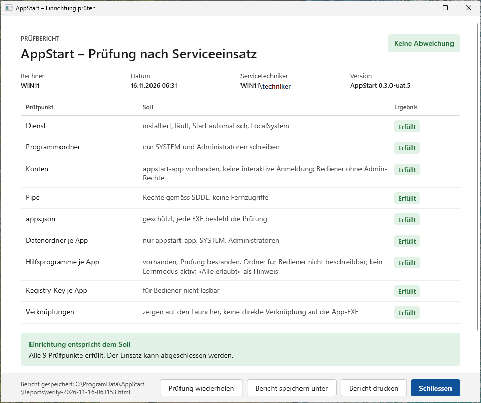
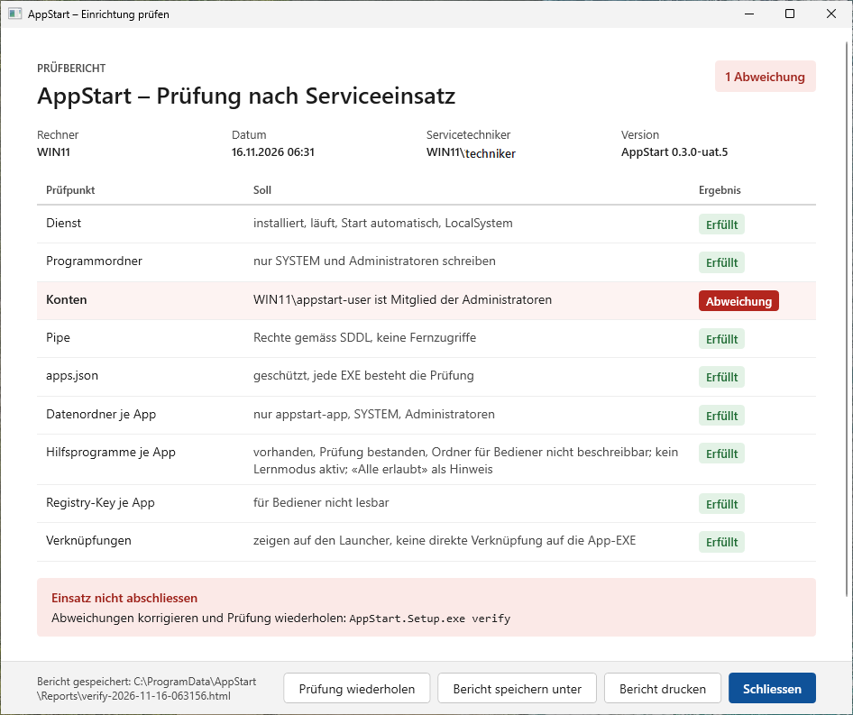
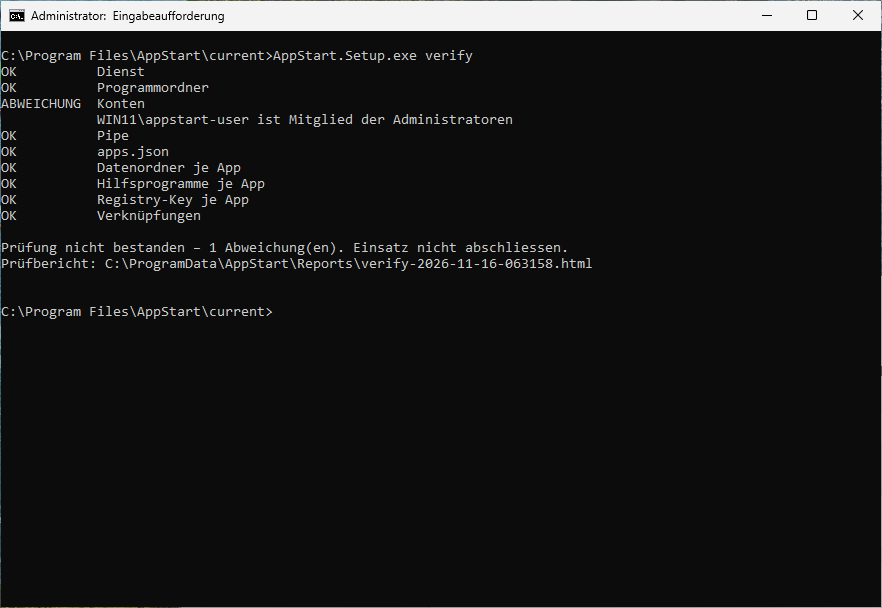

# Prüfung nach Serviceeinsatz

`verify` prüft die gesamte Einrichtung gegen das Soll und legt einen Prüfbericht ab. Es ändert nichts am System.

Das Service and Security Manual verlangt die Prüfung **nach der Installation und am Ende jedes Serviceeinsatzes**, etwa wenn ein Techniker vorübergehend Rechte geändert, Benutzer in die Administratoren aufgenommen oder eine Applikation aktualisiert hat. Der Bericht wird dem Einsatz beigelegt. Ein Einsatz ist erst abgeschlossen, wenn der Bericht «Keine Abweichung» zeigt.

## Prüfung starten

| Weg | Ablauf |
|---|---|
| **Startmenü** (Standardweg) | «AppStart» → «AppStart – Einrichtung prüfen». UAC-Abfrage mit Admin-Zugangsdaten bestätigen. Die Prüfansicht öffnet sich und prüft sofort. |
| **Assistent** | «AppStart – Einrichtung», in Schritt 1 unten links «Einrichtung prüfen». Gleiche Prüfansicht. |
| **Automatisch** | Am Ende der Einrichtung im Assistenten, nach jedem ändernden Befehl der Kommandozeile und nach jeder Installation und jedem Update des MSI. Der Bericht wird jeweils abgelegt. |
| **Kommandozeile** | `AppStart.Setup.exe verify [--report "<Pfad>"]` in einer Eingabeaufforderung «Als Administrator ausführen». Exit-Code 0 nur ohne Abweichung, sonst 1. |

Bediener können die Prüfung nicht starten, da sie Admin-Rechte verlangt.

## Prüfansicht



Fenster «AppStart – Einrichtung prüfen». Während der Prüfung steht «Prüfung läuft…». Danach:

- Kopf: «PRÜFBERICHT», Überschrift «AppStart – Prüfung nach Serviceeinsatz», rechts das Ergebnis: «Keine Abweichung», «1 Abweichung» oder z.B. «3 Abweichungen».
- Angaben: «Rechner» (Computername), «Datum» (z.B. 15.11.2026 10:42), «Servicetechniker» (angemeldetes Konto), «Version» (z.B. «AppStart 0.2.0»).
- Tabelle mit den Spalten «Prüfpunkt», «Soll» und «Ergebnis» («Erfüllt» oder «Abweichung»). Bei einer Abweichung steht statt des Solls die gefundene Abweichung, darunter das Soll.
- Bei Abweichungen ein roter Kasten «Einsatz nicht abschliessen» mit «Abweichungen korrigieren und Prüfung wiederholen:» und dem Befehl `AppStart.Setup.exe verify`.
- Ohne Abweichung ein grüner Kasten «Einrichtung entspricht dem Soll» mit «Alle 10 Prüfpunkte erfüllt. Der Einsatz kann abgeschlossen werden.»
- Unten die Felder «Unterschrift Servicetechniker» und «Unterschrift Kunde» für den ausgedruckten Bericht.



Knöpfe:

| Knopf | Wirkung |
|---|---|
| «Bericht drucken» | Druckt den Bericht (Druckauftrag «AppStart Prüfbericht») |
| «Bericht speichern unter» | Kopiert den abgelegten HTML-Bericht an einen frei wählbaren Ort, z.B. auf einen USB-Stick. Dialog «Bericht speichern unter». |
| «Prüfung wiederholen» | Prüft erneut und legt einen neuen Bericht ab |
| «Schliessen» | Schliesst die Ansicht. Exit-Code 0 ohne Abweichung, sonst 1. |

Im Dialog «Bericht speichern unter» ist der Dateityp `Prüfbericht (*.html)|*.html` vorgewählt.

Meldungen der Prüfansicht:

| Meldung | Bedeutung und Massnahme |
|---|---|
| «Bericht gespeichert: C:\ProgramData\AppStart\Reports\verify-2026-11-15-104212.html» | Bericht automatisch abgelegt |
| «Bericht kopiert nach E:\Einsatz\verify-2026-11-15-104212.html» | «Bericht speichern unter» war erfolgreich |
| «Bericht konnte nicht gespeichert werden: …» | `C:\ProgramData\AppStart\Reports` nicht beschreibbar oder Laufwerk voll. Platz schaffen, Prüfung wiederholen. |
| «Der Bericht konnte nicht kopiert werden: …» | Ziel nicht beschreibbar (schreibgeschützter Stick, fehlende Rechte). Anderes Ziel wählen. |
| «Der Bericht konnte nicht gedruckt werden: …» | Kein Drucker oder Druckerfehler. Bericht speichern und später drucken. |
| «Prüfung konnte nicht ausgeführt werden: …» | Unerwarteter Fehler. Grund lesen, Prüfung über die Kommandozeile wiederholen, sonst Service. |

## Prüfbericht und Ablage

Jede Prüfung legt zwei Dateien unter `C:\ProgramData\AppStart\Reports` ab, benannt mit Datum und Uhrzeit:

| Datei | Inhalt |
|---|---|
| `verify-<JJJJ-MM-TT-hhmmss>.html` | Lesbarer Bericht «Prüfbericht AppStart», gleiche Gliederung wie die Prüfansicht. Abweichende Zeilen sind rot; ihr Soll steht nach «Soll:». Bei Abweichungen listet der Kasten «Einsatz nicht abschliessen» alle Abweichungen und endet mit «Korrigieren und Prüfung wiederholen:» `AppStart.Setup.exe verify`. Ohne Abweichung: «Prüfung bestanden – 10 von 10 Prüfpunkten erfüllt». |
| `verify-<JJJJ-MM-TT-hhmmss>.json` | Dieselben Angaben maschinenlesbar, für Auswertungen |

Mit `verify --report "<Pfad>"` wird der HTML-Bericht zusätzlich an den angegebenen Ort kopiert. Berichte bleiben auch nach `uninstall` erhalten. Für den Einsatz: Bericht ausdrucken und unterschreiben oder die HTML-Datei dem Einsatzrapport beilegen.

Jede Zeile im HTML-Bericht trägt die Kennung des Prüfpunkts (z.B. `#pipe`); sie entspricht den Abschnitten unten.

## Ausgabe auf der Kommandozeile

```text
OK          Dienst
OK          Programmordner
ABWEICHUNG  Konten
            appstart-user ist Mitglied der Administratoren
OK          Administratoren mit Passwort
OK          Pipe
OK          apps.json
OK          Datenordner je App
OK          Registry-Key je App
OK          Verknüpfungen

Prüfung nicht bestanden – 1 Abweichung(en). Einsatz nicht abschliessen.
Prüfbericht: C:\ProgramData\AppStart\Reports\verify-2026-11-15-104212.html
```

Ohne Abweichung lautet die vorletzte Zeile «Prüfung bestanden – 10 von 10 Prüfpunkten erfüllt.»



## Die zehn Prüfpunkte

Je Prüfpunkt: das Soll, jede mögliche Abweichung, wie sie im Bericht steht, mit Ursache und Behebung. Werte in spitzen Klammern ersetzt der Bericht durch die gefundenen Namen und Pfade. Nach jeder Behebung die Prüfung wiederholen.

**Einrichtung erneut ausführen** heisst in den Tabellen: Startmenü «AppStart – Einrichtung», Schritt 1 und 2 unverändert lassen, zweimal «Weiter». Das Setup legt fehlende Konten, Gruppe und Verknüpfungen neu an, schützt `apps.json` und sperrt Datenordner und Registry-Keys erneut, ohne die Freigaben zu ändern. Gleichwertig auf der Kommandozeile: `AppStart.Setup.exe rehash --app <AppId>` (erfasst dabei auch Signatur bzw. Prüfsumme dieser Applikation neu).

Bei jedem Prüfpunkt möglich:

| Abweichung | Ursache | Behebung |
|---|---|---|
| «Prüfung nicht möglich: \<Grund>» | Der Prüfpunkt konnte nicht ausgewertet werden, z.B. Zugriff verweigert, weil `verify` ohne Admin-Rechte lief | Prüfung mit Admin-Rechten wiederholen. Bleibt es, den Grund an den Service melden. Ein nicht prüfbarer Punkt gilt immer als Abweichung. |

<a id="dienst"></a>
### Dienst

**Soll:** installiert, läuft, Start automatisch, LocalSystem

| Abweichung | Ursache | Behebung |
|---|---|---|
| «Dienst «AppStart» ist nicht installiert» | MSI nicht installiert, Installation abgebrochen oder Dienst von Hand gelöscht | MSI erneut installieren: `AppStart-Setup.exe` oder `msiexec /i AppStart-<Version>.msi /qn`. Die Einrichtung bleibt erhalten. |
| «Dienst «AppStart» läuft nicht (Status: \<Status>)» | Dienst gestoppt oder abgestürzt. Status: «beendet», «wird gestartet», «wird beendet», «wird fortgesetzt», «wird angehalten», «angehalten» oder «unbekannt (\<Nummer>)» | Ereignisprotokoll (Quelle AppStart) prüfen, besonders 1300 und 1301. Dienst starten: `sc start AppStart` oder «Dienste» → AppStart → Starten. «wird gestartet» kurz nach einem Neustart: Prüfung nach einer Minute wiederholen. |
| «Dienst «AppStart» startet nicht automatisch (Starttyp: \<Starttyp>)» | Starttyp geändert. Starttyp: «manuell», «deaktiviert», «Boot», «System» oder «unbekannt (\<Nummer>)» | `sc config AppStart start= auto` (Leerzeichen nach `=` beachten), danach `sc start AppStart` |
| «Dienst «AppStart» läuft unter «\<Konto>» statt LocalSystem» | Anmeldekonto des Dienstes geändert | `sc config AppStart obj= LocalSystem`, Dienst neu starten. Wer hat das Konto geändert? Als möglichen Sicherheitsvorfall behandeln. |

<a id="programmordner"></a>
### Programmordner

**Soll:** nur SYSTEM und Administratoren schreiben

Geprüft wird `C:\Program Files\AppStart`. Könnte ein Bediener dort schreiben, könnte er die Dienst-EXE austauschen und SYSTEM-Rechte erlangen.

| Abweichung | Ursache | Behebung |
|---|---|---|
| «Programmordner C:\Program Files\AppStart fehlt» | AppStart nicht installiert oder Ordner gelöscht | MSI erneut installieren |
| «C:\Program Files\AppStart: Besitzer \<Konto> ist nicht SYSTEM, Administratoren oder TrustedInstaller.» | Besitz des Ordners wurde übernommen, z.B. von einem Benutzerkonto | Besitzer zurücksetzen: `icacls "C:\Program Files\AppStart" /setowner *S-1-5-32-544 /T /C` (SID der Administratoren, unabhängig von der Sprache) |
| «C:\Program Files\AppStart: Keine Zugriffsliste (NULL DACL): jeder hat Vollzugriff.» | Rechte wurden entfernt | Rechte von «Program Files» neu erben: `icacls "C:\Program Files\AppStart" /reset /T /C` |
| «C:\Program Files\AppStart: \<Konto> hat Schreibrechte (Maske 0x\<Maske>).» | Ein Benutzer oder eine Gruppe (z.B. «Benutzer» oder «Jeder») hat Schreibrechte erhalten | `icacls "C:\Program Files\AppStart" /reset /T /C`. Prüfen, ob Dateien im Ordner verändert wurden: im Zweifel MSI neu installieren. Als möglichen Sicherheitsvorfall behandeln. |

<a id="konten"></a>
### Konten

**Soll:** appstart-app vorhanden, keine interaktive Anmeldung; Bediener ohne Admin-Rechte

| Abweichung | Ursache | Behebung |
|---|---|---|
| «Konto «appstart-app» fehlt» | Einrichtung nie abgeschlossen oder Konto gelöscht | Einrichtung erneut ausführen. Das Konto wird mit neuem Zufallspasswort angelegt. |
| «appstart-app ist nicht Mitglied der Administratoren» | Mitgliedschaft entfernt. Applikationen starten dann ohne Admin-Rechte. | Einrichtung erneut ausführen oder in PowerShell als Administrator: `Add-LocalGroupMember -SID S-1-5-32-544 -Member appstart-app` |
| «appstart-app: Recht SeDenyInteractiveLogonRight fehlt (lokale Anmeldung verweigern)» | Anmeldesperre entfernt, oder eine Gruppenrichtlinie setzt «Lokal anmelden verweigern» ohne `appstart-app` | Einrichtung erneut ausführen. Bei Gruppenrichtlinie: `appstart-app` in die Richtlinie aufnehmen (sonst überschreibt sie die Einstellung bei der nächsten Aktualisierung), danach `gpupdate /force`. |
| «appstart-app: Recht SeDenyRemoteInteractiveLogonRight fehlt (Anmeldung über Remotedesktop verweigern)» | Wie oben, Richtlinie «Anmelden über Remotedesktopdienste verweigern» | Wie oben |
| «\<Konto> ist Mitglied der Administratoren» | Ein Mitglied von `AppStart Users` (z.B. `appstart-user` oder `DOMAIN\bediener01`) ist Administrator, oft nach einem Serviceeinsatz vergessen. Auch über eine Gruppe (z.B. Domänen-Admins). | Konto aus den Administratoren entfernen («Computerverwaltung» → «Gruppen» → «Administratoren») oder, wenn es Administrator bleiben muss, aus `AppStart Users` entfernen. Benutzer neu anmelden lassen. |
| «Gruppe «AppStart Users» ist nicht lesbar: \<Grund>» | Gruppe gelöscht oder Domänenkonto eines Mitglieds nicht auflösbar (keine Verbindung zum Domänencontroller) | Gruppe fehlt: Einrichtung erneut ausführen, danach Dienst neu starten. Domäne nicht erreichbar: Netzwerk prüfen, Prüfung wiederholen. |

<a id="adminpasswort"></a>
### Administratoren mit Passwort

**Soll:** jedes aktive Konto in der Gruppe Administratoren hat ein Passwort

Geprüft werden alle aktivierten lokalen Konten, die direkt oder über eine Gruppe Administrator sind. Ein Administrator ohne Passwort hebt die ganze Absicherung auf: Jeder an diesem PC kann sich damit anmelden, Bediener zu Administratoren machen und `apps.json` ändern. Deaktivierte Konten zählen nicht. Für die Prüfung meldet `verify` jedes Konto einmal mit leerem Passwort an (Netzwerk-Anmeldung, ohne Sitzung). Bei Konten mit Passwort erscheint das im Sicherheitsprotokoll als fehlgeschlagene Anmeldung (Ereignis 4625) und zählt einmal zur Kontosperrung.

| Abweichung | Ursache | Behebung |
|---|---|---|
| «\<Konto> ist Administrator und hat kein Passwort. Passwort setzen oder Konto deaktivieren» | Konto ohne Passwort angelegt, oft ein Servicekonto oder das bei der Windows-Einrichtung erstellte Konto | Passwort setzen: «Computerverwaltung» → «Benutzer» → Konto → «Kennwort festlegen», oder in einer Eingabeaufforderung «Als Administrator ausführen»: `net user <Konto> *`. Wird das Konto nicht gebraucht: deaktivieren (`net user <Konto> /active:no`). Prüfung wiederholen. |
| «Passwort von \<Konto> nicht prüfbar (Windows-Fehler \<Nummer>), z.B. weil das Konto gesperrt ist» | Konto gesperrt (Fehler 1909) oder Anmeldung aus einem anderen Grund nicht möglich | Sperre aufheben («Computerverwaltung» → Konto → «Konto ist gesperrt» abwählen) und Prüfung wiederholen. Ein nicht prüfbares Konto gilt als Abweichung. |

<a id="pipe"></a>
### Pipe

**Soll:** Rechte gemäss SDDL, keine Fernzugriffe

Die Named Pipe `\\.\pipe\AppStart` muss genau diese Rechte haben (SDDL siehe [Referenz](09-referenz.md)): SYSTEM und Administratoren Vollzugriff, `AppStart Users` nur Verbinden, Netzwerk-Anmeldungen verweigert, Zugriffsliste geschützt.

| Abweichung | Ursache | Behebung |
|---|---|---|
| «Gruppe «AppStart Users» fehlt, Rechte der Pipe können nicht geprüft werden» | Einrichtung nie abgeschlossen oder Gruppe gelöscht | Einrichtung erneut ausführen, danach `sc stop AppStart` und `sc start AppStart` |
| «\\\\.\pipe\AppStart existiert nicht (läuft der Dienst?)» | Dienst gestoppt, oder er wartet noch auf die Gruppe (Ereignis 1301), oder er konnte die Pipe nicht anlegen (1300, 1301) | Prüfpunkt «Dienst» zuerst beheben. Dienst neu starten. Ereignisprotokoll prüfen. |
| «Rechte von \\\\.\pipe\AppStart sind nicht lesbar: \<Grund>» | `verify` ohne Admin-Rechte oder Pipe gerade belegt | Mit Admin-Rechten wiederholen |
| «Pipe hat keine Zugriffsliste (NULL DACL): jeder hat Vollzugriff» | Die Pipe stammt nicht vom Dienst AppStart. **Sicherheitsvorfall:** ein anderes Programm hat sie angelegt. | PC vom Netz trennen, Service informieren. Ereignis 1300 prüfen. PC neu starten; der Dienst legt die Pipe beim Start als erste Instanz an. |
| «Zugriffsliste der Pipe ist nicht geschützt (erbt Rechte)» | Wie oben: fremde Pipe oder veraltete Version des Dienstes | Dienst neu starten. Bleibt es: MSI neu installieren, sonst als Sicherheitsvorfall behandeln. |
| «Eintrag fehlt: SYSTEM Vollzugriff» | Fremde Pipe oder veraltete Version des Dienstes | Wie oben |
| «Eintrag fehlt: Administratoren Vollzugriff» | Wie oben | Wie oben |
| «Eintrag fehlt: AppStart Users Verbinden (Maske 0x0012018B, ohne FILE_CREATE_PIPE_INSTANCE)» | Die Gruppe wurde gelöscht und neu angelegt, während der Dienst lief: Die Pipe enthält noch die alte Gruppe (meist zusammen mit «Unerwarteter Eintrag … S-1-5-21-…»). Oder Gruppe mit falschen Rechten. | `sc stop AppStart`, `sc start AppStart`, Prüfung wiederholen |
| «Eintrag fehlt: Netzwerk-Anmeldungen verweigert (keine Fernzugriffe)» | Fremde Pipe oder veraltete Version des Dienstes | Dienst neu starten, sonst MSI neu installieren |
| «Unerwarteter Eintrag: Erlaubt für \<Konto> (Maske 0x\<Maske>)» | Zusätzliches Recht für ein Konto, z.B. alte SID der neu angelegten Gruppe oder eine fremde Pipe | Dienst neu starten. Bleibt es: als Sicherheitsvorfall behandeln. |
| «Unerwarteter Eintrag: Verweigert für \<Konto> (Maske 0x\<Maske>)» | Zusätzliche Sperre; stammt nicht vom Dienst | Wie oben |

<a id="appsjson"></a>
### apps.json

**Soll:** geschützt, jede EXE besteht die Prüfung

Geprüft wird `C:\ProgramData\AppStart\apps.json`: Ordner und Datei dürfen nur SYSTEM, Administratoren und TrustedInstaller verändern, der Inhalt muss gültig sein, und jede freigegebene EXE muss die Prüfung von Signatur bzw. SHA-256 bestehen. Solange dieser Punkt abweicht, verweigert der Dienst **jeden** Start mit «Die Einrichtung von AppStart ist nicht in Ordnung» (Ereignis 1202), ausser bei abweichenden EXE: dann nur deren Start (Ereignis 1201).

| Abweichung | Ursache | Behebung |
|---|---|---|
| «C:\ProgramData\AppStart\apps.json fehlt.» | Noch keine Applikation freigegeben oder Datei gelöscht | Applikationen freigeben (Assistent oder `add`) |
| «C:\ProgramData\AppStart ist nicht geschützt: \<Grund>» bzw. «C:\ProgramData\AppStart\apps.json ist nicht geschützt: \<Grund>». Grund z.B. «\<Konto> hat Schreibrechte (Maske 0x\<Maske>).», «Besitzer \<Konto> ist nicht SYSTEM, Administratoren oder TrustedInstaller.» oder «Keine Zugriffsliste (NULL DACL): jeder hat Vollzugriff.» | Rechte wurden geändert, oder der Ordner wurde von einem Benutzer angelegt | Einrichtung erneut ausführen; das Setup schützt Ordner und Datei neu. Prüfen, ob `apps.json` verändert wurde (Freigaben mit `list` kontrollieren). |
| «C:\ProgramData\AppStart\apps.json kann nicht gelesen werden: \<Grund>» | Datei gesperrt (z.B. im Editor offen) oder Datenträgerfehler | Editor schliessen, Prüfung wiederholen |
| «apps.json ist kein gültiges JSON (Zeile \<n>, \<Stelle>): \<Grund>» | Datei von Hand bearbeitet und dabei beschädigt | Fehler an der genannten Stelle korrigieren (Komma, Anführungszeichen) oder Sicherung zurückholen |
| «apps.json ist leer.» | Datei leer | Sicherung zurückholen oder Datei löschen und Applikationen neu freigeben |
| «version: \<n> wird nicht unterstützt, erwartet 1.» | Falsche Version oder Datei einer neueren AppStart-Version | `"version": 1` setzen bzw. passende AppStart-Version installieren |
| «apps[\<i>].id: «\<AppId>» ist ungültig. Erlaubt sind a-z, 0-9 und -, 1 bis 32 Zeichen.» | AppId von Hand geändert | AppId korrigieren. Verknüpfungen müssen dazu passen: danach Einrichtung erneut ausführen. |
| «apps[\<i>].id: «\<AppId>» kommt mehrfach vor.» | Eintrag doppelt | Doppelten Eintrag entfernen |
| «apps[\<i>].name: fehlt.» | Name leer | Namen eintragen |
| «apps[\<i>].exe: «\<Pfad>» ist kein absoluter Pfad auf eine EXE.» | Relativer Pfad, Netzwerkpfad oder keine `.exe` | Vollständigen lokalen Pfad eintragen |
| «apps[\<i>].workingDir: «\<Pfad>» ist kein absoluter Pfad.» | Arbeitsordner ungültig | Vollständigen lokalen Pfad eintragen |
| «apps[\<i>].dataDir: «\<Pfad>» ist kein absoluter Pfad.» | Datenordner ungültig | Vollständigen lokalen Pfad eintragen |
| «apps[\<i>].registryKey: «\<Key>» muss unter HKLM\ liegen.» | Key ausserhalb von `HKLM` | Key unter `HKLM\` eintragen |
| «apps[\<i>].signerThumbprint: bei check «signature» sind 40 Hex-Zeichen nötig.» | Thumbprint fehlt oder falsch | `AppStart.Setup.exe rehash --app <AppId>` |
| «apps[\<i>].sha256: bei check «sha256» sind 64 Hex-Zeichen nötig.» | Prüfsumme fehlt oder falsch | `AppStart.Setup.exe rehash --app <AppId>` |
| «\<Name> (\<EXE>): Datei fehlt» | Applikation deinstalliert oder verschoben | Applikation neu installieren, oder Freigabe mit `remove --app <AppId>` entziehen und neue EXE mit `add` freigeben |
| «\<Name> (\<EXE>): Datei nicht lesbar: \<Grund>» | Datei gesperrt oder Rechte fehlen | Grund prüfen, Prüfung wiederholen |
| «\<Name> (\<EXE>): SHA-256 weicht ab: erwartet \<Prüfsumme>, gefunden \<Prüfsumme>.» | Die EXE wurde verändert: Update der Applikation oder Manipulation | Bekanntes Update: `rehash --app <AppId>`. Sonst **Sicherheitsvorfall**: EXE nicht starten, Service informieren. |
| «\<Name> (\<EXE>): Authenticode-Prüfung fehlgeschlagen (0x\<Code>).» | Signatur ungültig: Datei verändert, Signatur entfernt oder Zertifikat nicht vertrauenswürdig | Herkunft der EXE klären. Original neu installieren. Ist die EXE nach einem Update unsigniert, nach Prüfung `rehash` (Prüfart wechselt auf SHA-256). |
| «\<Name> (\<EXE>): Signaturzertifikat nicht lesbar.» | Signatur beschädigt | Original neu installieren |
| «\<Name> (\<EXE>): Signatur gültig, aber fremdes Zertifikat: erwartet \<Thumbprint>, gefunden \<Thumbprint>.» | Neues Zertifikat des Herstellers nach Update, oder EXE eines anderen Herausgebers | Neues Herstellerzertifikat bestätigt: `rehash --app <AppId>`. Sonst Sicherheitsvorfall. |

Ist `apps.json` nicht lesbar, melden die folgenden Prüfpunkte zusätzlich «apps.json ist nicht lesbar, Prüfpunkt kann nicht geprüft werden». Das verschwindet mit der Behebung dieses Punkts.

<a id="datenordner"></a>
### Datenordner je App

**Soll:** nur appstart-app, SYSTEM, Administratoren

Für jede Applikation mit Datenordner. Bediener dürfen den Ordner weder lesen noch schreiben.

| Abweichung | Ursache | Behebung |
|---|---|---|
| «\<Ordner>: Ordner fehlt» | Applikation deinstalliert, Ordner gelöscht oder verschoben | Ordner wird gebraucht: Applikation reparieren, dann Einrichtung erneut ausführen. Wird nicht mehr gebraucht: Freigabe mit `add --exe … --data-dir <neu>` anpassen oder mit `remove` entziehen. |
| «\<Ordner>: \<Konto>: \<Rechte> (0x\<Maske>)», z.B. «C:\ProgramData\AppStartTest: VORDEFINIERT\Benutzer (S-1-5-32-545): Lesen, Schreiben (0x001301BF)». Rechte: «Vollzugriff», «Lesen», «Schreiben», «Löschen», «Rechte ändern», «Besitz übernehmen», «Rechte lesen» oder «Sonstige» | Rechte wurden geändert, oft durch ein Update oder eine Reparatur der Applikation oder von Hand bei einem Serviceeinsatz | Einrichtung erneut ausführen; das Setup sperrt den Ordner neu |
| «\<Ordner>: \<Konto>: Besitzer (darf Rechte lesen und ändern)» | Ein Benutzer ist Besitzer des Ordners und kann die Rechte jederzeit ändern | Einrichtung erneut ausführen (setzt Administratoren als Besitzer) |
| «\<Ordner>: Jeder (NULL DACL): Vollzugriff» | Zugriffsliste entfernt | Einrichtung erneut ausführen |
| «Konto «appstart-app» fehlt, Rechte können nicht geprüft werden» | Siehe Prüfpunkt [Konten](#konten) | Konto wiederherstellen, dann Einrichtung erneut ausführen |

<a id="hilfsprogramme"></a>
### Hilfsprogramme je App

**Soll:** vorhanden, Prüfung bestanden, Ordner für Bediener nicht beschreibbar; kein Lernmodus aktiv; «Alle erlaubt» als Hinweis

Für jede Applikation mit «nur erlaubte Hilfsprogramme» jedes Programm der Liste (siehe [Applikationen verwalten → Weitere Programme](04-applikationen-verwalten.md)). Applikationen mit «Alle erlaubt (unsicher)» erscheinen als «Hinweis: Alle weiteren Programme erlaubt (app-a)»; der Prüfpunkt bleibt erfüllt, weil der Modus bewusst gewählt ist.

| Abweichung | Ursache | Behebung |
|---|---|---|
| «app-a: Hilfsprogramm \<Pfad> fehlt» | Programm deinstalliert oder verschoben | Neu installieren, oder mit `deny-child` aus der Liste entfernen |
| «app-a: \<Pfad> besteht die Prüfung nicht (…). Nach einem Update: AppStart.Setup.exe rehash --app app-a --child "\<Pfad>"» | Datei nach einem Update geändert (SHA-256) oder Signatur ungültig bzw. von einem anderen Zertifikat | Nach einem gewollten Update den angezeigten Befehl ausführen; sonst Datei prüfen und dem Service melden |
| «app-a: Ordner oder Datei von \<Pfad> ist für Bediener beschreibbar» | Bediener könnten das Programm austauschen | Rechte des Ordners korrigieren oder das Programm in einen geschützten Ordner installieren |
| «app-a: Lernmodus aktiv bis 15.11.2026 11:07. Beenden: AppStart.Setup.exe learn stop --app app-a» | Lernmodus vergessen; der Schutz ist bis dahin schwächer | Angezeigten Befehl ausführen, danach Vorschläge mit `learn apply` übernehmen |
| «Steuerdatei des Lernmodus wird vom Dienst ignoriert: …» | `C:\ProgramData\AppStart\learn.json` für Bediener beschreibbar oder ungültig | Einrichtung erneut ausführen, Lernmodus neu starten |

<a id="registry"></a>
### Registry-Key je App

**Soll:** für Bediener nicht lesbar

Für jede Applikation mit Registry-Key. Der Key enthält typischerweise Passwörter der Applikation.

| Abweichung | Ursache | Behebung |
|---|---|---|
| «\<Key>: Schlüssel fehlt» | Applikation deinstalliert oder Key gelöscht | Applikation reparieren, dann Einrichtung erneut ausführen; oder Freigabe anpassen bzw. entziehen |
| «\<Key>: \<Konto>: \<Rechte> (0x\<Maske>)», z.B. «HKLM\SOFTWARE\AppStartTest: VORDEFINIERT\Benutzer (S-1-5-32-545): Lesen (0x00020019)» | Rechte wurden geändert, z.B. durch Update der Applikation oder von Hand | Einrichtung erneut ausführen. Passwörter im Key gelten als offengelegt, wenn Bediener sie lesen konnten: beim Hersteller ändern lassen. |
| «\<Key>: \<Konto>: Besitzer (darf Rechte lesen und ändern)» | Ein Benutzer ist Besitzer des Keys | Einrichtung erneut ausführen |
| «\<Key>: Jeder (NULL DACL): Vollzugriff» | Zugriffsliste entfernt | Einrichtung erneut ausführen |
| «Konto «appstart-app» fehlt, Rechte können nicht geprüft werden» | Siehe Prüfpunkt [Konten](#konten) | Konto wiederherstellen, dann Einrichtung erneut ausführen |

<a id="verknuepfungen"></a>
### Verknüpfungen

**Soll:** zeigen auf den Launcher, keine direkte Verknüpfung auf die App-EXE

Je Applikation muss `<Name>.lnk` im öffentlichen Startmenü oder auf dem öffentlichen Desktop auf `C:\Program Files\AppStart\current\AppStart.Launcher.exe --app <AppId>` zeigen. Keine Verknüpfung im öffentlichen Startmenü, auf dem öffentlichen Desktop oder in einem Benutzerprofil darf direkt auf die EXE zeigen.

| Abweichung | Ursache | Behebung |
|---|---|---|
| «\<Name>: keine Verknüpfung «\<Name>.lnk» auf den Launcher im öffentlichen Startmenü oder auf dem öffentlichen Desktop» | Verknüpfung gelöscht oder umbenannt | Einrichtung erneut ausführen |
| «\<Pfad>: zeigt auf «\<Ziel> \<Argumente>» statt auf den Launcher mit --app \<AppId>» | Die Verknüpfung wurde ersetzt, meist durch ein Update der Applikation, das seine eigene Verknüpfung gleichen Namens angelegt hat | Verknüpfung löschen, Einrichtung erneut ausführen |
| «\<Pfad>: keine lesbare Verknüpfung» | Datei beschädigt oder keine Verknüpfung | Datei löschen, Einrichtung erneut ausführen |
| «\<Pfad>: zeigt direkt auf \<EXE>» | Eine Verknüpfung umgeht AppStart, z.B. neu angelegt durch ein Update der Applikation. Bediener würden damit die EXE ohne Admin-Rechte starten. | Einrichtung erneut ausführen; das Setup sichert die Verknüpfung nach `C:\ProgramData\AppStart\ShortcutBackup` und entfernt sie |
