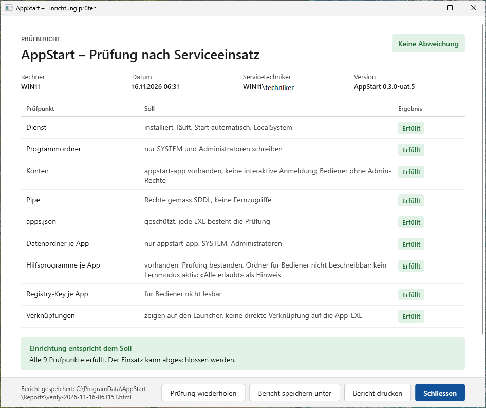
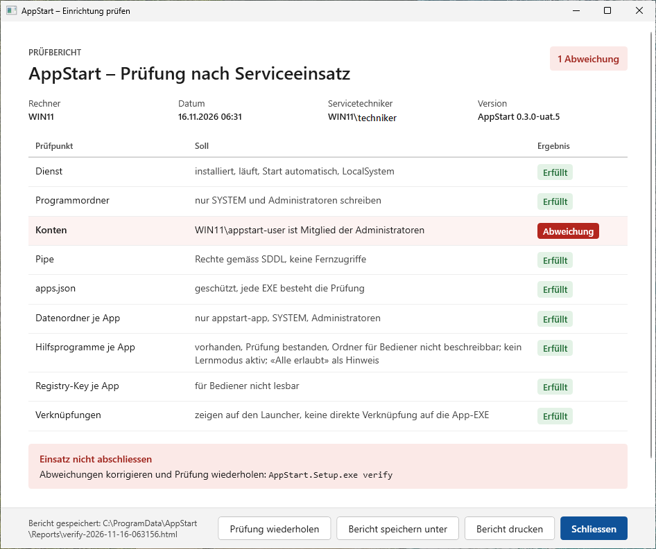
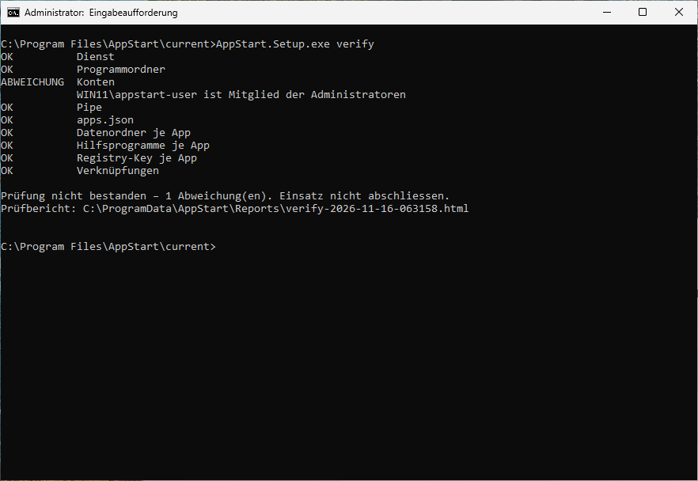

# Verification after a service visit

`verify` checks the entire setup against the expected state and saves a verification report. It changes nothing on the system.

The Service and Security Manual requires the verification **after the installation and at the end of every service visit**, for example when a technician temporarily changed permissions, added users to the Administrators group or updated an application. The report is attached to the service visit. A service visit is complete only when the report shows "No deviation".

## Starting the verification

| Way | Procedure |
|---|---|
| **Start menu** (standard way) | "AppStart" → "AppStart – Verify setup". Confirm the UAC prompt with admin credentials. The verification view opens and verifies immediately. |
| **Wizard** | "AppStart – Setup", in step 1 at the bottom left "Verify setup". Same verification view. |
| **Automatic** | At the end of the setup in the wizard, after every changing command of the command line and after every installation and update of the MSI. The report is saved each time. |
| **Command line** | `AppStart.Setup.exe verify [--report "<path>"]` in a command prompt opened with "Run as administrator". Exit code 0 only without deviation, otherwise 1. |

Operators cannot start the verification because it requires admin rights.

## Verification view



Window "AppStart – Verify setup". While the verification runs, it shows "Verification running…". Afterwards:

- Header: "VERIFICATION REPORT", heading "AppStart – Verification after a service visit", on the right the result: "No deviation", "1 deviation" or e.g. "3 deviations".
- Details: "Computer" (computer name), "Date" (e.g. 15.11.2026 10:42), "Service technician" (signed-in account), "Version" (e.g. "AppStart 0.2.0").
- Table with the columns "Check", "Expected" and "Result" ("Passed" or "Deviation"). For a deviation, the deviation found is shown instead of the expected state, with the expected state below it.
- With deviations, a red box "Do not close the service visit" with "Correct the deviations and repeat the verification:" and the command `AppStart.Setup.exe verify`.
- Without deviation, a green box "Setup matches the expected state" with "All 10 checks passed. The service visit can be closed."
- At the bottom, the fields "Signature service technician" and "Signature customer" for the printed report.



Buttons:

| Button | Effect |
|---|---|
| "Print report" | Prints the report (print job "AppStart verification report") |
| "Save report as" | Copies the saved HTML report to any location, e.g. a USB stick. Dialog "Save report as". |
| "Repeat verification" | Verifies again and saves a new report |
| "Close" | Closes the view. Exit code 0 without deviation, otherwise 1. |

In the dialog "Save report as", the file type `Verification report (*.html)|*.html` is preselected.

Messages of the verification view:

| Message | Meaning and action |
|---|---|
| "Report saved: C:\ProgramData\AppStart\Reports\verify-2026-11-15-104212.html" | Report saved automatically |
| "Report copied to E:\ServiceVisit\verify-2026-11-15-104212.html" | "Save report as" succeeded |
| "Report could not be saved: …" | `C:\ProgramData\AppStart\Reports` is not writable or the drive is full. Free up space, repeat the verification. |
| "The report could not be copied: …" | Target not writable (write-protected stick, missing permissions). Choose another target. |
| "The report could not be printed: …" | No printer or printer error. Save the report and print it later. |
| "Verification could not be run: …" | Unexpected error. Read the reason, repeat the verification from the command line, otherwise contact service support. |

## Verification report and storage

Every verification saves two files under `C:\ProgramData\AppStart\Reports`, named with date and time:

| File | Content |
|---|---|
| `verify-<YYYY-MM-DD-hhmmss>.html` | Readable report "AppStart verification report", same structure as the verification view. Rows with a deviation are red; their expected state follows "Expected:". With deviations, the box "Do not close the service visit" lists all deviations and ends with "Correct and repeat the verification:" `AppStart.Setup.exe verify`. Without deviation: "Verification passed – 10 of 10 checks passed". |
| `verify-<YYYY-MM-DD-hhmmss>.json` | The same details in machine-readable form, for evaluations |

With `verify --report "<path>"`, the HTML report is also copied to the given location. Reports are kept even after `uninstall`. For the service visit: print and sign the report, or attach the HTML file to the service report.

Every row in the HTML report carries the ID of the check (e.g. `#pipe`); it matches the sections below.

## Output on the command line

```text
OK          Service
OK          Program folder
DEVIATION   Accounts
            appstart-user is a member of Administrators
OK          Administrators with password
OK          Pipe
OK          apps.json
OK          Data folder per app
OK          Helper programs per app
OK          Registry key per app
OK          Shortcuts

Verification failed – 1 deviation(s). Do not close the service visit.
Verification report: C:\ProgramData\AppStart\Reports\verify-2026-11-15-104212.html
```

Without deviation, the second-to-last line reads "Verification passed – 10 of 10 checks passed."



## The ten checks

For each check: the expected state and every possible deviation as it appears in the report, with cause and fix. The report replaces values in angle brackets with the names and paths found. Repeat the verification after every fix.

**Run the setup again** means in the tables: Start menu "AppStart – Setup", leave steps 1 and 2 unchanged, click "Next" twice. The setup recreates missing accounts, group and shortcuts, protects `apps.json` and locks data folders and registry keys again, without changing the approvals. Equivalent on the command line: `AppStart.Setup.exe rehash --app <AppId>` (this also records the signature or checksum of this application again).

Possible for every check:

| Deviation | Cause | Fix |
|---|---|---|
| "Verification not possible: \<Reason>" | The check could not be evaluated, e.g. access denied because `verify` ran without admin rights | Repeat the verification with admin rights. If it persists, report the reason to service support. A check that cannot be evaluated always counts as a deviation. |

<a id="dienst"></a>
### Service

**Expected:** installed, running, starts automatically, LocalSystem

| Deviation | Cause | Fix |
|---|---|---|
| "Service "AppStart" is not installed" | MSI not installed, installation canceled or service deleted by hand | Install the MSI again: `AppStart-Setup.exe` or `msiexec /i AppStart-<Version>.msi /qn`. The setup is kept. |
| "Service "AppStart" is not running (status: \<Status>)" | Service stopped or crashed. Status: "stopped", "starting", "stopping", "resuming", "pausing", "paused" or "unknown (\<Number>)" | Check the Event Log (source AppStart), especially 1300 and 1301. Start the service: `sc start AppStart` or "Services" → AppStart → "Start". "starting" shortly after a restart: repeat the verification after one minute. |
| "Service "AppStart" does not start automatically (start type: \<Start type>)" | Start type changed. Start type: "manual", "disabled", "Boot", "System" or "unknown (\<Number>)" | `sc config AppStart start= auto` (note the space after `=`), then `sc start AppStart` |
| "Service "AppStart" runs as "\<Account>" instead of LocalSystem" | Logon account of the service changed | `sc config AppStart obj= LocalSystem`, restart the service. Who changed the account? Treat as a possible security incident. |

<a id="programmordner"></a>
### Program folder

**Expected:** only SYSTEM and Administrators can write

The folder `C:\Program Files\AppStart` is verified. If an operator could write there, they could replace the service EXE and gain SYSTEM rights.

| Deviation | Cause | Fix |
|---|---|---|
| "Program folder C:\Program Files\AppStart is missing" | AppStart not installed or folder deleted | Install the MSI again |
| "C:\Program Files\AppStart: Owner \<Account> is not SYSTEM, Administrators or TrustedInstaller." | Ownership of the folder was taken, e.g. by a user account | Reset the owner: `icacls "C:\Program Files\AppStart" /setowner *S-1-5-32-544 /T /C` (SID of Administrators, independent of the language) |
| "C:\Program Files\AppStart: No access control list (NULL DACL): everyone has full access." | Permissions were removed | Inherit the permissions of "Program Files" again: `icacls "C:\Program Files\AppStart" /reset /T /C` |
| "C:\Program Files\AppStart: \<Account> has write permissions (mask 0x\<Mask>)." | A user or a group (e.g. "Users" or "Everyone") was given write permissions | `icacls "C:\Program Files\AppStart" /reset /T /C`. Check whether files in the folder were changed: if in doubt, reinstall the MSI. Treat as a possible security incident. |

<a id="konten"></a>
### Accounts

**Expected:** appstart-app exists, no interactive sign-in; operators without admin rights

| Deviation | Cause | Fix |
|---|---|---|
| "Account "appstart-app" is missing" | Setup never completed or account deleted | Run the setup again. The account is created with a new random password. |
| "appstart-app is not a member of Administrators" | Membership removed. Applications then start without admin rights. | Run the setup again, or in PowerShell as administrator: `Add-LocalGroupMember -SID S-1-5-32-544 -Member appstart-app` |
| "appstart-app: right SeDenyInteractiveLogonRight is missing (deny log on locally)" | Logon restriction removed, or a Group Policy sets "Deny log on locally" without `appstart-app` | Run the setup again. With Group Policy: add `appstart-app` to the policy (otherwise it overwrites the setting at the next refresh), then `gpupdate /force`. |
| "appstart-app: right SeDenyRemoteInteractiveLogonRight is missing (deny log on through Remote Desktop Services)" | As above, policy "Deny log on through Remote Desktop Services" | As above |
| "\<Account> is a member of Administrators" | A member of `AppStart Users` (e.g. `appstart-user` or `DOMAIN\operator01`) is an administrator, often forgotten after a service visit. Also through a group (e.g. Domain Admins). | Remove the account from Administrators ("Computer Management" → "Local Users and Groups" → "Groups" → "Administrators") or, if it must remain an administrator, remove it from `AppStart Users`. Have the user sign in again. |
| "Group "AppStart Users" is not readable: \<Reason>" | Group deleted, or the domain account of a member cannot be resolved (no connection to the domain controller) | Group missing: run the setup again, then restart the service. Domain not reachable: check the network, repeat the verification. |

<a id="adminpasswort"></a>
### Administrators with password

**Expected:** every enabled account in the Administrators group has a password

All enabled local accounts that are administrators, directly or through a group, are verified. An administrator without a password undoes the entire protection: anyone at this PC can sign in with it, make operators administrators and change `apps.json`. Disabled accounts do not count. For the verification, `verify` signs in each account once with an empty password (network logon, without a session). For accounts with a password, this appears in the Security log as a failed logon (event 4625) and counts once toward the account lockout.

| Deviation | Cause | Fix |
|---|---|---|
| "\<Account> is an administrator and has no password. Set a password or disable the account" | Account created without a password, often a service account or the account created during Windows setup | Set a password: "Computer Management" → "Local Users and Groups" → "Users" → account → "Set Password…", or in a command prompt opened with "Run as administrator": `net user <Account> *`. If the account is not needed: disable it (`net user <Account> /active:no`). Repeat the verification. |
| "Password of \<Account> cannot be verified (Windows error \<Number>), e.g. because the account is locked out" | Account locked out (error 1909) or sign-in not possible for another reason | Unlock the account ("Computer Management" → account → clear "Account is locked out") and repeat the verification. An account that cannot be verified counts as a deviation. |

<a id="pipe"></a>
### Pipe

**Expected:** permissions as per SDDL, no remote access

The named pipe `\\.\pipe\AppStart` must have exactly these permissions (SDDL see [Reference](09-reference.md)): SYSTEM and Administrators full access, `AppStart Users` connect only, network logons denied, access control list protected.

| Deviation | Cause | Fix |
|---|---|---|
| "Group "AppStart Users" is missing, permissions of the pipe cannot be verified" | Setup never completed or group deleted | Run the setup again, then `sc stop AppStart` and `sc start AppStart` |
| "\\\\.\pipe\AppStart does not exist (is the service running?)" | Service stopped, or it is still waiting for the group (event 1301), or it could not create the pipe (1300, 1301) | Fix the check "Service" first. Restart the service. Check the Event Log. |
| "Permissions of \\\\.\pipe\AppStart are not readable: \<Reason>" | `verify` without admin rights, or the pipe is busy at the moment | Repeat with admin rights |
| "Pipe has no access control list (NULL DACL): everyone has full access" | The pipe does not come from the AppStart service. **Security incident:** another program created it. | Disconnect the PC from the network, inform service support. Check event 1300. Restart the PC; the service creates the pipe as the first instance at startup. |
| "Access control list of the pipe is not protected (inherits permissions)" | As above: foreign pipe or outdated version of the service | Restart the service. If it persists: reinstall the MSI, otherwise treat as a security incident. |
| "Entry missing: SYSTEM full access" | Foreign pipe or outdated version of the service | As above |
| "Entry missing: Administrators full access" | As above | As above |
| "Entry missing: AppStart Users connect (mask 0x0012018B, without FILE_CREATE_PIPE_INSTANCE)" | The group was deleted and recreated while the service was running: the pipe still contains the old group (usually together with "Unexpected entry: … S-1-5-21-…"). Or a group with wrong permissions. | `sc stop AppStart`, `sc start AppStart`, repeat the verification |
| "Entry missing: Network logons denied (no remote access)" | Foreign pipe or outdated version of the service | Restart the service, otherwise reinstall the MSI |
| "Unexpected entry: Allow for \<Account> (mask 0x\<Mask>)" | Additional permission for an account, e.g. the old SID of the recreated group or a foreign pipe | Restart the service. If it persists: treat as a security incident. |
| "Unexpected entry: Deny for \<Account> (mask 0x\<Mask>)" | Additional restriction; does not come from the service | As above |

<a id="appsjson"></a>
### apps.json

**Expected:** protected, every EXE passes the verification

The file `C:\ProgramData\AppStart\apps.json` is verified: only SYSTEM, Administrators and TrustedInstaller may change the folder and the file, the content must be valid, and every approved EXE must pass the signature or SHA-256 verification. As long as this check shows a deviation, the service denies **every** start with "The AppStart setup is not in order" (event 1202), except for EXEs with a deviation: then only their start is denied (event 1201).

| Deviation | Cause | Fix |
|---|---|---|
| "C:\ProgramData\AppStart\apps.json is missing." | No application approved yet, or file deleted | Approve applications (wizard or `add`) |
| "C:\ProgramData\AppStart is not protected: \<Reason>" or "C:\ProgramData\AppStart\apps.json is not protected: \<Reason>". Reason e.g. "\<Account> has write permissions (mask 0x\<Mask>).", "Owner \<Account> is not SYSTEM, Administrators or TrustedInstaller." or "No access control list (NULL DACL): everyone has full access." | Permissions were changed, or the folder was created by a user | Run the setup again; the setup protects the folder and file again. Check whether `apps.json` was changed (check the approvals with `list`). |
| "C:\ProgramData\AppStart\apps.json cannot be read: \<Reason>" | File locked (e.g. open in an editor) or disk error | Close the editor, repeat the verification |
| "apps.json is not valid JSON (line \<n>, \<JSON path>): \<Reason>" | File edited by hand and damaged in the process | Correct the error at the given location (comma, quotation marks) or restore a backup |
| "apps.json is empty." | File empty | Restore a backup, or delete the file and approve the applications again |
| "version: \<n> is not supported, expected 1 to 2." | Wrong version, or file of a newer AppStart version | Set `"version": 2`, or install the matching AppStart version |
| "apps[\<i>].id: "\<AppId>" is invalid. Allowed are a-z, 0-9 and -, 1 to 32 characters." | AppId changed by hand | Correct the AppId. The shortcuts must match it: then run the setup again. |
| "apps[\<i>].id: "\<AppId>" occurs more than once." | Duplicate entry | Remove the duplicate entry |
| "apps[\<i>].name: is missing." | Name empty | Enter a name |
| "apps[\<i>].exe: "\<Path>" is not an absolute path to an EXE." | Relative path, network path or not an `.exe` | Enter the full local path |
| "apps[\<i>].workingDir: "\<Path>" is not an absolute path." | Working folder invalid | Enter the full local path |
| "apps[\<i>].dataDir: "\<Path>" is not an absolute path." | Data folder invalid | Enter the full local path |
| "apps[\<i>].registryKey: "\<Key>" must lie under HKLM\\." | Key outside of `HKLM` | Enter a key under `HKLM\` |
| "apps[\<i>].signerThumbprint: check "signature" needs 40 hex characters." | Thumbprint missing or wrong | `AppStart.Setup.exe rehash --app <AppId>` |
| "apps[\<i>].sha256: check "sha256" needs 64 hex characters." | Checksum missing or wrong | `AppStart.Setup.exe rehash --app <AppId>` |
| "\<Name> (\<EXE>): File missing" | Application uninstalled or moved | Reinstall the application, or revoke the approval with `remove --app <AppId>` and approve the new EXE with `add` |
| "\<Name> (\<EXE>): File not readable: \<Reason>" | File locked or permissions missing | Check the reason, repeat the verification |
| "\<Name> (\<EXE>): SHA-256 differs: expected \<Checksum>, found \<Checksum>." | The EXE was changed: update of the application or tampering | Known update: `rehash --app <AppId>`. Otherwise **security incident**: do not start the EXE, inform service support. |
| "\<Name> (\<EXE>): Authenticode check failed (0x\<Code>)." | Signature invalid: file changed, signature removed or certificate not trusted | Clarify the origin of the EXE. Reinstall the original. If the EXE is unsigned after an update, run `rehash` after checking it (the check type changes to SHA-256). |
| "\<Name> (\<EXE>): Signing certificate not readable." | Signature damaged | Reinstall the original |
| "\<Name> (\<EXE>): Signature valid, but foreign certificate: expected \<Thumbprint>, found \<Thumbprint>." | New certificate of the vendor after an update, or EXE of a different publisher | New vendor certificate confirmed: `rehash --app <AppId>`. Otherwise security incident. |

If `apps.json` is not readable, the following checks additionally report "apps.json is not readable, check cannot be verified". This disappears once this check is fixed.

<a id="datenordner"></a>
### Data folder per app

**Expected:** only appstart-app, SYSTEM, Administrators

For every application with a data folder. Operators may neither read nor write the folder.

| Deviation | Cause | Fix |
|---|---|---|
| "\<Folder>: folder is missing" | Application uninstalled, folder deleted or moved | Folder is needed: repair the application, then run the setup again. No longer needed: adjust the approval with `add --exe … --data-dir <new>` or revoke it with `remove`. |
| "\<Folder>: \<Account>: \<Rights> (0x\<Mask>)", e.g. "C:\ProgramData\AppStartTest: BUILTIN\Users (S-1-5-32-545): Read, Write (0x001301BF)". Rights: "Full access", "Read", "Write", "Delete", "Change permissions", "Take ownership", "Read permissions" or "Other" | Permissions were changed, often by an update or repair of the application, or by hand during a service visit | Run the setup again; the setup locks the folder again |
| "\<Folder>: \<Account>: owner (may read and change permissions)" | A user owns the folder and can change the permissions at any time | Run the setup again (sets Administrators as owner) |
| "\<Folder>: Everyone (NULL DACL): full access" | Access control list removed | Run the setup again |
| "Account "appstart-app" is missing, permissions cannot be verified" | See check [Accounts](#konten) | Restore the account, then run the setup again |

<a id="hilfsprogramme"></a>
### Helper programs per app

**Expected:** present, verification passed, folder not writable by operators; no learning mode active; "All allowed" as a note

For every application with "Allowed helper programs only", every program on the list (see [Managing applications → Other programs](04-managing-applications.md)). Applications with "All allowed (unsafe)" appear as "Note: All other programs allowed (app-a)"; the check stays passed because the mode was chosen deliberately.

| Deviation | Cause | Fix |
|---|---|---|
| "app-a: helper program \<Path> is missing" | Program uninstalled or moved | Reinstall it, or remove it from the list with `deny-child` |
| "app-a: \<Path> fails the verification (…). After an update: AppStart.Setup.exe rehash --app app-a --child "\<Path>"" | File changed after an update (SHA-256), or signature invalid or from a different certificate | After an intended update, run the command shown; otherwise check the file and report it to service support |
| "app-a: folder or file of \<Path> is writable by operators" | Operators could replace the program | Correct the permissions of the folder, or install the program in a protected folder |
| "app-a: learning mode active until 15.11.2026 11:07. To end it: AppStart.Setup.exe learn stop --app app-a" | Learning mode forgotten; until then the protection is weaker | Run the command shown, then apply the suggestions with `learn apply` |
| "The service ignores the learning mode control file: …" | `C:\ProgramData\AppStart\learn.json` is writable by operators or invalid | Run the setup again, restart learning mode |

<a id="registry"></a>
### Registry key per app

**Expected:** not readable by operators

For every application with a registry key. The key typically contains passwords of the application.

| Deviation | Cause | Fix |
|---|---|---|
| "\<Key>: key is missing" | Application uninstalled or key deleted | Repair the application, then run the setup again; or adjust or revoke the approval |
| "\<Key>: \<Account>: \<Rights> (0x\<Mask>)", e.g. "HKLM\SOFTWARE\AppStartTest: BUILTIN\Users (S-1-5-32-545): Read (0x00020019)" | Permissions were changed, e.g. by an update of the application or by hand | Run the setup again. Passwords in the key count as disclosed if operators could read them: have the vendor change them. |
| "\<Key>: \<Account>: owner (may read and change permissions)" | A user owns the key | Run the setup again |
| "\<Key>: Everyone (NULL DACL): full access" | Access control list removed | Run the setup again |
| "Account "appstart-app" is missing, permissions cannot be verified" | See check [Accounts](#konten) | Restore the account, then run the setup again |

<a id="verknuepfungen"></a>
### Shortcuts

**Expected:** point to the launcher, no direct shortcut to the app EXE

For each application, `<Name>.lnk` in the public Start menu or on the public desktop must point to `C:\Program Files\AppStart\current\AppStart.Launcher.exe --app <AppId>`. No shortcut in the public Start menu, on the public desktop or in a user profile may point directly to the EXE.

| Deviation | Cause | Fix |
|---|---|---|
| "\<Name>: no shortcut "\<Name>.lnk" to the launcher in the public Start menu or on the public desktop" | Shortcut deleted or renamed | Run the setup again |
| "\<Path>: points to "\<Target> \<Arguments>" instead of the launcher with --app \<AppId>" | The shortcut was replaced, usually by an update of the application that created its own shortcut with the same name | Delete the shortcut, run the setup again |
| "\<Path>: not a readable shortcut" | File damaged or not a shortcut | Delete the file, run the setup again |
| "\<Path>: points directly to \<EXE>" | A shortcut bypasses AppStart, e.g. newly created by an update of the application. Operators would use it to start the EXE without admin rights. | Run the setup again; the setup backs up the shortcut to `C:\ProgramData\AppStart\ShortcutBackup` and removes it |
