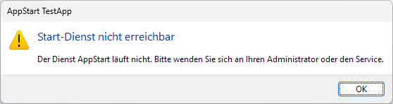
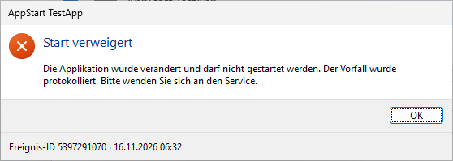

# Meldungen und Fehlerbehebung

## Meldungen des Launchers

Der Launcher steht hinter jeder Verknüpfung einer freigegebenen Applikation. Bei Erfolg zeigt er nichts: Die Applikation erscheint nach kurzer Zeit. Sonst zeigt er genau eine Meldung mit «OK»-Knopf. Der Fenstertitel ist der Name der Verknüpfung, also der Name der Applikation (ohne Verknüpfung: «AppStart»).





Bei «Start verweigert» steht unten eine Zeile wie «Ereignis-ID 4821930571 · 15.11.2026 10:51». Die Zahl ist die **Vorgangsnummer** dieser Ablehnung, nicht die ID des Ereignistyps. So finden Sie den passenden Eintrag: Ereignisanzeige → «Windows-Protokolle» → «Anwendung» → rechts «Suchen…» → Vorgangsnummer eingeben. Der Eintrag (Quelle AppStart, ID 1200 bis 1205) enthält «Vorgang: 4821930571» und den genauen Grund. Datum und Uhrzeit helfen, wenn der Bediener die Nummer nicht notiert hat.

Exit-Codes des Launchers (für Skripte und Fehlersuche): 0 = gestartet, 1 = ungültige Verknüpfung, 2 = Dienst nicht erreichbar, 3 = Start verweigert oder läuft bereits, 4 = keine Berechtigung, 5 = unerwartete Antwort.

### Start-Dienst nicht erreichbar

> «Der Dienst AppStart läuft nicht. Bitte wenden Sie sich an Ihren Administrator oder den Service.»

**Ursache:** Der Launcher erreicht die Pipe `\\.\pipe\AppStart` nicht innerhalb von 3 Sekunden. Der Dienst ist gestoppt, startet gerade (kurz nach dem Hochfahren), wartet noch auf die Einrichtung (Ereignis 1301) oder konnte nicht starten (Ereignis 1300 oder 1301). Ebenso, wenn alle vier Verbindungen des Dienstes gerade belegt sind.

**Massnahme:** Einen Moment warten und erneut versuchen. Bleibt es: Dienst prüfen (`sc query AppStart`), starten (`sc start AppStart`), Ereignisprotokoll prüfen. Danach `verify`. Exit-Code 2.

### Keine Berechtigung

> «Ihr Benutzerkonto darf Applikationen nicht über AppStart starten. Bitte wenden Sie sich an Ihren Administrator.»

**Ursache:** Der angemeldete Benutzer ist nicht Mitglied der Gruppe `AppStart Users`, oder er wurde erst aufgenommen und hat sich seither nicht neu angemeldet. Der Dienst lehnt die Verbindung schon auf der Pipe ab; im Ereignisprotokoll steht deshalb nichts.

**Massnahme:** Benutzer in die Gruppe aufnehmen ([Konten und Gruppe](05-konten-und-gruppe.md)), abmelden und neu anmelden. Exit-Code 4.

### Ungültige Verknüpfung

> «Diese Verknüpfung ist nicht korrekt eingerichtet. Bitte wenden Sie sich an den Service.»

**Ursache:** Der Launcher wurde ohne `--app <AppId>`, mit zusätzlichen Argumenten oder mit einer AppId in ungültigem Format aufgerufen, z.B. über eine von Hand kopierte oder geänderte Verknüpfung oder durch direkten Start von `AppStart.Launcher.exe`.

**Massnahme:** Verknüpfung löschen und die Einrichtung erneut ausführen («AppStart – Einrichtung», «Weiter», «Weiter»), damit das Setup sie neu anlegt. Exit-Code 1.

### Start verweigert – Applikation verändert

> «Die Applikation wurde verändert und darf nicht gestartet werden. Der Vorfall wurde protokolliert. Bitte wenden Sie sich an den Service.»

**Ursache:** Signatur oder SHA-256 der EXE stimmen nicht mit der Freigabe überein (Ereignis 1201). Meist ein Update der Applikation, sonst eine Manipulation.

**Massnahme:** Eintrag zur Vorgangsnummer im Ereignisprotokoll lesen. Bekanntes Update: `AppStart.Setup.exe rehash --app <AppId>` ([Applikationen verwalten](04-applikationen-verwalten.md)). Sonst als Sicherheitsvorfall behandeln: EXE nicht anders starten, Service informieren. Exit-Code 3.

### Start verweigert – nicht freigegeben

> «Diese Applikation ist für den Start über AppStart nicht freigegeben. Der Vorfall wurde protokolliert. Bitte wenden Sie sich an den Service.»

**Ursache:** Die AppId der Verknüpfung steht nicht in `apps.json` (Ereignis 1200). Die Freigabe wurde entzogen, aber eine Verknüpfung blieb übrig, oder eine Verknüpfung wurde von Hand angelegt.

**Massnahme:** Applikation freigeben ([Applikationen verwalten](04-applikationen-verwalten.md)) oder die übrig gebliebene Verknüpfung löschen. Exit-Code 3.

### Start verweigert – Einrichtung nicht in Ordnung

> «Die Einrichtung von AppStart ist nicht in Ordnung. Der Start wurde verweigert und protokolliert. Bitte wenden Sie sich an den Service.»

**Ursache:** `apps.json` fehlt, ist ungültig oder kann von Nicht-Administratoren verändert werden (Ereignis 1202). Der Dienst verweigert dann jeden Start.

**Massnahme:** `AppStart.Setup.exe verify` ausführen und den Prüfpunkt [apps.json](06-pruefung-nach-serviceeinsatz.md) beheben. Exit-Code 3.

### Start verweigert – sonstiger Fehler

> «Die Applikation konnte nicht gestartet werden. Der Vorfall wurde protokolliert. Bitte wenden Sie sich an den Service.»

**Ursache:** Prüfung bestanden, aber der Start ist technisch gescheitert (Ereignis 1205), z.B. weil `appstart-app` fehlt, deaktiviert ist oder sich nicht anmelden darf («Als Batchauftrag anmelden»), oder die EXE fehlt.

**Massnahme:** Eintrag zur Vorgangsnummer lesen (Ereignis 1205 mit Grund), `verify` ausführen und Abweichungen beheben. Exit-Code 3.

### Start läuft bereits

> «Die Applikation wird gerade gestartet. Bitte warten Sie einen Moment und versuchen Sie es dann erneut.»

**Ursache:** In dieser Sitzung läuft schon eine Startanfrage, oder die letzte Anfrage liegt weniger als 2 Sekunden zurück (Doppelklick, Ereignis 1203).

**Massnahme:** Kurz warten. Die Applikation erscheint meist von selbst. Exit-Code 3.

### Unerwartete Antwort

> «Der Dienst AppStart hat unerwartet geantwortet. Bitte wenden Sie sich an den Service.»

**Ursache:** Die Antwort des Dienstes war nicht lesbar oder kam nicht innerhalb von 30 Sekunden, z.B. weil Launcher und Dienst aus verschiedenen Versionen stammen oder der Dienst während der Anfrage beendet wurde.

**Massnahme:** Ereignisprotokoll prüfen (1204, 1302). AppStart mit dem aktuellen MSI neu installieren, damit Launcher und Dienst dieselbe Version haben. Exit-Code 5.

<a id="installationsprogramm"></a>
## Meldungen des Installationsprogramms AppStart-Setup.exe

Fenstertitel «AppStart Setup». Jede Meldung zeigt Überschrift, Ursache, eine Zeile «Massnahme: …» und, wenn ein Protokoll entstanden ist, «Protokoll: C:\ProgramData\AppStart\Logs\install-20261115-104212.log». Mit `/quiet` erscheint keine Meldung; dann zählen Exit-Code und Protokolle unter `C:\ProgramData\AppStart\Logs`.

Während der Installation: «AppStart wird installiert …» – «Bitte warten. Die Installation kann einige Minuten dauern. Danach startet die Einrichtung.»

| Überschrift | Text | Massnahme (wie angezeigt) | Exit-Code | Assistent startet |
|---|---|---|---|---|
| «Neustart erforderlich» | «AppStart wurde installiert. Damit alle Änderungen wirksam werden, ist ein Neustart erforderlich.» | «Führen Sie zuerst die Einrichtung durch und starten Sie den Rechner danach neu.» | 3010 | ja |
| «AppStart ist bereits installiert» | «Installiert ist Version 0.2.0, dieses Setup enthält Version 0.2.0. Die Installation wird übersprungen.» | «Keine. Die Einrichtung startet direkt.» | 0 | ja |
| «Installation abgebrochen» | «Die Installation wurde abgebrochen (Code 1602). AppStart wurde nicht geändert.» | «Starten Sie AppStart-Setup.exe erneut, um die Installation zu wiederholen.» | 1602 | nein |
| «Eine andere Installation läuft gerade» | «Eine andere Installation läuft gerade. Bitte warten und erneut versuchen. (Code 1618)» | «Warten Sie, bis die andere Installation (zum Beispiel Windows Update) abgeschlossen ist, und starten Sie AppStart-Setup.exe dann erneut.» | 1618 | nein |
| «Installation fehlgeschlagen» | «Bei der Installation ist ein schwerwiegender Fehler aufgetreten (Code 1603). AppStart wurde nicht installiert.» | «Prüfen Sie das Protokoll. Wenden Sie sich mit dem Protokoll an den Service.» | 1603 | nein |
| «Installation fehlgeschlagen» | «Das Installationsprogramm hat mit dem Fehler 1638 geendet. AppStart wurde nicht installiert.» (jeder andere Code von `msiexec`) | wie oben | Code von `msiexec` | nein |
| «Kein Installationspaket enthalten» | «Diese AppStart-Setup.exe enthält kein Installationspaket (Entwicklungs-Build) und kann AppStart nicht installieren.» | «Verwenden Sie die AppStart-Setup.exe aus dem offiziellen Release.» | 1620 | nein |
| «Administratorrechte erforderlich» | «AppStart-Setup.exe läuft ohne Administratorrechte und kann AppStart nicht installieren.» | «Starten Sie AppStart-Setup.exe mit einem Administratorkonto und bestätigen Sie die Abfrage der Benutzerkontensteuerung.» | 5 | nein |
| «Ordner nicht geschützt» | «Der Ordner C:\ProgramData\AppStart kann von Benutzern ohne Administratorrechte verändert werden oder ist ein Verweis. Aus Sicherheitsgründen wird nicht installiert.» | «Lassen Sie den Ordner durch einen Administrator prüfen oder löschen und starten Sie AppStart-Setup.exe dann erneut.» | 1603 | nein |
| «Installationspaket konnte nicht entpackt werden» | «Das Installationspaket konnte nicht nach C:\ProgramData\AppStart\Installer\… geschrieben werden: …» | «Prüfen Sie den freien Speicherplatz auf Laufwerk C: und starten Sie AppStart-Setup.exe erneut.» | 1603 | nein |
| «Installationsprogramm nicht startbar» | «Windows Installer (msiexec.exe) konnte nicht gestartet werden: …» | «Starten Sie den Rechner neu und starten Sie AppStart-Setup.exe dann erneut. Hilft das nicht, wenden Sie sich an den Service.» | 1603 | nein |
| «Einrichtung nicht gefunden» | «AppStart ist installiert, aber C:\Program Files\AppStart\current\AppStart.Setup.exe fehlt. Die Einrichtung kann nicht starten.» | «Starten Sie AppStart-Setup.exe erneut. Hilft das nicht, wenden Sie sich an den Service.» | 2 | nein |
| «Einrichtung nicht vertrauenswürdig» | «Die Signatur von C:\Program Files\AppStart\current\AppStart.Setup.exe ist ungültig oder stammt nicht vom Herausgeber dieses Setups. Die Einrichtung wird aus Sicherheitsgründen nicht gestartet.» | «Starten Sie die Einrichtung nicht von Hand. Wenden Sie sich an den Service.» | 577 | nein |
| «Einrichtung konnte nicht gestartet werden» | «AppStart ist installiert, aber C:\Program Files\AppStart\current\AppStart.Setup.exe konnte nicht gestartet werden: …» | «Starten Sie die Einrichtung über das Startmenü (AppStart – Einrichtung).» | 1 | nein |
| «Unbekannter Parameter» | «Der Parameter «/x» ist unbekannt.», danach die Hilfe | «Starten Sie AppStart-Setup.exe ohne Parameter, mit /quiet oder mit /? für die Hilfe.» | 87 | nein |
| «Unerwarteter Fehler» | «Bei der Installation ist ein unerwarteter Fehler aufgetreten: …» | «Wenden Sie sich mit dem Protokoll an den Service.» | 1603 | nein |

Erläuterungen für den Service:

- **«Installation abgebrochen» (1602):** Die Installation wurde abgebrochen, z.B. weil ein Benutzer sich abgemeldet hat. Nichts wurde geändert.
- **«Eine andere Installation läuft gerade» (1618):** Windows Installer ist durch eine andere Installation belegt (Windows Update, Softwareverteilung). Warten, dann wiederholen.
- **«Installation fehlgeschlagen» (1603 und andere Codes):** Im Protokoll `install-….log` nach «Return value 3» suchen; die Zeilen davor nennen den Grund. Häufig: Dienst lässt sich nicht stoppen, Dateien gesperrt, zu wenig Platz.
- **«Ordner nicht geschützt»:** Absichtliche Sperre. `C:\ProgramData\AppStart` existiert schon, aber Benutzer ohne Admin-Rechte dürfen darin schreiben, oder der Ordner ist ein Verweis (Junction, symbolischer Link). Typisch: Ein Bediener oder ein anderes Programm hat den Ordner vor der Installation angelegt. Würde das Installationsprogramm dort das MSI entpacken und mit Admin-Rechten ausführen, könnte ein Bediener es vorher austauschen. **Behebung:** Ordner prüfen. Ist AppStart noch nicht eingerichtet, Ordner als Administrator löschen (`rmdir /s /q C:\ProgramData\AppStart`) und `AppStart-Setup.exe` erneut starten. Enthält er eine bestehende Einrichtung (`apps.json`, `Reports`), als möglichen Sicherheitsvorfall behandeln: Inhalt prüfen, Rechte durch einen Administrator auf SYSTEM und Administratoren beschränken (`icacls C:\ProgramData\AppStart /inheritance:r /grant:r *S-1-5-18:(OI)(CI)F *S-1-5-32-544:(OI)(CI)F /T`), dann erneut starten und `verify` ausführen.
- **«Einrichtung nicht vertrauenswürdig» (577):** `AppStart.Setup.exe` im Programmordner ist nicht mit dem Zertifikat des Installationsprogramms signiert. Möglich sind ein Mischbestand verschiedener Builds oder eine Manipulation. AppStart mit dem offiziellen Release neu installieren. Bei unsignierten Entwicklungs-Builds wird die Prüfung übersprungen; das Protokoll `bootstrapper-….log` enthält dann eine Zeile «WARNUNG».
- **«Kein Installationspaket enthalten» (1620):** Entwicklungs-Build ohne eingebettetes MSI. Offizielles Release verwenden.

Hilfe (`AppStart-Setup.exe /?`), Fenster «AppStart-Setup.exe»:

```text
AppStart-Setup.exe
    Installiert AppStart und startet danach die Einrichtung.

AppStart-Setup.exe /quiet
    Installiert nur, ohne Oberfläche und ohne Einrichtung. Der Exit-Code ist der von msiexec (0 oder 3010 = erfolgreich).

AppStart-Setup.exe /?
    Zeigt diese Hilfe.
```

Darunter: «Protokolle: C:\ProgramData\AppStart\Logs».

## Ereignisprotokoll

Der Dienst schreibt in das Protokoll **Anwendung** mit der Quelle **AppStart**. Ereignisanzeige: `eventvwr.msc` → «Windows-Protokolle» → «Anwendung» → «Aktuelles Protokoll filtern…» → Ereignisquelle «AppStart».


Jede Startanfrage steht mit Zeit, Benutzer, Sitzung, AppId und Ergebnis im Protokoll. Abgelehnte Anfragen enthalten die Vorgangsnummer, die der Launcher anzeigt, und den genauen Grund; diese Details erfährt der Launcher nie.

| ID | Stufe | Bedeutung | Massnahme |
|---|---|---|---|
| 1000 | Information | Dienst gestartet, Pipe bereit. Text: «Dienst AppStart gestartet, Pipe bereit. Rechte: \<SDDL>» | Keine. Die SDDL muss der [Referenz](09-referenz.md) entsprechen. |
| 1001 | Information | Dienst beendet. Text: «Dienst AppStart beendet.» | Keine, wenn gewollt (Update, Neustart). Sonst prüfen, wer den Dienst gestoppt hat. |
| 1100 | Information | Applikation gestartet. Text: «Start ausgeführt. Benutzer: …, Session: …, AppId: …, EXE: …, Prozess: \<PID>, weitere Programme: …» mit Modus («gesperrt», «nur erlaubte Hilfsprogramme», «alle erlaubt»), gegebenenfalls «Lernmodus bis …», und Ergebnis der Prüfung | Keine |
| 1101 | Information | Hilfsprogramm erlaubt: Die Applikation hat ein Programm von ihrer Liste der erlaubten Hilfsprogramme gestartet, oder das Konsolenfenster von Windows (conhost.exe). Text: «Hilfsprogramm erlaubt. Benutzer: …, Session: …, AppId: …, Pfad: …, Prozess: …» | Keine |
| 1102 | Information | Lernmodus: Programm aufgezeichnet. Text mit Benutzer, AppId, Pfad, Elternprozess und Signatur | Keine. Am Ende des Lernmodus die Vorschläge prüfen und übernehmen. |
| 1206 | Warnung | Programm beendet: Die Applikation hat ein Programm gestartet, das nicht erlaubt ist, oder dessen Prüfung fehlschlug (z.B. «Prüfsumme stimmt nicht»). Text: «Programm beendet. Benutzer: …, Session: …, AppId: …, Pfad: …, Prozess: …, beendet: ja. Grund: …» | Gehört das Programm zur Applikation, in die Liste der erlaubten Hilfsprogramme aufnehmen bzw. Prüfsumme aktualisieren. Sonst: Versuch, ein fremdes Programm mit Admin-Rechten zu starten, dem Service melden. «beendet: NEIN» sofort dem Service melden. |
| 1207 | Fehler | Lernmodus ignoriert: `C:\ProgramData\AppStart\learn.json` ist für Bediener beschreibbar oder ungültig. Es gilt die Liste der erlaubten Hilfsprogramme. | `verify` ausführen, Rechte von `C:\ProgramData\AppStart` korrigieren, Lernmodus neu starten. |
| 1208 | Fehler | Überwachung gestört: Ein neuer Prozess im Job war nicht prüfbar, eine Aufzeichnung im Lernmodus misslang, oder die Überwachung einer Applikation ist ausgefallen (dann werden alle ihre Prozesse beendet). | Grund im Text an den Service melden. |
| 1200 | Warnung | Abgelehnt: AppId nicht freigegeben (`unknown-app`). Text: «Start verweigert (unknown-app). Vorgang: \<Nummer>, Benutzer: …, Session: …, AppId: …. AppId ist nicht in apps.json freigegeben.» | Applikation freigeben oder Verknüpfung entfernen |
| 1201 | Warnung | Abgelehnt: Signatur oder SHA-256 falsch (`integrity`). Grund: «SHA-256 weicht ab: …», «Authenticode-Prüfung fehlgeschlagen (0x…)», «Signaturzertifikat nicht lesbar.» oder «Signatur gültig, aber fremdes Zertifikat: …» | Bekanntes Update: `rehash`. Sonst Sicherheitsvorfall. |
| 1202 | Warnung | Abgelehnt: Konfiguration fehlt, ungültig oder unsicher (`config`). Grund wie beim Prüfpunkt [apps.json](06-pruefung-nach-serviceeinsatz.md) | `verify`, Prüfpunkt «apps.json» beheben |
| 1203 | Warnung | Abgelehnt: in dieser Sitzung läuft bereits eine Anfrage oder die Sperrzeit von 2 s läuft (`busy`). Grund: «Session hat bereits eine Anfrage in Arbeit oder ist in der Sperrzeit.» | Keine. Häufung: Bediener auf Einfachklick hinweisen. |
| 1204 | Warnung | Ungültige Anfrage verworfen, ohne Antwort. Text: «Ungültige Anfrage verworfen. Benutzer: …, Session: …, Länge: … Byte.» oder «Keine Anfrage innerhalb von 2 s. Benutzer: …, Session: ….» | Einzeln: harmlos (z.B. abgebrochener Launcher). Gehäuft oder mit fremdem Benutzer: Versuch, den Dienst mit eigenen Programmen anzusprechen. Benutzer ermitteln, Sicherheitsvorfall prüfen. |
| 1205 | Warnung | Start technisch gescheitert (`error`). Text mit EXE und Fehler, z.B. Anmeldung von `appstart-app` fehlgeschlagen | `verify`, besonders Prüfpunkt «Konten». Grund im Text an den Service melden. |
| 1300 | Fehler | Pipe existiert bereits, der Dienst startet nicht. Text: «Dienst startet nicht: …». **Sicherheitsereignis:** ein anderes Programm hat `\\.\pipe\AppStart` vor dem Dienst angelegt, um Anfragen abzufangen. | Als Sicherheitsvorfall behandeln. PC neu starten; tritt es wieder auf, Programme im Autostart prüfen, Service informieren. |
| 1301 | Warnung oder Fehler | Pipe kann nicht angelegt werden. Warnung «Gruppe «AppStart Users» fehlt: AppStart ist noch nicht eingerichtet. Der Dienst wartet und versucht es alle 10 s erneut.» oder Fehler «Dienst startet nicht: Pipe kann nicht angelegt werden. …» | Warnung vor der Einrichtung: normal, Einrichtung abschliessen. Danach: Gruppe fehlt, Einrichtung erneut ausführen und Dienst neu starten. Fehler: Grund lesen, PC neu starten. |
| 1302 | Fehler oder Warnung | Fehler an der Pipe: «Pipe-Instanz kann nicht angelegt werden, neuer Versuch in 5 s: …» oder «Pipe-Verbindung abgebrochen: …» | Einzeln: harmlos, der Dienst läuft weiter. Gehäuft: Grund an den Service melden. |
| 1400 | Information | Lernmodus gestartet für eine AppId, mit Ablaufzeit | Keine. Während des Lernmodus den PC nicht unbeaufsichtigt lassen. |
| 1401 | Information | Lernmodus beendet (von Hand oder abgelaufen). Text: «Lernmodus abgelaufen (…), es gilt wieder der eingestellte Modus.» | Keine |

Der Dienst startet nach einem Absturz automatisch neu (nach 5 s, 5 s und 30 s).

## Meldungen des Setups

### Ergebnis der Einrichtung

Assistent (Schritt 3) und Kommandozeile zeigen je Schritt eine Zeile mit ✓ oder ✗. Bei ✗ folgt nach dem Doppelpunkt der Grund.

| Meldung | Bedeutung | Massnahme bei ✗ |
|---|---|---|
| «Konten appstart-app und appstart-user, Gruppe AppStart Users angelegt» / «Konto appstart-app und Gruppe AppStart Users angelegt» | Konten und Gruppe eingerichtet (vorhandene geprüft) | – |
| «Konten und Gruppe konnten nicht eingerichtet werden» | Konto oder Gruppe konnten nicht angelegt werden; die weiteren Schritte entfallen. Gründe z.B. «Zugriff verweigert. Dafür sind Administratorrechte nötig.», «Das Passwort erfüllt die Kennwortrichtlinie dieses Computers nicht (Länge, Komplexität oder Verlauf).», «Das Konto «…» wurde nicht gefunden.», «… ist kein Benutzerkonto.» | Grund beheben (Admin-Rechte, anderes Passwort, Konto prüfen), Einrichtung wiederholen |
| «2 Applikationen freigegeben, Konfiguration geschützt» | `apps.json` geschrieben und geschützt | – |
| «Konfiguration konnte nicht geschrieben werden» | `C:\ProgramData\AppStart` oder `apps.json` lässt sich nicht schützen oder schreiben, oder eine Angabe ist ungültig (Grund wie beim Prüfpunkt [apps.json](06-pruefung-nach-serviceeinsatz.md)). Weitere Schritte entfallen. | Grund beheben. Ist `C:\ProgramData\AppStart` ein Verweis (Junction), Ordner als Administrator prüfen und löschen. |
| «apps.json ist ungültig: …» | Die bestehende `apps.json` ist beschädigt; das Setup ändert nichts | Datei korrigieren oder aus Sicherung zurückholen |
| «Applikation «app-x» ist nicht freigegeben» | `remove` oder `rehash` mit unbekannter AppId | AppId mit `list` prüfen |
| «Datenordner und Registry-Keys gesperrt» | Rechte gesetzt | – |
| «Datenordner oder Registry-Keys konnten nicht gesperrt werden» | Gründe z.B. «Datenordner «C:\» ist ein Laufwerk oder Systemordner und darf nicht gesperrt werden.», «Datenordner … ist ein Verweis (Junction oder symbolischer Link) und wird nicht geschützt.», «Datenordner … existiert nicht.», «Registry-Key … existiert nicht.» | Pfad korrigieren (`add --exe … --data-dir …`), Ordner bzw. Key anlegen lassen (Applikation einmal starten), Einrichtung wiederholen |
| «Verknüpfungen mit App-Icon angelegt, 2 alte Verknüpfungen gesichert» | Verknüpfungen angelegt; die Zahl nennt die gesicherten direkten Verknüpfungen | – |
| «Verknüpfungen konnten nicht angelegt werden» | Häufigster Grund: «Die Verknüpfung «…» existiert bereits und gehört nicht zu dieser Applikation. Sie wird nicht überschrieben. Bitte die Datei prüfen und von Hand sichern oder entfernen.» | Fremde Verknüpfung prüfen und entfernen oder anderen Namen wählen (`--name`), wiederholen |
| «Dienst AppStart läuft, Start automatisch» | Dienst läuft und die Pipe ist bereit | – |
| «Dienst AppStart läuft nicht» | Dienst fehlt oder startet nicht. Zusatz «Die Pipe des Dienstes ist nicht erreichbar. Ereignisprotokoll (Quelle AppStart) prüfen.», wenn der Dienst läuft, die Pipe aber auch nach einem Neustart des Dienstes fehlt | Ereignisprotokoll prüfen (1300, 1301). Fehlt der Dienst: MSI neu installieren. |
| «Verknüpfungen zurückgestellt, Datenordner und Registry-Keys zurückgesetzt» | `uninstall`: ursprüngliche Verknüpfungen und Rechte wiederhergestellt | – |
| «Konten und Gruppe entfernt» | `uninstall`: `appstart-app`, Gruppe und (falls vom Setup angelegt) `appstart-user` gelöscht | Bei ✗: Konten von Hand in «Computerverwaltung» löschen |
| «Konfiguration entfernt (Prüfberichte bleiben erhalten)» | `uninstall`: `apps.json` gelöscht | Bei ✗: Datei als Administrator löschen |

Weitere Gründe beim Zurückstellen: «Die Sicherung «…» der Verknüpfung «…» fehlt. Sie kann nicht zurückgestellt werden.» (Original von Hand neu anlegen) und «Am ursprünglichen Ort «…» liegt bereits eine Datei. Die gesicherte Verknüpfung wird nicht darüber geschrieben und bleibt in «…». Bitte von Hand prüfen.» (Sicherung unter `C:\ProgramData\AppStart\ShortcutBackup` von Hand zurückkopieren).

### Kommandozeile

| Meldung | Bedeutung | Exit-Code |
|---|---|---|
| «Automatische Prüfung nach der Änderung:» | Nach `add`, `add-user`, `remove` und `rehash` folgt die Ausgabe von `verify` | 0 oder 1 |
| «Prüfung bestanden – 9 von 9 Prüfpunkten erfüllt.» | Keine Abweichung | 0 |
| «Prüfung nicht bestanden – 2 Abweichung(en). Einsatz nicht abschliessen.» | Abweichungen, siehe [Prüfung nach Serviceeinsatz](06-pruefung-nach-serviceeinsatz.md) | 1 |
| «Prüfbericht: C:\ProgramData\AppStart\Reports\verify-2026-11-15-104212.html» | Pfad des Berichts (mit `--report` der angegebene Pfad) | – |
| «Bitte genau eine Angabe machen: --name appstart-user oder --member "DOMAIN\User".» | `add-user` ohne oder mit beiden Angaben | 2 |
| «Mit --name kann nur das Konto appstart-user angelegt werden.» | Anderer Name bei `--name` | 2 |
| «Passwort leer oder nicht identisch.» | Passwort für `appstart-user` leer oder Wiederholung verschieden | 2 |
| Fehlermeldung der Befehlszeilen-Auswertung (Sprache je nach Windows), z.B. dass die Option `--exe` fehlt oder ein Befehl unbekannt ist, gefolgt von der Hilfe | Pflichtoption fehlt, Tippfehler | 1 |

## Meldung der Testapplikation

Wird `AppStart.TestApp.exe` ohne AppStart gestartet (ohne Admin-Rechte), erscheint «AppStart TestApp» mit dem Text:

> «Die Testapplikation benötigt Administratorrechte und wird beendet.
>
> Bitte über die Verknüpfung von AppStart starten.»

Das ist das erwartete Verhalten (Abnahmeschritt 4 im Kapitel [Installation](03-installation.md)). Die übrigen Anzeigen der Testapplikation sind dort beschrieben.

## Häufige Probleme

| Problem | Ursache | Behebung |
|---|---|---|
| Nach dem Klick passiert nichts, keine Meldung | Applikation startet, ist aber hinter anderen Fenstern oder braucht lange | Taskleiste prüfen; Ereignis 1100 bestätigt den Start |
| Applikation startet, meldet aber fehlende Admin-Rechte | `appstart-app` ist nicht mehr Administrator | `verify`, Prüfpunkt «Konten» |
| Applikation findet Netzlaufwerke oder Datenbank nicht | S4U-Anmeldung ohne Netzwerk-Anmeldedaten | Nicht behebbar über AppStart; Zugriff der Applikation anders lösen (z.B. SQL-Anmeldung) |
| Drucken, Export oder Hilfe der Applikation funktioniert nicht | Die Funktion startet ein weiteres Programm; das Job-Objekt verhindert das | Abwägen und gegebenenfalls `allowChildProcesses` setzen ([Applikationen verwalten](04-applikationen-verwalten.md)) |
| Bediener sieht die Verknüpfung nicht | Verknüpfung gelöscht | `verify`, Prüfpunkt «Verknüpfungen» |
| Nach Update der Applikation «Start verweigert» | Neue EXE, Prüfsumme bzw. Zertifikat geändert | `rehash --app <AppId>` |
