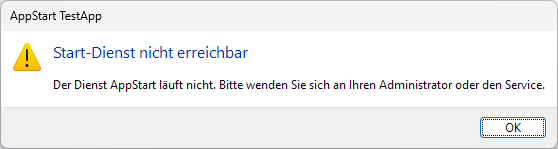
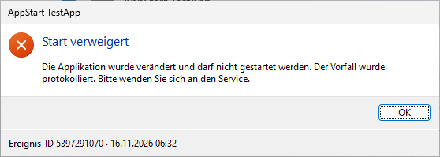

# Messages and troubleshooting

## Launcher messages

The launcher is behind every shortcut of an approved application. On success it shows nothing: the application appears after a short time. Otherwise it shows exactly one message with an "OK" button. The window title is the name of the shortcut, i.e. the name of the application (without a shortcut: "AppStart").





With "Launch denied", a line such as "Event ID 4821930571 · 15.11.2026 10:51" appears at the bottom. The number is the **incident number** of this denial, not the ID of the event type. To find the matching entry: Event Viewer → "Windows Logs" → "Application" → on the right "Find…" → enter the incident number. The entry (source AppStart, ID 1200 to 1205) contains "Incident: 4821930571" and the exact reason. Date and time help if the operator did not note the number.

Exit codes of the launcher (for scripts and troubleshooting): 0 = started, 1 = invalid shortcut, 2 = service not reachable, 3 = launch denied or already in progress, 4 = no permission, 5 = unexpected response.

### Launch service not reachable

> "The AppStart service is not running. Please contact your administrator or service support."

**Cause:** The launcher does not reach the pipe `\\.\pipe\AppStart` within 3 seconds. The service is stopped, is just starting (shortly after boot), is still waiting for the setup (event 1301) or could not start (event 1300 or 1301). The same happens if all four connections of the service are busy at the moment.

**Action:** Wait a moment and try again. If it persists: check the service (`sc query AppStart`), start it (`sc start AppStart`), check the Event Log. Then run `verify`. Exit code 2.

### No permission

> "Your user account may not start applications through AppStart. Please contact your administrator."

**Cause:** The signed-in user is not a member of the group `AppStart Users`, or was only just added and has not signed in again since. The service rejects the connection already at the pipe; therefore there is nothing in the Event Log.

**Action:** Add the user to the group ([Accounts and group](05-accounts-and-group.md)), sign out and sign in again. Exit code 4.

### Invalid shortcut

> "This shortcut is not set up correctly. Please contact service support."

**Cause:** The launcher was called without `--app <AppId>`, with additional arguments or with an AppId in an invalid format, e.g. through a shortcut copied or changed by hand, or by starting `AppStart.Launcher.exe` directly.

**Action:** Delete the shortcut and run the setup again ("AppStart – Setup", "Next", "Next") so that the setup recreates it. Exit code 1.

### Launch denied – application modified

> "The application has been modified and may not be started. The incident has been logged. Please contact service support."

**Cause:** The signature or SHA-256 of the EXE does not match the approval (event 1201). Usually an update of the application, otherwise tampering.

**Action:** Read the entry for the incident number in the Event Log. Known update: `AppStart.Setup.exe rehash --app <AppId>` ([Managing applications](04-managing-applications.md)). Otherwise treat as a security incident: do not start the EXE any other way, inform service support. Exit code 3.

### Launch denied – not approved

> "This application is not approved for starting through AppStart. The incident has been logged. Please contact service support."

**Cause:** The AppId of the shortcut is not in `apps.json` (event 1200). The approval was revoked but a shortcut was left behind, or a shortcut was created by hand.

**Action:** Approve the application ([Managing applications](04-managing-applications.md)) or delete the leftover shortcut. Exit code 3.

### Launch denied – setup not in order

> "The AppStart setup is not in order. The start was denied and logged. Please contact service support."

**Cause:** `apps.json` is missing, is invalid or can be changed by non-administrators (event 1202). The service then denies every start.

**Action:** Run `AppStart.Setup.exe verify` and fix the check [apps.json](06-verification-after-a-service-visit.md#appsjson). Exit code 3.

### Launch denied – other error

> "The application could not be started. The incident has been logged. Please contact service support."

**Cause:** Verification passed, but the start failed technically (event 1205), e.g. because `appstart-app` is missing, is disabled or may not sign in ("Log on as a batch job"), or the EXE is missing.

**Action:** Read the entry for the incident number (event 1205 with reason), run `verify` and fix the deviations. Exit code 3.

### Start already in progress

> "The application is being started. Please wait a moment and then try again."

**Cause:** A start request is already running in this session, or the last request was less than 2 seconds ago (double-click, event 1203).

**Action:** Wait briefly. The application usually appears on its own. Exit code 3.

### Unexpected response

> "The AppStart service responded unexpectedly. Please contact service support."

**Cause:** The response of the service was not readable or did not arrive within 30 seconds, e.g. because the launcher and the service come from different versions or the service was stopped during the request.

**Action:** Check the Event Log (1204, 1302). Reinstall AppStart with the current MSI so that the launcher and the service have the same version. Exit code 5.

<a id="installationsprogramm"></a>
## Messages of the installer AppStart-Setup.exe

Window title "AppStart Setup". Every message shows a heading, the cause, a line "Action: …" and, if a log was written, "Log: C:\ProgramData\AppStart\Logs\install-20261115-104212.log". With `/quiet` no message appears; then the exit code and the logs under `C:\ProgramData\AppStart\Logs` are what counts.

During the installation: "Installing AppStart …" – "Please wait. The installation can take a few minutes. Afterwards the setup starts."

| Heading | Text | Action (as shown) | Exit code | Wizard starts |
|---|---|---|---|---|
| "Restart required" | "AppStart has been installed. A restart is required for all changes to take effect." | "Complete the setup first and then restart the computer." | 3010 | yes |
| "AppStart is already installed" | "Version 0.2.0 is installed, this setup contains version 0.2.0. The installation is skipped." | "None. The setup starts directly." | 0 | yes |
| "Installation canceled" | "The installation was canceled (code 1602). AppStart was not changed." | "Start AppStart-Setup.exe again to repeat the installation." | 1602 | no |
| "Another installation is in progress" | "Another installation is in progress. Please wait and try again. (Code 1618)" | "Wait until the other installation (for example Windows Update) has finished, then start AppStart-Setup.exe again." | 1618 | no |
| "Installation failed" | "A fatal error occurred during the installation (code 1603). AppStart was not installed." | "Check the log. Contact service support with the log." | 1603 | no |
| "Installation failed" | "The installer ended with error 1638. AppStart was not installed." (any other code of `msiexec`) | as above | code of `msiexec` | no |
| "No installation package included" | "This AppStart-Setup.exe contains no installation package (development build) and cannot install AppStart." | "Use the AppStart-Setup.exe from the official release." | 1620 | no |
| "Administrator rights required" | "AppStart-Setup.exe is running without administrator rights and cannot install AppStart." | "Start AppStart-Setup.exe with an administrator account and confirm the User Account Control prompt." | 5 | no |
| "Folder not protected" | "The folder C:\ProgramData\AppStart can be changed by users without administrator rights or is a reparse point. For security reasons nothing is installed." | "Have an administrator check or delete the folder, then start AppStart-Setup.exe again." | 1603 | no |
| "Installation package could not be extracted" | "The installation package could not be written to C:\ProgramData\AppStart\Installer\…: …" | "Check the free disk space on drive C: and start AppStart-Setup.exe again." | 1603 | no |
| "Installer cannot be started" | "Windows Installer (msiexec.exe) could not be started: …" | "Restart the computer, then start AppStart-Setup.exe again. If that does not help, contact service support." | 1603 | no |
| "Setup not found" | "AppStart is installed, but C:\Program Files\AppStart\current\AppStart.Setup.exe is missing. The setup cannot start." | "Start AppStart-Setup.exe again. If that does not help, contact service support." | 2 | no |
| "Setup not trustworthy" | "The signature of C:\Program Files\AppStart\current\AppStart.Setup.exe is invalid or does not come from the publisher of this setup. For security reasons the setup is not started." | "Do not start the setup by hand. Contact service support." | 577 | no |
| "Setup could not be started" | "AppStart is installed, but C:\Program Files\AppStart\current\AppStart.Setup.exe could not be started: …" | "Start the setup from the Start menu (AppStart – Setup)." | 1 | no |
| "Unknown parameter" | "The parameter "/x" is unknown.", followed by the help | "Start AppStart-Setup.exe without parameters, with /quiet, with /quiet /config \<answer file> (absolute path) or with /? for help." | 87 | no |
| "Unexpected error" | "An unexpected error occurred during the installation: …" | "Contact service support with the log." | 1603 | no |

Notes for service support:

- **"Installation canceled" (1602):** The installation was canceled, e.g. because a user signed out. Nothing was changed.
- **"Another installation is in progress" (1618):** Windows Installer is busy with another installation (Windows Update, software distribution). Wait, then repeat.
- **"Installation failed" (1603 and other codes):** Search the log `install-….log` for "Return value 3"; the lines before it name the reason. Common: the service cannot be stopped, files are locked, not enough space.
- **"Folder not protected":** Intentional block. `C:\ProgramData\AppStart` already exists, but users without admin rights may write to it, or the folder is a reparse point (junction, symbolic link). Typical: an operator or another program created the folder before the installation. If the installer extracted the MSI there and ran it with admin rights, an operator could replace it beforehand. **Fix:** Check the folder. If AppStart is not set up yet, delete the folder as administrator (`rmdir /s /q C:\ProgramData\AppStart`) and start `AppStart-Setup.exe` again. If it contains an existing setup (`apps.json`, `Reports`), treat as a possible security incident: check the content, have an administrator restrict the permissions to SYSTEM and Administrators (`icacls C:\ProgramData\AppStart /inheritance:r /grant:r *S-1-5-18:(OI)(CI)F *S-1-5-32-544:(OI)(CI)F /T`), then start again and run `verify`.
- **"Setup not trustworthy" (577):** `AppStart.Setup.exe` in the program folder is not signed with the certificate of the installer. Possible causes are a mix of different builds or tampering. Reinstall AppStart with the official release. For unsigned development builds the check is skipped; the log `bootstrapper-….log` then contains a line "WARNING".
- **"No installation package included" (1620):** Development build without an embedded MSI. Use the official release.

Help (`AppStart-Setup.exe /?`), window "AppStart-Setup.exe":

```text
AppStart-Setup.exe
    Installs AppStart and then starts the setup.

AppStart-Setup.exe /quiet
    Installs only, without user interface and without setup. The exit code is that of msiexec (0 or 3010 = success).

AppStart-Setup.exe /quiet /config <answer file>
    Installs and then sets up without user interface from the answer file (AppStart.Setup.exe apply). Exit code 0 or 3010 = success, 10 = setup with error or deviation, 11 = answer file invalid.

AppStart-Setup.exe /?
    Shows this help.
```

Below it: "Logs: C:\ProgramData\AppStart\Logs".

## Event Log

The service writes to the **Application** log with the source **AppStart**. Event Viewer: `eventvwr.msc` → "Windows Logs" → "Application" → "Filter Current Log…" → event source "AppStart".


Every start request is logged with time, user, session, AppId and result. Denied requests contain the incident number that the launcher shows and the exact reason; the launcher never learns these details.

| ID | Level | Meaning | Action |
|---|---|---|---|
| 1000 | Information | Service started, pipe ready. Text: "Service AppStart started, pipe ready. Permissions: \<SDDL>" | None. The SDDL must match the [Reference](09-reference.md). |
| 1001 | Information | Service stopped. Text: "Service AppStart stopped." | None if intended (update, restart). Otherwise check who stopped the service. |
| 1100 | Information | Application started. Text: "Launch succeeded. User: …, Session: …, AppId: …, EXE: …, Process: \<PID>, Other programs: …" with the mode ("blocked", "allowed helper programs only", "all allowed"), if applicable ", learning mode until …", and the result of the verification | None |
| 1101 | Information | Helper program allowed: the application started a program from its list of allowed helper programs, or the Windows console window (conhost.exe). Text: "Helper program allowed. User: …, Session: …, AppId: …, Path: …, Process: …" | None |
| 1102 | Information | Learning mode: program recorded. Text "Learning mode: program recorded. …" with user, AppId, path, parent process and signature | None. At the end of learning mode, check and apply the suggestions. |
| 1206 | Warning | Program ended: the application started a program that is not allowed or whose verification failed (e.g. "Checksum does not match"). Text: "Program ended. User: …, Session: …, AppId: …, Path: …, Process: …, Ended: yes. Reason: …" | If the program belongs to the application, add it to the list of allowed helper programs or update its checksum. Otherwise: an attempt to start a foreign program with admin rights; report it to service support. Report "Ended: NO" to service support immediately. |
| 1207 | Error | Learning mode ignored: `C:\ProgramData\AppStart\learn.json` is writable by operators or invalid. The list of allowed helper programs applies. Text: "Learning mode ignored, the allowlist applies. …" | Run `verify`, correct the permissions of `C:\ProgramData\AppStart`, restart learning mode. |
| 1208 | Error | Monitoring disrupted: a new process in the job could not be verified, a recording in learning mode failed, or the monitoring of an application failed (then all its processes are ended). | Report the reason in the text to service support. |
| 1200 | Warning | Denied: AppId not approved (`unknown-app`). Text: "Launch denied (unknown-app). Incident: \<Number>, User: …, Session: …, AppId: …. AppId is not approved in apps.json." | Approve the application or remove the shortcut |
| 1201 | Warning | Denied: signature or SHA-256 wrong (`integrity`). Reason: "SHA-256 differs: …", "Authenticode check failed (0x…).", "Signing certificate not readable." or "Signature valid, but foreign certificate: …" | Known update: `rehash`. Otherwise security incident. |
| 1202 | Warning | Denied: configuration missing, invalid or unsafe (`config`). Reason as for the check [apps.json](06-verification-after-a-service-visit.md#appsjson) | `verify`, fix the check "apps.json" |
| 1203 | Warning | Denied: a request is already running in this session or the lockout period of 2 s is running (`busy`). Reason: "Session already has a request in progress or is in the lockout period." | None. If frequent: tell operators to single-click. |
| 1204 | Warning | Invalid request discarded, without response. Text: "Invalid request discarded. User: …, Session: …, Length: … bytes." or "No request within 2 s. User: …, Session: …." | Single occurrence: harmless (e.g. an aborted launcher). Frequent or with a foreign user: an attempt to address the service with other programs. Identify the user, check for a security incident. |
| 1205 | Warning | Start failed technically (`error`). Text with EXE and error, e.g. sign-in of `appstart-app` failed | `verify`, especially the check "Accounts". Report the reason in the text to service support. |
| 1300 | Error | Pipe already exists, the service does not start. Text: "Service does not start: …". **Security event:** another program created `\\.\pipe\AppStart` before the service to intercept requests. | Treat as a security incident. Restart the PC; if it occurs again, check the programs in autostart and inform service support. |
| 1301 | Warning or Error | Pipe cannot be created. Warning "Group "AppStart Users" is missing: AppStart is not set up yet. The service waits and tries again every 10 s." or error "Service does not start: pipe cannot be created. …" | Warning before the setup: normal, complete the setup. Afterwards: group missing, run the setup again and restart the service. Error: read the reason, restart the PC. |
| 1302 | Error or Warning | Error at the pipe: "Pipe instance cannot be created, retrying in 5 s: …" or "Pipe connection aborted: …" | Single occurrence: harmless, the service keeps running. Frequent: report the reason to service support. |
| 1400 | Information | Learning mode started for an AppId, with expiry time | None. Do not leave the PC unattended during learning mode. |
| 1401 | Information | Learning mode ended (by hand or expired). Text: "Learning mode expired (…), the configured mode applies again." | None |

The service restarts automatically after a crash (after 5 s, 5 s and 30 s).

## Setup messages

### Setup result

The wizard (step 3) and the command line show one line per step with ✓ or ✗. With ✗, the reason follows after the colon.

| Message | Meaning | Action with ✗ |
|---|---|---|
| "Accounts appstart-app and appstart-user, group AppStart Users created" / "Account appstart-app and group AppStart Users created" | Accounts and group set up (existing ones verified) | – |
| "Accounts and group could not be set up" | Account or group could not be created; the further steps are skipped. Reasons e.g. "…: access denied. This requires administrator rights.", "The password does not meet the password policy of this computer (length, complexity or history).", "The account was not found.", ""…" is not a user account. Only users can be added to "AppStart Users"." | Fix the reason (admin rights, another password, check the account), repeat the setup |
| "2 applications approved, configuration protected" (with one: "1 application approved, configuration protected") | `apps.json` written and protected | – |
| "Configuration could not be written" | `C:\ProgramData\AppStart` or `apps.json` cannot be protected or written, or an entry is invalid (reason as for the check [apps.json](06-verification-after-a-service-visit.md#appsjson)). Further steps are skipped. | Fix the reason. If `C:\ProgramData\AppStart` is a reparse point (junction), check and delete the folder as administrator. |
| "apps.json is invalid: …" | The existing `apps.json` is damaged; the setup changes nothing | Correct the file or restore it from a backup |
| "Application "app-x" is not approved" | `remove` or `rehash` with an unknown AppId | Check the AppId with `list` |
| "Data folders and registry keys locked" | Permissions set | – |
| "Data folders or registry keys could not be locked" | Reasons e.g. "Data folder "C:\" is a drive or system folder and must not be locked.", "Data folder … is a reparse point (junction or symbolic link) and is not protected.", "Data folder … does not exist.", "Registry key … does not exist." | Correct the path (`add --exe … --data-dir …`), have the folder or key created (start the application once), repeat the setup |
| "Shortcuts with app icon created, 2 old shortcuts backed up" | Shortcuts created; the number is the count of direct shortcuts backed up | – |
| "Shortcuts could not be created" | Most common reason: "The shortcut "…" already exists and does not belong to this application. It is not overwritten. Please check the file and back it up or remove it by hand." | Check and remove the foreign shortcut or choose another name (`--name`), repeat |
| "Service AppStart is running, starts automatically" | Service running and pipe ready | – |
| "Service AppStart is not running" | Service missing or does not start. Additional text "The pipe of the service is not reachable. Check the Event Log (source AppStart)." if the service is running but the pipe is still missing after a restart of the service | Check the Event Log (1300, 1301). If the service is missing: reinstall the MSI. |
| "Shortcuts restored, data folders and registry keys reset" | `uninstall`: original shortcuts and permissions restored | – |
| "Accounts and group removed" | `uninstall`: `appstart-app`, the group and (if created by the setup) `appstart-user` deleted | With ✗: delete the accounts by hand in "Computer Management" |
| "Configuration removed (verification reports are kept)" | `uninstall`: `apps.json` deleted | With ✗: delete the file as administrator |

Further reasons when restoring: "The backup "…" of the shortcut "…" is missing. It cannot be restored." (recreate the original by hand) and "A file already exists at the original location "…". The backed-up shortcut is not written over it and stays in "…". Please check by hand." (copy the backup from `C:\ProgramData\AppStart\ShortcutBackup` back by hand).

### Command line

| Message | Meaning | Exit code |
|---|---|---|
| "Automatic verification after the change:" | After `add`, `add-user`, `remove` and `rehash`, the output of `verify` follows | 0 or 1 |
| "Verification passed – 10 of 10 checks passed." | No deviation | 0 |
| "Verification failed – 2 deviation(s). Do not close the service visit." | Deviations, see [Verification after a service visit](06-verification-after-a-service-visit.md) | 1 |
| "Verification report: C:\ProgramData\AppStart\Reports\verify-2026-11-15-104212.html" | Path of the report (with `--report`, the given path) | – |
| "Specify exactly one option: --name appstart-user or --member "DOMAIN\User"." | `add-user` without or with both options | 2 |
| "With --name only the account appstart-user can be created." | Another name with `--name` | 2 |
| "Password empty or not identical." | Password for `appstart-user` empty or the repetition differs | 2 |
| Error message of the command line parser (language depending on Windows), e.g. that the option `--exe` is missing or a command is unknown, followed by the help | Required option missing, typo | 1 |

## Message of the test application

If `AppStart.TestApp.exe` is started without AppStart (without admin rights), "AppStart TestApp" appears with the text:

> "The test application needs administrator rights and will exit.
>
> Please start it through the AppStart shortcut."

This is the expected behavior (acceptance step 4 in the chapter [Installation](03-installation.md)). The other displays of the test application are described there.

## Common problems

| Problem | Cause | Fix |
|---|---|---|
| Nothing happens after the click, no message | The application starts but is behind other windows or takes a long time | Check the taskbar; event 1100 confirms the start |
| The application starts but reports missing admin rights | `appstart-app` is no longer an administrator | `verify`, check "Accounts" |
| The application does not find network drives or the database | S4U sign-in without network credentials | Cannot be fixed through AppStart; solve the application's access differently (e.g. SQL sign-in) |
| Printing, export or help of the application does not work | The function starts another program; the job object prevents this | Weigh it up and, if appropriate, allow the program as a helper program ([Managing applications → Other programs](04-managing-applications.md)) |
| The operator does not see the shortcut | Shortcut deleted | `verify`, check "Shortcuts" |
| "Launch denied" after an update of the application | New EXE, checksum or certificate changed | `rehash --app <AppId>` |
