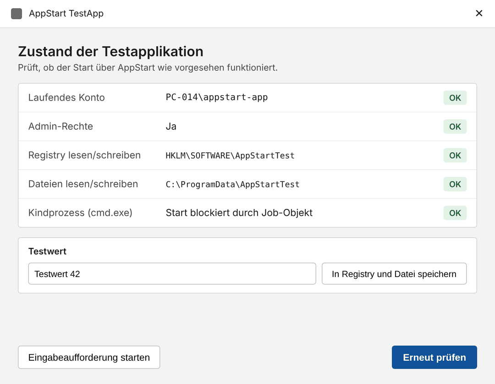

# Sicherheitsmodell

AppStart gibt Programmen Admin-Rechte, die ein Standard-Benutzer startet. Damit ist AppStart selbst ein lohnendes Angriffsziel. Diese Seite zeigt, was AppStart schützt, wie, und wo die Grenzen liegen.

## Schutzziele

1. Ein Bediener bekommt **keine** Admin-Rechte für beliebige Programme. Nur freigegebene Applikationen laufen mit Admin-Rechten. Was ihre eigenen Dialoge erlauben, steht unter [Restrisiken](#restrisiken-und-grenzen).
2. Ein Bediener kann **nur** freigegebene, **unveränderte** Applikationen starten.
3. Ein Bediener kann Daten und Registry-Werte der Applikationen **nicht lesen oder ändern**.
4. Jeder Startversuch ist **nachvollziehbar**.
5. Eine **Abweichung** vom Sollzustand fällt auf, statt still zu einem unsicheren Betrieb zu führen.

Grundsatz: Im Zweifel verweigert AppStart den Start und protokolliert den Grund.

## Angriffe und Gegenmassnahmen

Massnahmen mit «geplant» setzt das Setup um, das noch in Arbeit ist.

| Angriff | Gegenmassnahme | Stand |
|---|---|---|
| Bediener startet über den Launcher eine beliebige EXE | Der Launcher sendet nur eine AppId. Pfade, Argumente und Umgebung kommen ausschliesslich aus `apps.json`. | umgesetzt |
| Bediener ändert `apps.json` und trägt eigene Programme ein | Datei nur für SYSTEM und Administratoren beschreibbar. Ist sie es nicht, verweigert der Dienst jeden Start. | Prüfung im Dienst umgesetzt, Rechte setzen geplant |
| Bediener tauscht die EXE einer Applikation aus | Prüfung von Signatur (mit festem Zertifikat) oder SHA-256 vor jedem Start. | umgesetzt |
| Bediener tauscht die EXE zwischen Prüfung und Start aus | Der Dienst hält die Datei vom Öffnen bis zum Prozessstart gesperrt und prüft über dasselbe Handle. | umgesetzt |
| Bediener öffnet aus der Applikation heraus eine Eingabeaufforderung, etwa über «Datei öffnen» | Modus «gesperrt» (Standard): Job-Objekt mit Limit von einem Prozess, Kindprozesse scheitern. Modus «nur erlaubte Hilfsprogramme»: Der Dienst überwacht das Job-Objekt und beendet jeden Prozess, der nicht mit Pfad und Signatur bzw. SHA-256 auf der Liste steht, sofort (Ereignis 1206). Shells und Skript-Hosts kommen nur mit ausdrücklicher Bestätigung auf die Liste, der Lernmodus schlägt sie nie vor. | umgesetzt |
| Bediener tauscht ein erlaubtes Hilfsprogramm aus | Prüfung wie bei der Haupt-EXE bei jedem Start; Hilfsprogramme nur aus Ordnern, die Bediener nicht beschreiben können (`allow-child` verweigert sonst, `verify` meldet es). | umgesetzt |
| Bediener startet Programme über einen vergessenen Lernmodus | Lernmodus läuft höchstens 120 Minuten und gilt danach auch in laufenden Instanzen nicht mehr; `verify` meldet einen aktiven Lernmodus als Abweichung. `learn.json` ist geschützt wie `apps.json`; ist sie für Bediener beschreibbar, ignoriert der Dienst sie (Ereignis 1207). | umgesetzt |
| Dienst wird beendet, damit nicht erlaubte Programme weiterlaufen | Job-Objekt mit `KILL_ON_JOB_CLOSE`: Endet der Dienst, beendet Windows alle Prozesse der überwachten Applikation. | umgesetzt |
| Bediener tauscht Dienst- oder Launcher-EXE aus | Installation nur nach `C:\Program Files\AppStart`, dort nur SYSTEM und Administratoren schreibberechtigt. Per-user-Installation ist ausgeschlossen. | umgesetzt |
| Ein Programm legt eine gefälschte Pipe `AppStart` an, um Anfragen abzufangen | Der Dienst legt die Pipe als erste Instanz an. Existiert sie schon, startet er nicht (Ereignis 1300). Die Gruppe hat kein Recht, weitere Pipe-Instanzen anzulegen. | umgesetzt |
| Zugriff auf die Pipe über das Netzwerk | `PIPE_REJECT_REMOTE_CLIENTS` und ausdrückliches Verbot für Netzwerk-Anmeldungen. | umgesetzt |
| Benutzer ohne Freigabe nutzt AppStart | Pipe nur für die Gruppe `AppStart Users` geöffnet. | umgesetzt |
| Start einer Applikation in der Session eines anderen Benutzers | Der Dienst startet nur in der Session, aus der die Anfrage kommt. | umgesetzt |
| Überflutung des Dienstes mit Anfragen | Feste Länge (64 Byte), Zeitlimit 2 s, eine Anfrage pro Session, Sperrzeit nach jeder Anfrage. | umgesetzt |
| Anmeldung als `appstart-app` | Interaktive und Remote-Desktop-Anmeldung verweigert. Passwort zufällig, unbekannt, nirgends gespeichert. Der Dienst meldet das Konto ohne Passwort an (S4U). | S4U umgesetzt, Anmeldesperre geplant |
| Bediener liest Passwörter der Applikation in der Registry | Registry-Key je Applikation nur für `appstart-app`, SYSTEM und Administratoren lesbar. | geplant |
| Fehlkonfiguration nach einem Serviceeinsatz (z. B. Bediener wieder Admin) | `verify` prüft alle Punkte und meldet jede Abweichung mit Exit-Code ungleich 0. | geplant |

  
   
  Die Testapplikation prüft die wichtigsten Schutzmassnahmen sichtbar, hier: Kindprozess blockiert. (UI-Entwurf)

## Was die Applikation sieht

Die Applikation läuft als `appstart-app`, nicht als Bediener und nicht als SYSTEM:

- Sie hat volle Admin-Rechte auf dem lokalen Rechner.
- Ihr `HKEY_CURRENT_USER` liegt im Profil von `appstart-app` (`C:\Users\appstart-app`), nicht im Profil des Bedieners.
- Ihr Fenster erscheint auf dem Bildschirm des Bedieners und ist normal bedienbar.
- Sie hat **keine Netzwerk-Anmeldedaten**. Netzlaufwerke oder Datenbanken mit Windows-Anmeldung erreicht sie nicht.

## Restrisiken und Grenzen

| Punkt | Bewertung |
|---|---|
| Datei-Dialoge der Applikation | «Datei öffnen» und «Speichern unter» laufen im Prozess der Applikation, also mit Admin-Rechten. Ein Bediener kann darüber Dateien umbenennen, löschen oder ersetzen – auch ausserhalb der Applikation, im Extremfall die Konfiguration von AppStart. Je Applikation prüfen, welche Dialoge sie anbietet, und das Risiko bewerten. |
| Nur die EXE wird geprüft | DLLs und andere Dateien im Programmordner der Applikation nicht. Dieser Ordner muss für Bediener schreibgeschützt sein. |
| Administratoren können Passwörter der Applikationen weiterhin lesen | Bleibt bestehen. AppStart schützt nur vor Bedienern ohne Admin-Rechte. |
| Die Applikation selbst hat Admin-Rechte | Eine Schwachstelle in der Applikation, die beliebigen Code ausführt, wirkt mit Admin-Rechten. Das Job-Objekt verhindert neue Prozesse, nicht aber Code im Prozess der Applikation. |
| Modus «alle erlaubt» | Schwächt den Schutz deutlich: Die Applikation kann jedes Programm mit Admin-Rechten starten. Nur wählen, wenn «nur erlaubte Hilfsprogramme» nicht reicht, und je Applikation bewerten. `verify` nennt diese Applikationen als Hinweis. |
| Modus «nur erlaubte Hilfsprogramme»: Lücke von Millisekunden | Windows bietet ohne Kernel-Treiber keinen Weg, einen Prozess vor dem Start zu verhindern. Der Dienst beendet einen nicht erlaubten Prozess nach dem Start. Gemessen (Spike 1.1): 0,7 bis 4,7 ms, einmal 16 ms unter Last; der startende Prozess erhielt jeweils «Zugriff verweigert». Für interaktive Arbeit reicht das nicht, ein vorbereitetes Programm könnte in dieser Zeit aber etwas ausführen. Gegenmassnahmen: Datenordner gesperrt, Hilfsprogramme nur aus geschützten Ordnern, Shells nie automatisch. Ist das Restrisiko nicht tragbar: Modus «gesperrt», oder AppLocker/WDAC (eigenes Vorhaben). |
| Erlaubte Hilfsprogramme laufen mit Admin-Rechten | Ein erlaubter PDF-Viewer oder Editor kann Dateien öffnen und speichern wie die Applikation selbst. Der Lernmodus schlägt solche Programme vor, wählt sie aber nicht vor («kann Dateien öffnen – abwägen»). |
| Übergabe an Prozesse ausserhalb des Job-Objekts | Ein Programm kann eine Aufgabe an eine schon laufende Instanz (z. B. Edge) oder an einen COM-Server übergeben, den Windows ausserhalb des Job-Objekts startet. Diese Prozesse überwacht AppStart in keinem Modus. Betroffen sind nur Prozesse von `appstart-app` in derselben Session. |
| Hilfsprogramme mit SHA-256 | Nach einem Update der Applikation stimmt die Prüfsumme nicht mehr; der Dienst beendet das Hilfsprogramm. `verify` meldet es mit dem Befehl `rehash --app … --child …`. |
| Keine Online-Sperrprüfung von Zertifikaten | Bewusst, weil viele Arbeitsplatzrechner offline sind. Das Pinning auf den Thumbprint ersetzt sie. Ein kompromittiertes Herstellerzertifikat bleibt gültig, bis die Freigabe angepasst wird. |
| Windows 10 | Start in der Bediener-Session bisher nur unter Windows 11 getestet. |

## Schwachstellen melden

Bitte vertraulich über [GitHub Security Advisories](https://github.com/trosinde/app-launcher/security/advisories/new), nicht als öffentliches Issue. Siehe [SECURITY.md](../SECURITY.md).

## Weiterführend

- Technische Entscheide mit Begründung: [design.md](../openspec/changes/add-appstart-service/design.md)
- Nachweise aus den Spikes: [spike-results.md](../openspec/changes/add-appstart-service/spike-results.md)
- Anforderungen als Szenarien: [specs](../openspec/changes/add-appstart-service/specs/)
